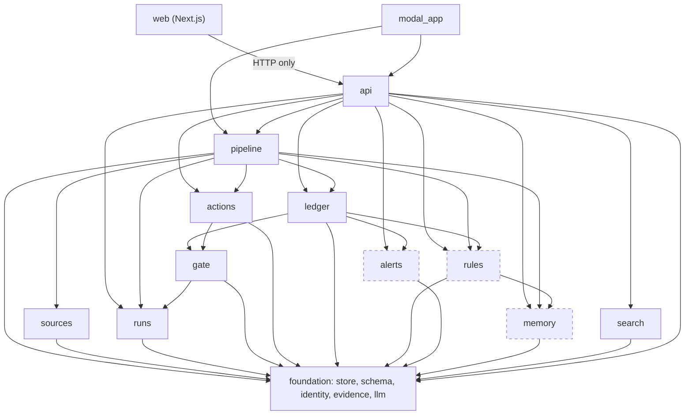
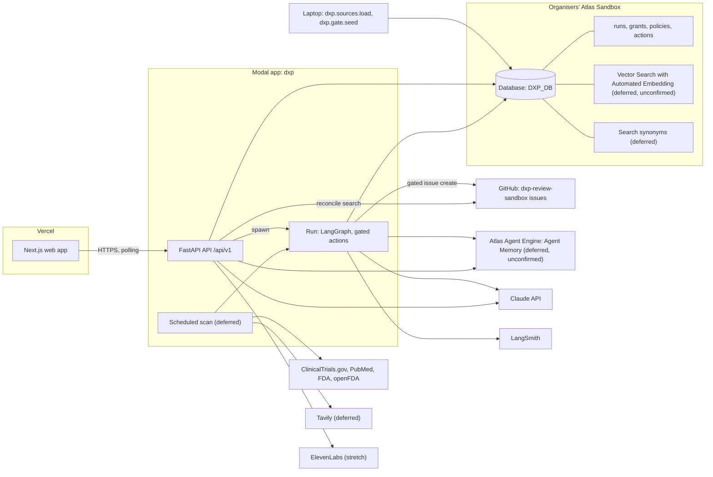
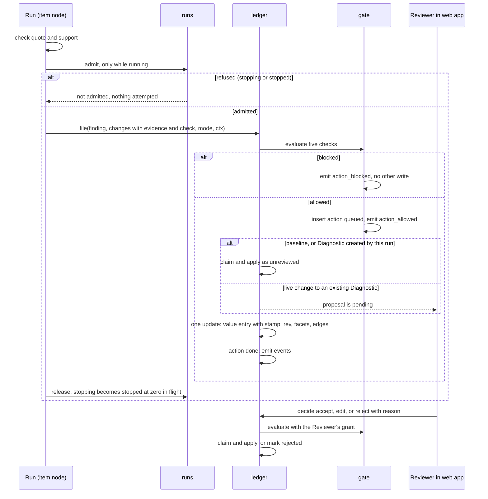
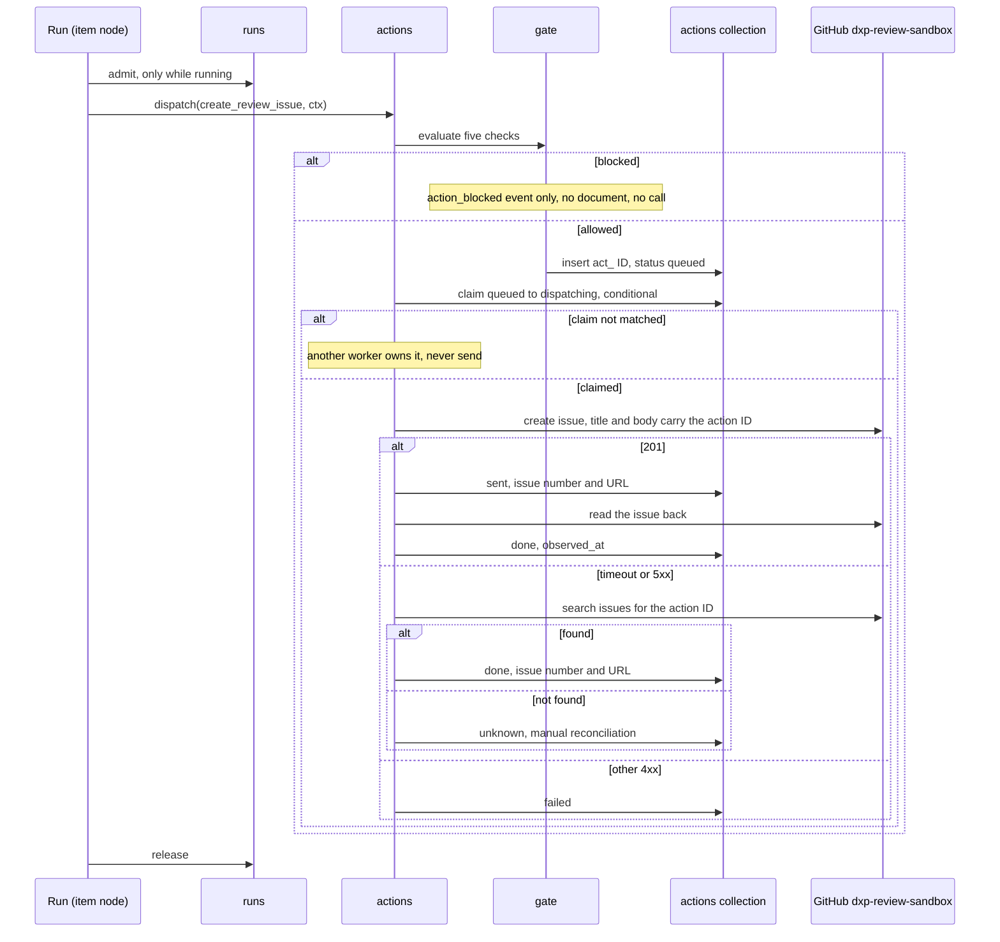
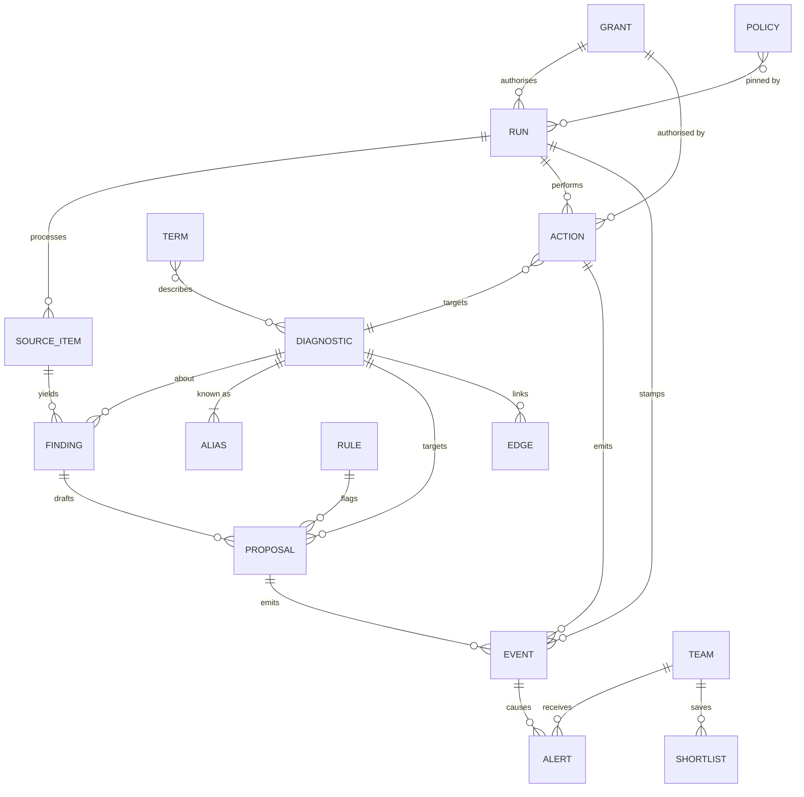

# Architecture Spine — DxProvida (DxP)

Terms follow the PRD Glossary. This is a one-day hackathon build: where a rule trades robustness for speed, speed wins.

**Pivot (13 Nov).** Per the approved sprint change proposal, DxP is built for Statement 1, "Agents You Can Audit". The governed agent is the product: no Record change and no external action without a named identity, a scoped grant, a policy check before the action and a replayable audit (AD-17 to AD-23). Build and validation happen on the organisers' Atlas Sandbox (AD-24). Decisions and routes that serve only deferred features are kept and marked **Deferred (pivot, 13 Nov)**; nobody builds them on Saturday.

**Precedence.** This spine overrides the `dxp-*` skills. The skills say how to call each technology; where a skill's example disagrees with a rule here, the rule wins. Known differences: review is a MongoDB queue, not a LangGraph `interrupt`; a batch is one graph run with `Send`, not `.map` or `.starmap` across containers; the collection is `proposals`, not `proposed_changes`; IDs are derived strings, not ObjectId; live updates are a long-poll on `events`, not server-sent events; update triggers come from the extraction model, not a vector index; the database variable is `DXP_DB`; web types are generated from the API, not copied from the front-end skill.

## Design Paradigm

**Pipes-and-filters ingest feeding a policy-gated proposal ledger.** Source items flow one way through fixed filters: triage, extract, check, resolve, propose. The filters never touch a Record. They end by filing Proposed changes, and the ledger is the only thing that turns a Proposed change into a Record value. Every ledger write and every external call passes the policy gate first, inside a run that stamps its identity on everything it writes.

| Layer | Directory under `backend/dxp/` | Writes |
| --- | --- | --- |
| Foundation | `store`, `schema`, `identity`, `evidence`, `llm` | indexes and validators only |
| Governance | `runs`, `gate`, `actions` | `runs`, `actions`, `events`; `grants` and `policies` only through the seed script (AD-18) |
| Ingest filters | `sources`, `pipeline` | `source_items`, `findings`, unmatched `terms` |
| Ledger | `ledger` | `aliases`, `diagnostics`, `proposals`, `edges`, `events`, status of ledger `actions` |
| Ledger helpers — **Deferred (pivot, 13 Nov)** | `rules`, `alerts` | `rules`, `check.flags` on pending `proposals`, `alerts`, `events` |
| Memory — **Deferred (pivot, 13 Nov)** | `memory` | Agent Memory, or `mem_*` collections |
| Read side | `search` | nothing |
| Edge | `api`, and `backend/modal_app.py` | `teams`, `audio`; `shortlists` deferred |
| Web | `web/` | nothing; it calls the API |

## Invariants & Rules



Imports follow these arrows only. Dashed modules are deferred. Only `modal_app` imports `api`; nothing imports `modal_app`. The backend imports nothing from `scripts/`. Code copied into `backend/` from `scripts/data/` or from a `dxp-*` skill is pre-made work and is listed in the README disclosure.

### AD-1 — The ledger is the only writer of Records [ADOPTED]

- **Binds:** FR-11, FR-15, FR-16, FR-17, FR-29, FR-30, Story 9.3
- **Prevents:** agents, the review screen and the manual-entry form each writing Record values their own way, and parallel writers corrupting a Record.
- **Rule:**
  - Only `ledger` creates a `diagnostics` document and writes its `fields`, `rev`, `search_text`, `facets` and its `edges`. Every value enters through `ledger.file(finding_id, changes, mode, ctx)`: agent finds, seed values, values on a new Diagnostic and values typed by hand. (Baseline load values: deferred.) `ctx` carries the principal and the AD-17 stamp.
  - `ledger.file()`, `ledger.review_value()` and the decision apply call `gate.evaluate()` (AD-19) before any write, including `ensure_diagnostic()`. Blocked means no write at all.
  - `ledger.apply()` first claims the Proposed change with a conditional update, `status: pending` to `applied`. If the claim fails it does nothing. It then makes one `update_one` on the Diagnostic that writes the value entry, increments `rev` and rewrites `search_text` and `facets`.
  - A Proposed change whose canonical value equals a `current` entry of that field is not filed.
  - A value whose check fails (AD-6) is never filed and never applied.

### AD-2 — One value-entry shape, one registry, one canonical form

- **Binds:** FR-5, FR-7, FR-15, FR-17, FR-22
- **Prevents:** a new trial overwriting an earlier one; the backend and web app naming fields differently; one drug or gene appearing as two values, two graph nodes or two Proposed changes.
- **Rule:**
  - `diagnostics.fields.<key>` is always a list of value entries in the shape below. Entries are never deleted.
  - Field keys, labels, cardinality, enums, the stage order and the low-confidence threshold live only in `backend/dxp/schema/registry.py`. The web app reads them from `GET /api/v1/schema`.
  - `value` is always a string in canonical form, produced only by `registry.canonical(field, raw)`. `label` keeps the text as written. Extra detail goes in `detail` and never affects identity.
  - A `single` field has at most one `current` entry. A `list` field adds entries.
  - When values are applied without review (AD-4), a `single` field that already has a `current` entry is not superseded: the new value stays `pending` for a Reviewer. `lifecycle_stage` follows AD-5 instead.
  - An edit or rejection keeps its `reason` on the entry (Story 2.3). Every entry carries the `action_id` and AD-17 `stamp` of the write that made or decided it.

```text
{ value_id, value, label, detail, state: current | superseded | rejected,
  review: unreviewed | accepted | edited | manual,
  evidence: { source_ref, source, source_url, source_date, quote } | { manual: true, submitter, note },
  check: { quote_found, supported, confidence, flags: [ { rule_id, note } ] },
  proposal_id, action_id, stamp, decided_by, decided_at, reason }
```

| Field | Cardinality | Canonical `value` |
| --- | --- | --- |
| `modality`, `regulatory_status`, `lifecycle_stage` | single | registry enum value |
| `provider` | single | `identity.normalise_name(provider)` |
| `clinical_uses`, `sample_types`, `tumour_stage_or_line` | list | registry enum value |
| `biomarkers` | list | HGNC approved symbol; for a non-gene analyte, a registry enum value |
| `tumour_types` | list | OncoTree code |
| `trials` | list | NCT ID, upper case; linked drugs for that trial go in `detail` |
| `linked_drugs` | list | generic name, lower case, resolved through `terms` |
| `study_results` | list | the supporting sentence with whitespace collapsed |

### AD-3 — Derived identity, insert-if-absent, never auto-merge [ADOPTED]

- **Binds:** FR-3, FR-4, FR-30
- **Prevents:** duplicate Source items, Findings, Proposed changes, Diagnostics, events, actions or Alerts when a batch runs in parallel, is retried by Modal or is run twice; a re-run resetting a decision already made.
- **Rule:**
  - `identity.derive(prefix, *parts)` is the only ID maker: the prefix plus the first 16 hex characters of SHA-256 over the parts joined with `|`.
  - `source_ref` is `<source>:<source_item_id>` using the `source` strings already in `data/` (`clinicaltrials.gov`, `pubmed`, `fda_cdx_list`, `openfda_device_pma`). It is the `_id` of `source_items` and the only way any other document refers to a Source item.
  - Finding ID: `derive("f_", source_ref, diagnostic_id)`. Proposed change ID: `derive("p_", finding_id, field, value)`. Action ID: AD-20. Alert ID (deferred): `derive("alert_", team_id, diagnostic_id, kind, cause)`.
  - Writes of Findings, Proposed changes and actions are insert-if-absent (`$setOnInsert`). A second run never changes a document that exists.
  - `identity.normalise_name(text)` is the only name normaliser: Unicode NFKC, lower case, remove `®`, `™` and `©`, replace each run of non-alphanumeric characters with one space, trim.
  - A Diagnostic is found through `aliases`, whose `_id` is the normalised name. Its ID is `derive("dx_", first_alias)`. `ledger.ensure_diagnostic()` upserts the alias and the Diagnostic with `created_run_id` and `created_mode`; a duplicate-key error (`pymongo.errors.DuplicateKeyError`) means it exists, so read it.
  - A Finding that names no assay uses the alias `approach:<modality>:<biomarker>`, with registry values, taking the first biomarker in alphabetical order or `any`.
  - Seed Diagnostics come from `data/fda/assays.json`, with every string in `name_strings_in_list` passed through `normalise_name` as an alias. The file's own `assay_normalised` is not used as a key.
  - Nothing merges two Diagnostics automatically.
  - The `raw_text` of a Source item that has Evidence pointing at it is never overwritten.

### AD-4 — Two ingest modes decide what is applied and what alerts

- **Binds:** FR-12, FR-13, FR-16, FR-30
- **Prevents:** the Baseline load flooding Teams with Alerts; live changes reaching a Record without a Reviewer; the two developers reading "new Diagnostic" differently.
- **Rule:** Every run, Proposed change and event carries `mode`.
  - `baseline`: the ledger applies each filed change at once with `review: unreviewed`. On Saturday only the seed uses it; the comprehensive Baseline load is deferred.
  - `live`: on a Diagnostic whose `created_run_id` is this run's `run_id`, changes are applied at once as `unreviewed`. On any other Diagnostic they wait with `status: pending`.
  - A Proposed change has `status` in `pending | applied | rejected`. The Reviewer queue is a query on `proposals`.
  - A Reviewer accepts, edits or rejects an `unreviewed` value through `ledger.review_value()`, which sets `review` or `state` on that entry.
  - Values with `confidence` below the registry threshold are applied or queued as above and listed first in the Reviewer queue.
  - `dry_run` (Story 2.1, writes nothing): **Deferred (pivot, 13 Nov)**.

### AD-5 — Lifecycle stage is a registry field, ordered by the ledger

- **Binds:** FR-2, FR-11, FR-12
- **Prevents:** stage being judged two ways; stage moving backwards when items are processed in parallel; the Early research label being computed in two places.
- **Rule:** Extraction gives each Finding at most one `stage_evidence { stage, quote }`, filed as a change to `lifecycle_stage`. `ledger.apply()` enforces the order: its update only matches when the stored stage is earlier than the new one. Rows from the FDA list file `regulatory_approval` by rule, without a model call. `registry.is_early_research(stage)` is the only test for the label; it is true for `discovery` and `assay_development`, and the label is never stored. A Diagnostic with no stage evidence has stage `not_determined`.

### AD-6 — One Evidence check before filing, one gate on the read side

- **Binds:** FR-7, FR-8, FR-18, FR-22, FR-25, FR-29
- **Prevents:** screens disagreeing about which values may be shown; unsupported values replacing good ones; PubMed text leaving the backend.
- **Rule:**
  - `evidence.quote_in_source(quote, raw_text)` is the only quote check. It runs against `source_items.raw_text`.
  - The pipeline's check filter sets `quote_found`, `supported` and `confidence`. A value passes when `quote_found` and `supported` are both true. A value that does not pass is recorded on its Finding and goes no further. The policy gate's evidence check (AD-19) reads this same `check`; it never re-judges.
  - Every endpoint that returns Record data builds it with `search.readmodel`. The read model shows only entries that passed or are `manual`, adds the no-data state for an empty field, attaches the source name and its data date, and passes `synthetic` through. The web app applies no display rule of its own.
  - A hand-typed value has `evidence.manual` and `review: manual`, and is shown marked as manually sourced.
  - PubMed `raw_text` is stored only in `source_items`. It is never returned by the API, written to a file in the repository, sent in a trace that is shared, or put in a GitHub issue. A quote is at most 300 characters.

### AD-7 — One Learned rule mechanism, owned by DxP — **Deferred (pivot, 13 Nov)**

- **Binds:** FR-19
- **Prevents:** three mechanisms built by different hands; a rule that cannot be switched off; flags with no owner.
- **Rule:** A Learned rule is one document in `rules`: `{ field, text, status: draft | active | off, from_proposal_id, synthetic }`. Rules apply to every Team. A rejection or edit must carry a reason. `rules.draft()` asks the model for a plain-language rule; a Reviewer's confirmation sets it `active`. `rules.evaluate(field, value, quote)` is the only place a rule is applied: in the pipeline's check filter, and over every `pending` Proposed change for that field when a rule's status changes. Only `rules` writes `check.flags`, and only on `pending` Proposed changes. A rule adds or removes flags; it never rejects or withdraws. Setting a rule `off` removes its flags. `rules` is the source of truth. Agent Memory receives one copy when a rule first becomes `active`. The stretch rejection-to-policy draft (Story 9.11) is not a Learned rule; it follows AD-18.

### AD-8 — Memory sits behind one adapter; app state stays in DxP collections — **Deferred (pivot, 13 Nov)**

- **Binds:** FR-9, FR-19, FR-28
- **Prevents:** the preview SDK leaking into every module; the app depending on a memory search for facts it must read exactly; developers' test memories mixing with production.
- **Rule:**
  - Only `backend/dxp/memory` imports the Agent Memory SDK. Its interface is `remember_episode(team_id, session_id, kind, text)`, `recall(team_id, query) -> list[str]`, `save_rule(rule_id, field, text)` and `glossary(term) -> list[str]`.
  - Two backends, chosen by `DXP_MEMORY_BACKEND`: `agent_engine` and `collections`.
  - The memory user ID is `<DXP_DB>:<team_id>`. Rule copies use `<DXP_DB>:reviewers`.
  - Facts the app must read exactly live in DxP collections: `teams` (profile, `last_seen_seq`, `last_seen_at`, last Intended use), `shortlists`, `rules`, `terms`. "What changed since last visit" is a query on `events` after `last_seen_seq`.
  - Memory holds what a Team asked, opened and dismissed, and supplies the resume summary and agent context. Text recalled from a synthetic episode is labelled synthetic. Synthetic episodes are written with a `session_id` that starts `synthetic_`, and `recall` prefixes their text with `[synthetic] `.
  - Synonyms are owned by `search.terms`, reading `terms`. A curated link, such as liquid biopsy to ctDNA, carries `curated: true`. A term the pipeline cannot match is written to `terms` with `status: unmatched` for the Reviewer. Every `terms` document is a valid synonym document, `{ mappingType: "equivalent", synonyms: [...] }` plus DxP's own fields; an unmatched term is stored as `synonyms: [<term>]`. One invalid document stops the MongoDB Search index from building.
  - Agent Memory preview availability on the Atlas Sandbox is unconfirmed (AD-24).

### AD-9 — The web app talks to the API only; long work is a job [ADOPTED]

- **Binds:** FR-1, FR-4, FR-21, FR-27
- **Prevents:** a second data path from Next.js to MongoDB, to a model or to GitHub; requests that die at Modal's 150-second cap.
- **Rule:** The web app's only backend is `NEXT_PUBLIC_API_URL` + `/api/v1`. No Next.js code opens a MongoDB connection, calls a model or calls GitHub. Anything that can run longer than 30 seconds is a run (AD-16, AD-17). The one long request is the 25-second long-poll in AD-10 and AD-23.

### AD-10 — One outbox feeds live updates and "what changed"

- **Binds:** FR-12, FR-13, FR-14, FR-27, FR-28, Stories 9.6, 9.7, 9.9
- **Prevents:** the action feed, the audit, the Graph view highlight and the resume summary each tracking change separately; events lost between polls; Alerts raised twice or not at all.
- **Rule:**
  - `store.emit_event()` is the only writer of `events`. The event `_id` is `seq`, the next integer, assigned by inserting and retrying on a duplicate key, so a higher `seq` is never visible before a lower one. Each event has a unique `dedupe_key`, so a retry emits nothing new. Every event carries the AD-17 `stamp`.
  - Event `type` is one of `diagnostic_created`, `value_applied`, `proposal_pending`, `proposal_rejected`, `run_status_changed`, `action_allowed`, `action_blocked`, `action_status_changed`; `rule_status_changed` and `alert_created` are deferred.
  - `GET /api/v1/changes?after=<seq>` returns events with a higher `seq`. If there are none it may wait up to 25 seconds, using a change stream only as a wake-up, then query again (AD-23). The query on `seq` is the only source of truth. Plain polling is acceptable (Story 1.1).
  - **Deferred (pivot, 13 Nov):** `alerts.react()` runs once at the end of each `ledger` call, when `mode` is `live`. A Team matches a Diagnostic when its profile overlaps the Diagnostic's `facets` on modality, biomarker or linked drug. Tumour type alone is not a match.
  - **Deferred (pivot, 13 Nov):** First Alert: the Diagnostic's `created_mode` is `live`, the Team matches, and no first Alert exists for that pair. Diagnostics from the Baseline load never get a first Alert.
  - **Deferred (pivot, 13 Nov):** Update Alert: an applied change carries a trigger and the Team matches. Triggers are `stage_advance`, `line_of_therapy`, `used_in_trial` and `standard_of_care`. The ledger sets `stage_advance` when it applies a `lifecycle_stage` change. The extraction model sets the other three per Finding.

### AD-11 — All model calls go through one module

- **Binds:** FR-4, FR-5, FR-13, FR-18, FR-19, FR-21, Story 9.1
- **Prevents:** separate code paths together exceeding the rate limit, or using different clients and output methods; a run that cannot say which model and prompt produced an action.
- **Rule:** Only `backend/dxp/llm` calls Claude, through `langchain-anthropic` and nothing else. It holds the model IDs, retry and refusal handling, and returns parsed objects from the Pydantic models in `schema`. Structured output uses the JSON-schema method; no sampling parameters are sent. Every call is async. An ingest run may hold 16 calls at once; all other callers share 4. Triage uses the fast model; extraction, checking, rule drafting and query parsing use the stronger model. `llm` exposes `MODEL_IDS` and `PROMPT_VERSION`; the run reads them into its identity at start (AD-17).

### AD-12 — One graph run per job, fan-out inside it [ADOPTED]

- **Binds:** FR-1, FR-4
- **Prevents:** one trace per item exhausting the LangSmith allowance; one failed item discarding the batch; review state split between LangGraph and MongoDB.
- **Rule:** An ingest run is one LangGraph run in one Modal container, fanning out over Source items with `Send` and `max_concurrency` at most 16. Saturday's run covers the selected set of 10 to 20 held-back trials. Each item node catches its own exceptions and returns a failure result. Each item node admits every action through `runs.admit()` (AD-21); a refused admission ends that item with no action. Human review is not a graph node. The scheduled scan (deferred) and a manual start call the same run function.

### AD-13 — Graph node IDs and edges are derived by the ledger

- **Binds:** FR-26, FR-27, Story 5.1
- **Prevents:** the backend and the Graph view inventing different node IDs; links lost when two changes land together; the impact view showing more or less than the run touched.
- **Rule:** A node ID is `<type>:<value>`, with type in `diagnostic | biomarker | trial | drug | provider | tumour | issue` and the canonical `value` from AD-2. An edge is `{ _id: derive("e_", from, to, kind), from, to, kind, seq, run_id }`, upserted by `ledger.apply()`; an edge is removed only when the `single` value that produced it is superseded. `GET /api/v1/graph` returns nodes and links built from `edges`. `?run_id=` restricts to the Diagnostics named by that run's actions and events and their edges, plus one `issue:<number>` node per GitHub action of the run, linked to its Diagnostic with kind `review_issue`; issue nodes and links are built at read time from `actions`, never stored in `edges`. The web app does not derive links.

### AD-14 — The API contract is written once and types are generated

- **Binds:** all web-facing FRs, Stories 9.1 to 9.11
- **Prevents:** the web app and the backend each guessing routes and shapes; authority taken from a request body.
- **Rule:** This table is the single reference for routes and shapes, including every earlier Departure from `epics.md`. Response models are Pydantic classes in `backend/dxp/api/models.py`, matching the shapes below. `web/lib/types.ts` is generated from the API's `/openapi.json` with `openapi-typescript` and is never edited by hand. The web app calls the API only through `web/lib/api.ts`. Every request carries `X-DxP-Key`, which the web app sends from server-side code only; the API resolves the principal and grant from it (AD-18). A body field `actor`, where a deferred route still has one, is display text and never read for authority. Routes marked deferred are not built on Saturday.

| Route under `/api/v1` | Returns | Status |
| --- | --- | --- |
| `GET /schema` | registry: fields, enums, stage order | core |
| `GET /whoami` | `Principal`, resolved from the key | core |
| `POST /runs` `{ source, set, limit, team_id }` | `Run`; 409 if one is `running` or `stopping` | core |
| `GET /runs`, `GET /runs/<run_id>` | `Run` | core |
| `POST /runs/<run_id>/stop` | `Run`, `stopping` or `stopped` | core |
| `GET /runs/<run_id>/audit` | `Audit` | core |
| `GET /runs/<run_id>/audit/audio` | audio of the audit summary | stretch (9.10) |
| `GET /actions?run_id=&status=` | `{ items: Action[], next }` | core |
| `GET /actions/<action_id>` | `Action` with `authorised_by` | core |
| `POST /actions/<action_id>/reconcile` | `Action`; searches GitHub for the action ID, never creates | supporting |
| `GET /grants`, `GET /grants/<grant_id>` | `Grant`, latest version; `?version=` for an earlier one | core |
| `GET /policies?status=` | `{ items: Policy[], policy_set_version }` | core |
| `POST /policies/<policy_id>/approve` `{ version }` | `Policy`; person principal only | stretch (9.11) |
| `POST /jobs`, `GET /jobs`, `GET /jobs/<job_id>` | superseded by `/runs`; not built | superseded |
| `GET /teams`, `GET /teams/<team_id>` | `Team`; resume summary deferred | supporting |
| `POST /teams/<team_id>/seen` `{ seq }` | `Team`, sets `last_seen_seq` and `last_seen_at` | supporting |
| `GET /diagnostics?<facet>=&q=` | `{ items: Record[], next }`; `q` deferred | core |
| `GET /diagnostics/<dx_id>` | `Record`, all entries with history | core |
| `POST /diagnostics/<dx_id>/values` `{ field, value, note }` | `Proposal` | deferred (4.7) |
| `POST /diagnostics/<dx_id>/values/<value_id>/review` `{ action, value, reason }` | `Record` | core |
| `POST /query` `{ text, filters, team_id }` | `{ parsed, columns, rows: Record[] }` | deferred (4.2) |
| `GET /proposals?status=&field=&diagnostic_id=&run_id=` | `{ items: Proposal[], next }` | core |
| `POST /proposals/<p_id>/decision` `{ action: accept, edit or reject, value, reason }` | `{ proposal, rule_draft }`; `rule_draft` is null while AD-7 is deferred | core |
| `GET /rules`, `POST /rules/<rule_id>/status` `{ status }` | `Rule` | deferred (2.6) |
| `GET /alerts?team_id=`, `POST /alerts/<alert_id>/dismiss` | `Alert` | deferred (3.1) |
| `GET /alerts/<alert_id>/audio` | audio | deferred (3.4) |
| `GET /changes?after=<seq>&run_id=` | `{ events: Event[], last_seq }` | core |
| `GET /graph?after=<seq>&focus=<node_id>&depth=<n>&run_id=&team_id=` | `{ nodes: Node[], links: Link[] }`; `team_id` deferred (6.4) | supporting |
| `GET /digest?team_id=` | `{ pending: Proposal[], alerts: Alert[] }` | deferred (3.3) |
| `GET /terms?status=unmatched` | `{ items: Term[] }` | deferred (4.8) |
| `POST /shortlists` `{ team_id, intended_use, query, diagnostic_ids }`, `GET /shortlists?team_id=` | `Shortlist` | deferred (4.4) |

Audio routes are the only non-JSON responses.

```text
Stamp      { run_id, agent, model, prompt_version, policy_set_version, acting_for,
             principal, grant_id, grant_version }
Principal  { id, kind: agent | person, name, acting_for, grant_id, grant_version }
Run        { id, agent, model, prompt_version, policy_set_version, acting_for, principal,
             grant_id, grant_version, team_id, mode, source, set, limit,
             status: running | stopping | stopped | done | failed, in_flight,
             counts: { total, done, failed, filed, allowed, blocked, unknown, not_admitted, early_research },
             active: [ { source_ref, step } ], failures: [ { source_ref, error } ],
             started_at, stopping_at, stopped_at, finished_at }
Grant      { id, grant_id, version, principal, kind, acting_for, granted_by, team_id,
             scope: { diagnostic_ids }, destinations, actions, expires_at,
             status: active | revoked, created_at }
Policy     { id, policy_id, version, status: draft | active | retired, applies_to,
             requires: { quote_found, supported, min_confidence }, text, author, approved_by, created_at }
Action     { id, run_id, kind, destination, target: { diagnostic_id, proposal_id }, inputs, evidence_ref,
             stamp, decision: allowed, checks: [ { check, passed, note } ],
             status: queued | dispatching | sent | done | failed | unknown,
             result: { issue_number, issue_url } | { proposal_ids, value_ids } | null,
             proposed_at, decided_at, claimed_at, sent_at, observed_at, decision_seq, authorised_by }
AuditEntry { seq, action_id, kind, destination, decision: allowed | blocked, failed_check, checks,
             inputs, evidence_ref, stamp, grant_id, grant_version, policy_set_version,
             status, result, proposed_at, decided_at, sent_at, observed_at, authorised_by }
Audit      { run: Run, policies: Policy[], entries: AuditEntry[] }
authorised_by { principal, acting_for, granted_by, grant_id, grant_version, expires_at, policy_set_version }
Record     { id, name, lifecycle_stage, early_research, created_mode, rev, synthetic,
             fields: { <key>: { values: Value[], no_data } },
             completeness: { filled, of, thin, stale } }      completeness deferred (4.6)
Value      the AD-2 entry, plus evidence.data_as_of (from source_date)
Proposal   { id, diagnostic_id, diagnostic_name, field, value, label, current_value, evidence, check,
             status, mode, trigger, run_id, action_id, stamp, decided_by, decided_at, reason }
Event      { seq, type, mode, run_id, stamp, action_id, decision, failed_check, status,
             diagnostic_id, proposal_id, field, trigger, at }
Node       { id, type, label, lifecycle_stage, early_research, sample_type, url, changed }
Link       { source, target, kind, run_id, changed }
Team       { id, name, profile: { modalities, biomarkers, linked_drugs }, last_seen_seq, last_seen_at, synthetic }
Rule       { id, field, text, status, from_proposal_id, synthetic }                       deferred
Alert      { id, team_id, diagnostic_id, diagnostic_name, kind: first | update, trigger, why,
             lifecycle_stage, from_stage, evidence, early_research, seq, at, dismissed }  deferred
Shortlist  { id, team_id, intended_use, query, diagnostic_ids, created_at }               deferred
```

`Run` absorbs the former `Job` and its Story 1.7 fields (`limit`, `started_at`, `finished_at`, `counts.filed`, `active`); the former `actor` is `principal`. `Node.sample_type` is set for Diagnostics; `Node.url` for issue nodes.

### AD-15 — Search reads derived fields that only the ledger writes — **Deferred (pivot, 13 Nov)**

- **Binds:** FR-9, FR-21, FR-22
- **Prevents:** the search index and the filters being built from the stored value entries in two different ways.
- **Rule:** On every apply the ledger rewrites two derived fields on the Diagnostic from its `current` entries: `search_text`, one plain-text summary, and `facets.<key>`, a flat list of canonical values per field. The Vector Search index with Automated Embedding is on `search_text` only. `search.query` filters on `facets` and ranks on `search_text`; it expands terms through `search.terms`. No other code indexes or filters on `fields`. On Saturday the ledger still writes `facets` (the `GET /diagnostics` facet filters use them); the search index, `search.query` and synonym expansion are deferred, and Automated Embedding on the sandbox is unconfirmed (AD-24).

### AD-16 — Source items are loaded once; runs read them, one at a time

- **Binds:** FR-1, FR-4, FR-30
- **Prevents:** a run on Modal looking for files that exist only on a laptop; two runs sharing one rate limit; a restarted run repeating finished work; PubMed text reaching a shared trace.
- **Rule:**
  - Source items reach MongoDB by `python -m dxp.sources.load`, run from a laptop. It upserts the files under `data/` into `source_items` with `window` (`baseline` or `heldback`), `sets`, the subset names from each manifest, and `source_date` (a trial's `last_update_posted`, a PubMed item's publication date, the FDA list's download date), which becomes `evidence.source_date`. Membership comes from the manifest ID lists, never from a date comparison.
  - A job is a run (AD-17): `{ mode, source, set, limit }`, where `limit` takes the most recent N items of the set. It processes the matching Source items that have no `processed_at`, and sets `processed_at` when an item's result is filed. Starting the same run parameters again therefore resumes.
  - At most one run is `running` or `stopping` at a time. `POST /runs` returns 409 otherwise. A run with no progress for 10 minutes counts as stalled and does not block a new start.
  - The run function sets its Modal timeout to 3600 seconds. `modal_app.py` passes the run function to `api.create_app()`, and the API starts it with `.spawn()` on that object, never with `modal.Function.from_name`, so a `modal serve` API starts its own run and never production's. It is never called inside a request.
  - A run over `pubmed` runs with tracing off. Only a trace from a `clinicaltrials.gov` run is shared.
  - **Deferred (pivot, 13 Nov):** the scheduled scan first calls each `sources` adapter's `fetch(since)` to add new Source items, then starts a `live` run.

### AD-17 — Every run has one identity, stamped on every write, event and action

- **Binds:** Story 9.1, FR-1, FR-4
- **Prevents:** a change or external action nobody can attribute; a client naming who acts; stamps assembled differently in different modules.
- **Rule:**
  - A run is one document in `runs`, `_id` `run_<random>`. It replaces the AD-16 job: there is no `jobs` collection, and `run_id` is the former job ID.
  - At start the API fixes `agent`, `model` and `prompt_version` (from `llm`), `policy_set_version` (AD-18, pinned for the run), and `principal`, `acting_for`, `grant_id`, `grant_version` (from the caller's key, AD-18). None comes from the request body. None changes during the run.
  - `runs.stamp(run_id)` is the only stamp maker. It returns `Stamp` (AD-14).
  - Every document a run writes carries the stamp: Finding, Proposed change, value entry, edge (`run_id`), event, action. A write outside a run, such as a Reviewer decision, carries a stamp with `run_id: null` and the Reviewer's principal and grant.

### AD-18 — Grants and versioned policies live in Atlas; authority comes from the key

- **Binds:** Stories 9.2, 9.11
- **Prevents:** a client-supplied name conferring permission; an edited grant or policy erasing what authorised an earlier action; malformed authority documents.
- **Rule:**
  - `store.ensure_indexes()` creates `grants`, `policies`, `runs` and `actions` with a `$jsonSchema` validator at creation, `validationLevel: strict`, `validationAction: error`.
  - The API hashes `X-DxP-Key` with SHA-256 and finds the latest active grant version whose `key_hash` matches. That grant gives the principal and `acting_for`. No match: 401. The raw key is never stored, logged or traced. One key maps to one principal: the run worker's key to the agent, the web app's server-side key to the Reviewer.
  - A grant document: `{ _id: "<grant_id>@v<version>", grant_id, version, principal, kind: agent | person, key_hash, acting_for, granted_by, team_id, scope: { diagnostic_ids }, destinations, actions, expires_at, status: active | revoked, created_at }`. Destinations: `ledger`, `github:dxp-review-sandbox`. Actions: `file_proposal`, `apply_value`, `decide_proposal`, `create_review_issue`.
  - A policy document: `{ _id: "<policy_id>@v<version>", policy_id, version, status: draft | active | retired, applies_to: [action], requires: { quote_found, supported, min_confidence }, text, author, approved_by, created_at }`. `requires` accepts only these keys; `text` is description and never executed.
  - Grants and policies are never edited in place. A change inserts a new version; a revocation is a new version with `status: revoked`. Earlier versions stay.
  - `policy_set_version` is `derive("ps_", *sorted "<policy_id>@v<version>" of the active policies)`. A run pins it at start.
  - Grants and policies are hand-written and seeded by `python -m dxp.gate.seed`. No route writes a grant. The only route that writes a policy is the stretch approval (9.11): a person principal turns a `draft` into a new `active` version. A model-drafted policy is a `requires` object from the supported keys, never model prose.

### AD-19 — The policy gate is inside the single write path and before every external call

- **Binds:** Story 9.3
- **Prevents:** a write or external call that skips the checks; a blocked action leaving a partial change; checks judged differently by different callers.
- **Rule:**
  - `gate.evaluate(ctx, action) -> Decision { allowed, failed_check, checks, grant_id, grant_version, policy_set_version }` is the only policy check. `ledger.file()`, `ledger.review_value()`, the decision apply and `actions.dispatch()` call it before any write or call. Nothing else writes a Record or calls GitHub.
  - Five checks, in order, stopping at the first failure:
    1. `grant_active`: the principal's latest grant version is `active` and `expires_at` is in the future.
    2. `team_scope`: the target Diagnostic, including one the action would create, is in `grant.scope.diagnostic_ids`.
    3. `destination_action`: `action.destination` is in `grant.destinations` and `action.kind` is in `grant.actions`.
    4. `evidence_checks`: every `requires` key of the pinned policies that apply to `action.kind` is met by the change's AD-6 `check`.
    5. `run_authorised`: the run is `running` or `stopping` and this action was admitted (AD-21). Outside a run it records `n/a`.
  - Policies are read at the run's pinned `policy_set_version`; the grant at its latest version, so a revocation blocks the next action.
  - Allowed: the gate inserts the `actions` document (`status: queued`, `decision: allowed`, the checks, `proposed_at`, `decided_at`) and emits `action_allowed`. The caller then acts.
  - Blocked: the gate emits one `action_blocked` event carrying the stamp, inputs, `evidence_ref`, grant and policy-set versions and the failed check. No `actions` document, no business-record change, no external call.
  - Ledger action kinds need no claim: their writes are idempotent (AD-1, AD-3). `ledger` sets the action `done` with `result { proposal_ids, value_ids }`, or `failed`.

### AD-20 — An external action is persisted before it is sent, claimed once, read back and reconciled

- **Binds:** Story 9.4
- **Prevents:** duplicate GitHub issues from retries or two workers; an issue that cannot be tied to its action; a timeout silently counted as success or failure.
- **Rule:**
  - Only `actions` calls GitHub, through the REST API, to one repository: `dxp-review-sandbox`. The one external kind is `create_review_issue`.
  - Action ID: `derive("act_", run_id, kind, diagnostic_id, proposal_id)`. The gate inserts it insert-if-absent before anything is sent; a repeat of the same step finds the existing document.
  - Claim: `update_one({ _id, status: "queued" }, { $set: { status: "dispatching", claimed_at } })`. Only the worker whose update matched sends. Any other status is never sent again.
  - The issue title and body carry the action ID, and the body carries the run ID, Diagnostic, proposed change, quote and `source_ref`.
  - 201: set `sent`, `result { issue_number, issue_url }`, `sent_at`; read the issue back by number; when it matches, set `done` and `observed_at`.
  - Timeout, connection error or 5xx: reconcile. Search the repository for the action ID among issues created since `claimed_at`. One match: `done` with its number and URL. None: `unknown`, for manual reconciliation. Never create again.
  - Other 4xx: `failed` with the error.
  - An action left `dispatching` by a dead worker is reconciled, never re-sent. `POST /actions/<action_id>/reconcile` repeats the search and never creates.
  - Every status change emits `action_status_changed`.
  - The token is a fine-grained token restricted to `dxp-review-sandbox` with Issues permission only, read from `DXP_GITHUB_TOKEN` (`.env` locally, a Modal secret when deployed). It is never in the repository, a log, a trace, an event or an action document.

### AD-21 — Stop: admission is one conditional update on the run; stopping drains in-flight

- **Binds:** Story 9.5
- **Prevents:** a stop and an admission racing; an action starting after stop; `stopped` shown while an action is still in flight.
- **Rule:**
  - `runs.admit(run_id) -> bool`: `update_one({ _id: run_id, status: "running" }, { $inc: { in_flight: 1 } })`. Admitted only if it matched. Every run action is admitted before `gate.evaluate()`. Refused: nothing attempted, `counts.not_admitted` incremented.
  - `runs.release(run_id)`, in a `finally`, once the action is blocked, `done`, `failed` or `unknown`: `$inc: { in_flight: -1 }`, then `update_one({ _id, status: "stopping", in_flight: 0 }, { $set: { status: "stopped", stopped_at } })`.
  - `runs.stop(run_id)`: `update_one({ _id, status: "running" }, { $set: { status: "stopping", stopping_at } })`, then the same conditional `stopping` to `stopped`. Stopping a run that is `stopping`, `stopped`, `done` or `failed` changes nothing and returns it.
  - Admitted actions finish after stop and show as in flight. The run shows `stopping` until `in_flight` is 0, then `stopped`. A run that ends normally goes `running` to `done` only when `in_flight` is 0.
  - Each run status change emits `run_status_changed`.
  - Reversal of a run is stretch and not designed here.

### AD-22 — The audit is reconstructed from `actions` and `events` alone

- **Binds:** Stories 9.6, 9.8, 9.10
- **Prevents:** an audit that depends on logs, traces or memory; "who authorised this" answered from state that has since changed.
- **Rule:**
  - Each `actions` document keeps its inputs (no secrets, no PubMed raw text), `evidence_ref { source_ref, finding_id, proposal_id }`, stamp, `grant_id`, `grant_version`, `policy_set_version`, checks, decision, timestamps `proposed_at`, `decided_at`, `sent_at`, `observed_at`, and result: issue number and URL, proposal and value IDs, or `unknown`. Only `status`, `result` and the later timestamps change after insert.
  - `GET /runs/<run_id>/audit` returns the run, its pinned policies and one entry per allowed action (from `actions`) and per blocked action (from `action_blocked` events), ordered by decision `seq`. `search.audit` builds it, with no model call.
  - `authorised_by` reads the grant at the entry's `grant_version` and the policies at its `policy_set_version`, so later versions never change an earlier answer.
  - Value entries and Proposed changes carry `action_id`, so "who moved this value, under what authority" goes Record → value entry → action → grant version.
  - The spoken briefing (stretch 9.10) reads only this response.

### AD-23 — The live feed uses change streams on the sandbox, polling as fallback

- **Binds:** Stories 9.7, 9.9, FR-27
- **Prevents:** the feed depending on a capability the sandbox may lack; the feed and the audit disagreeing.
- **Rule:**
  - The action feed is `GET /changes?after=<seq>&run_id=` over `events` (AD-10). The query on `seq` is the only source of truth.
  - `DXP_FEED=change_stream`: `/changes` waits up to 25 seconds, woken by `events.watch()` on inserts. `DXP_FEED=poll`: it returns at once and the web app polls every 2 seconds. The response is the same either way.
  - Every run and action status change is an event, so the feed shows allowed, blocked, in flight and `unknown` without reading `actions`.
  - Change streams are confirmed on the Atlas Sandbox by 12:00 Saturday (PR A04), or `poll` is chosen.

### AD-24 — Build and validate on the organisers' Atlas Sandbox from the start

- **Binds:** Stories 8.1, 8.2; the finalists' sandbox rule
- **Prevents:** a demo that works only on our own cluster; core work depending on a feature the sandbox lacks.
- **Rule:**
  - Every developer and production database is on the organisers' Atlas Sandbox from 10:45 Saturday: one `DXP_DB` per developer, `DXP_DB=dxp` for the demo. Our own cluster is preparation only and never the final environment.
  - No core decision depends on a capability unconfirmed on the sandbox. Unconfirmed: Agent Memory preview, Automated Embedding and Vector Search, Search synonyms, change streams. Memory and search are deferred; the feed has its polling fallback (AD-23).
  - Validators are applied at collection creation (AD-18), which needs no `collMod`.
  - **Open item, owner Luis:** confirm on the sandbox, as soon as access arrives, Agent Memory preview, Automated Embedding, Vector Search and change streams.

## Consistency Conventions

| Concern | Convention |
| --- | --- |
| Naming | Python packages and modules `snake_case`. MongoDB collections plural `snake_case`. JSON keys `snake_case` end to end, with no case conversion in the web app. British spelling in identifiers that come from the Glossary (`tumour_types`). |
| IDs | Strings, never ObjectId. Prefixes `dx_`, `f_`, `p_`, `e_`, `act_`, `ps_`, `run_`, `rule_`, `alert_`, `team_`. All derived with `identity.derive`, except `run_` and `rule_`, which are random. Grant and policy documents use `<id>@v<version>`. (`job_` is retired; a job is a run.) |
| Dates | Stored as UTC BSON dates. In JSON, ISO 8601 with `Z`. A source date that arrives as text keeps its original string beside the parsed date. |
| Enums | Lower `snake_case`, defined in the registry, never free text. Source names are the exception and follow `data/`. |
| API | Success returns the resource or `{ items, next }`. Failure returns `{ error: { code, message } }` with a 4xx or 5xx status. A blocked action is not an error: it returns 200 with the `Decision`. |
| MongoDB access | Only `store` creates a client. One database, named by `DXP_DB`. Indexes and validators are created by `store.ensure_indexes()`. |
| Run tracing | Every document written by a run carries `run_id`, `mode` and the AD-17 `stamp`. |
| Authority | Principal and grant come only from `X-DxP-Key` (AD-18). No body field confers permission. |
| Synthetic data | Synthetic Team profiles, session history, Reviewer corrections and rules carry `synthetic: true`. |
| Attribution | The web app footer carries the credits line from `dxp-open-data-sources/references/terms.md`. Every Evidence shows its source and that source's data date. |
| Config | Environment variables only. The spine fixes `MONGODB_URI`, `DXP_DB`, `DXP_MEMORY_BACKEND` (deferred), `DXP_API_KEY`, `DXP_FEED`, `DXP_GITHUB_TOKEN`, `DXP_GITHUB_REPO`, `NEXT_PUBLIC_API_URL`. The skills name the variables each service needs. No secret in the repository. |
| Errors in filters | A filter returns a result or a failure record. It does not raise out of an item node. |
| Accessibility | Every Reviewer action and the stop control are reachable by keyboard and labelled. The audit view is the non-visual equivalent of the run impact view. |

## Stack

| Name | Version |
| --- | --- |
| Python | 3.13 |
| FastAPI | 0.162.5 |
| Pydantic | 2.14.3 |
| PyMongo (async API) | 4.19.0 |
| MongoDB Atlas | 8.0, on the organisers' Atlas Sandbox |
| LangGraph | 1.2.21 |
| langchain-anthropic | 1.7.10 |
| LangSmith SDK | 0.14.17 |
| Claude models | claude-haiku-5-5, claude-sonnet-5-5 |
| GitHub REST API | `X-GitHub-Api-Version: 2022-11-28` |
| agent-engine-sdk-memory (deferred) | 0.11.14 |
| tavily-python (deferred) | 0.8.5 |
| ElevenLabs Python SDK (stretch) | 2.78.0 |
| Modal | 1.6.4 |
| Next.js | 16.4.6 |
| React | 19.3.1 |
| TypeScript | 5.9 |
| openapi-typescript | 7.13.0 |
| react-force-graph-2d | 1.29.2 |

## Structural Seed

### System and deployment



| Environment | Web | Backend | Database |
| --- | --- | --- | --- |
| Developer | `next dev` | `modal serve`, own `MODAL_DEV_SUFFIX`; `DXP_DB` passed with `modal.Secret.from_dict` | own `DXP_DB` on the Atlas Sandbox, for example `dxp_luis` |
| Production (judges) | Vercel production URL | `modal deploy`, by one person | `DXP_DB=dxp` on the Atlas Sandbox |

- **Cluster.** The organisers' Atlas Sandbox, from 10:45 Saturday (AD-24). Our own cluster served Friday preparation only and is not the final environment. Its tier and the features it allows are set by the organisers.
- **Network.** If the sandbox lets us edit its access list, allow any address (`0.0.0.0/0`) as a temporary entry set to expire, protected by a strong database password. Otherwise use the access the organisers give. No second cluster.
- **Sandbox checks, as soon as access arrives (owner Luis).** (1) Change streams: `events.watch()` from a Modal function wakes on an insert; else `DXP_FEED=poll`. (2) Collections created with `$jsonSchema` validators reject a bad grant. (3) Agent Memory preview and Automated Embedding: record whether available; both stay deferred either way. (4) One `with_structured_output(..., method="json_schema")` call on each model inside the pinned Modal image, since `langchain-anthropic` 1.7.10 predates `anthropic` 2.8.0. (5) Under `modal serve`, `POST /runs` with 3 items writes to the developer's `DXP_DB`, not `dxp`. (6) One test issue created in `dxp-review-sandbox` with the token, then found by searching for its action ID.
- **Long runs.** Runs execute in the deployed app or with `modal run --detach` when longer than a few minutes. The scheduled scan is deferred.

### Operations on the day

| Situation | What to do |
| --- | --- |
| See a run's progress or failures | `GET /api/v1/runs/<run_id>`: counts, in-flight, and one failure line per item |
| A run stops part-way | Start a run with the same parameters; finished items are skipped (AD-16) |
| An action is `unknown` | Look in `dxp-review-sandbox` for the action ID; `POST /actions/<action_id>/reconcile`. Never create the issue by hand without the action ID |
| A run is stuck in `stopping` | An action is still `dispatching`; reconcile it (AD-20), which releases it |
| Bad data in a developer database | Drop that database, run `store.ensure_indexes()`, `dxp.gate.seed`, the seed and `dxp.sources.load` again |
| LangSmith quota gone | Turn tracing off; progress is still in `runs` |
| A source API is down | Nothing to do: Saturday's runs read `source_items`, not the APIs |
| Rate-limit errors | Lower the ingest limit in `llm`; do not start a second run |
| Retake the live demo | After seeding, `mongodump` database `dxp` to a folder outside the repository. To retake, `delete_many({})` every collection (dropping would delete validators and indexes), `mongorestore` that dump, and close the earlier run's issues in `dxp-review-sandbox`. A new run has a new `run_id`, so its action IDs never match old issues |

### Gated write path



### External action



### Core entities



`RULE`, `ALERT`, `SHORTLIST` and `TERM` are deferred.

### MongoDB capabilities, for the video

| Capability | Where DxP uses it |
| --- | --- |
| `$jsonSchema` validation | `grants`, `policies`, `runs`, `actions` reject malformed authority and action documents (AD-18) |
| Atomic conditional updates | Run admission and stop (AD-21), the action claim (AD-20), the proposal claim (AD-1) |
| Versioned documents | Grants and policies, never edited in place, so every audit answer replays (AD-18, AD-22) |
| Change streams | Wake-up for the live action feed, if confirmed on the sandbox (AD-23) |
| `$graphLookup` | Neighbourhood of a node over `edges` in the run impact view (FR-26) |
| Flexible documents | Registry-driven fields: a new field needs no migration |
| Agent Memory, episodic, procedural, taxonomic | **Deferred (pivot, 13 Nov)**; availability on the sandbox unconfirmed |
| Vector Search with Automated Embedding | **Deferred (pivot, 13 Nov)**; availability on the sandbox unconfirmed |
| Search synonym mappings | **Deferred (pivot, 13 Nov)** |

This replaces the mapping in the PRD addendum: update triggers come from the extraction model, not from a vector index.

Wording for the video: name only capabilities proven on the sandbox. Agent Memory is not named unless it ran there.

### Source tree

```text
backend/
  modal_app.py         # Modal app: ASGI API, run function; scheduled scan deferred
  dxp/
    store/             # client, collections, indexes, validators, emit_event
    schema/            # registry.py, Pydantic models, enums
    identity/          # derive, normalise_name
    evidence/          # quote_in_source
    llm/               # the only Claude caller; MODEL_IDS, PROMPT_VERSION
    runs/              # start, stamp, admit, release, stop
    gate/              # evaluate, the five checks; seed.py and seed/ for grants and policies
    actions/           # dispatch, claim, GitHub client, read-back, reconcile
    sources/           # adapters: fetch(since); load.py: data/ into source_items
    pipeline/          # LangGraph graph, filters, run function
    ledger/            # ensure_diagnostic, file, apply, review_value, seed
    rules/             # deferred: draft, set_status, evaluate
    alerts/            # deferred: react, match
    memory/            # deferred: adapter and two backends
    search/            # readmodel, graph, audit; query and terms deferred
    api/               # routers, models.py
web/
  app/                 # Next.js App Router pages: Run console, Audit, Record and Review, Run impact
  lib/api.ts           # the only fetch wrapper
  lib/types.ts         # generated from /openapi.json
  components/          # action feed, audit table, review queue, graph
data/                  # downloaded datasets and manifests (existing)
scripts/data/          # download scripts (existing)
```

### Saturday data

- **Seed, no model calls:** `data/fda/assays.json` and the 76 lung list rows, filed through the ledger in `baseline` mode by the seed principal's grant; synthetic Teams; grants and policies by `dxp.gate.seed`.
- **The run, on camera:** `clinicaltrials.gov`, a selected set of 10 to 20 held-back trials that hit FDA-seeded Diagnostics, `live` mode, traced. At least one action is in scope (a real GitHub issue) and one is out of scope (blocked before execution).
- **Deferred (pivot, 13 Nov):** the Baseline jobs (`recent_baseline_narrow`, PubMed `small`) and the PubMed live job.

## Capability → Architecture Map

| Capability | Lives in | Governed by |
| --- | --- | --- |
| Governed agent actions (Epic 9) | `runs`, `gate`, `actions`, `ledger`, `search.audit`, `api`, `web` | AD-1, AD-14, AD-17 to AD-24 |
| §4.1 Monitoring and Maturity gate (FR-1 to FR-4, FR-30) | `sources`, `pipeline`, `modal_app` | AD-3, AD-4, AD-5, AD-11, AD-12, AD-16 |
| §4.2 Records with Evidence (FR-5, FR-7 to FR-9) | `schema`, `evidence`, `ledger`, `search` | AD-1, AD-2, AD-6; AD-8 and AD-15 deferred |
| §4.3 Lifecycle tracking and Alerts (FR-11 to FR-14) — Alerts deferred | `pipeline`, `ledger`, `alerts`, `api` | AD-4, AD-5, AD-10, AD-14 |
| §4.4 Agent proposals and review (FR-15 to FR-20) — Learned rules deferred | `ledger`, `rules`, `api`, `web` review | AD-1, AD-2, AD-4, AD-6, AD-7, AD-10, AD-14, AD-19 |
| §4.5 Intended-use shortlisting (FR-21, FR-22, FR-24, FR-25) — deferred | `search`, `api`, `web` table | AD-6, AD-9, AD-11, AD-14, AD-15 |
| §4.6 Graph view (FR-26, FR-27) — as the run impact view | `ledger`, `search`, `web` graph | AD-10, AD-13, AD-14, AD-23 |
| §4.7 Memory across sessions (FR-28) — deferred | `memory`, `api`, `store` | AD-8, AD-10, AD-14 |
| §4.8 Category landscape (FR-29) — deferred | `search`, `ledger` | AD-1, AD-2, AD-6, AD-14 |

## Deferred

- **Pivot, 13 Nov.** Find, Categories, the broad Home dashboard, Tavily and scheduled scans, quick capture, the comprehensive Baseline load, Learned-rule enforcement, Team Alerts, memory and resume. Their ADs and routes stay, marked; nobody builds them on Saturday.
- **Stretch, only if the allowed-and-blocked loop is green by 14:30.** Spoken audit briefing (9.10), rejection drafting a policy for approval (9.11), narrowly scoped reversal of a run.
- **The P1 cut line.** Set in the scoping session, superseded by the pivot.
- **Provider-website scan through Tavily.** It is one more `sources` adapter behind `fetch(since)` and needs a domain allow-list.
- **Merging duplicate Diagnostics.** Not built. If added, a merge is a Proposed change.
- **Versions of a Source item.** Saturday's data has one version of each item. A changed text must be stored as a new item version, which is not designed here; AD-3 only forbids overwriting.
- **Lifecycle stage per clinical use, and its accuracy.** One stage per Diagnostic on Saturday. Stage labels can be added to the Gold set.
- **FR-6, FR-10, FR-23.** Later development. They add registry fields and need no new rule.
- **Login and tenancy.** One key per principal (AD-18) stands in; no user login.
- **Shortlists and export (FR-24, FR-25).** Routes are recorded in AD-14 as deferred. An export is built from the read model.
- **Digest delivery (FR-20).** The in-app page from `GET /digest`. Other channels later.
- **Audio briefing for Alerts (FR-14).** Replaced by the stretch spoken audit briefing (9.10), generated on request and cached in `audio`.
- **Capture on the go (§4.9).** If built, a submission is a Source item with `source: manual`.
- **Maturity gate thresholds.** None on Saturday.
- **Gold-set accuracy harness (SM-5).** A script over the pipeline's extract filter. Gold-set files hold IDs and labels, never PubMed text.
- **Tests.** Each FR's and story's acceptance criteria are the checks. No framework is mandated.
- **Cost.** The Claude skill's estimate stands. No budget control is built.
- **Claude Agent SDK.** Not used. Revisit after the hackathon.
