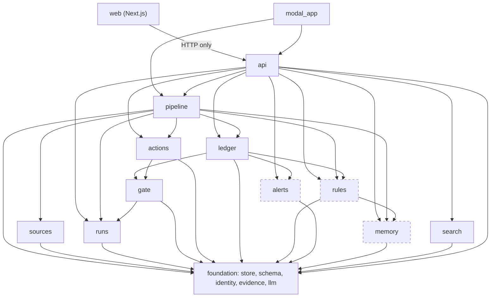
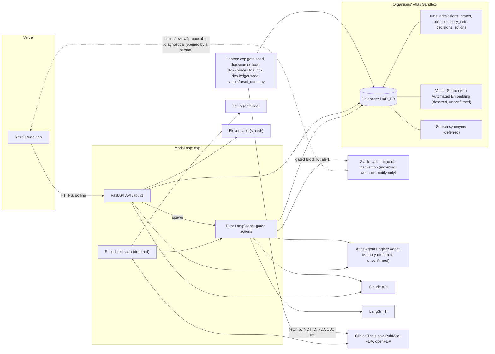
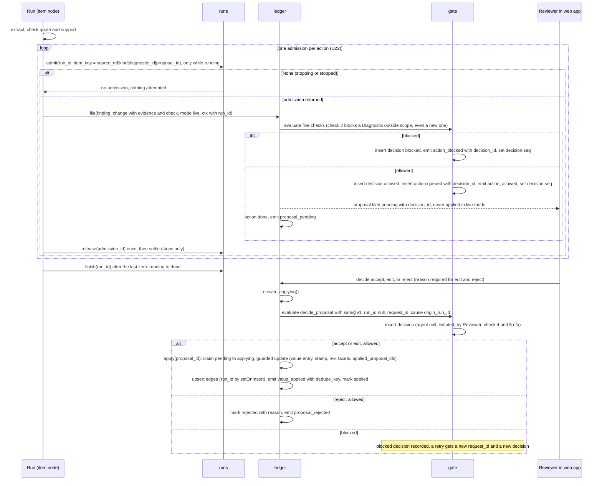
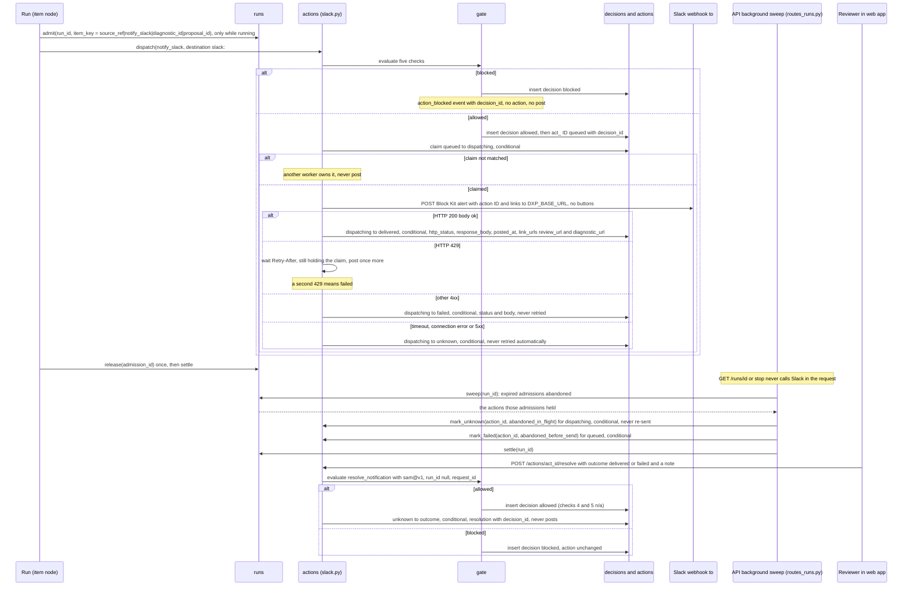
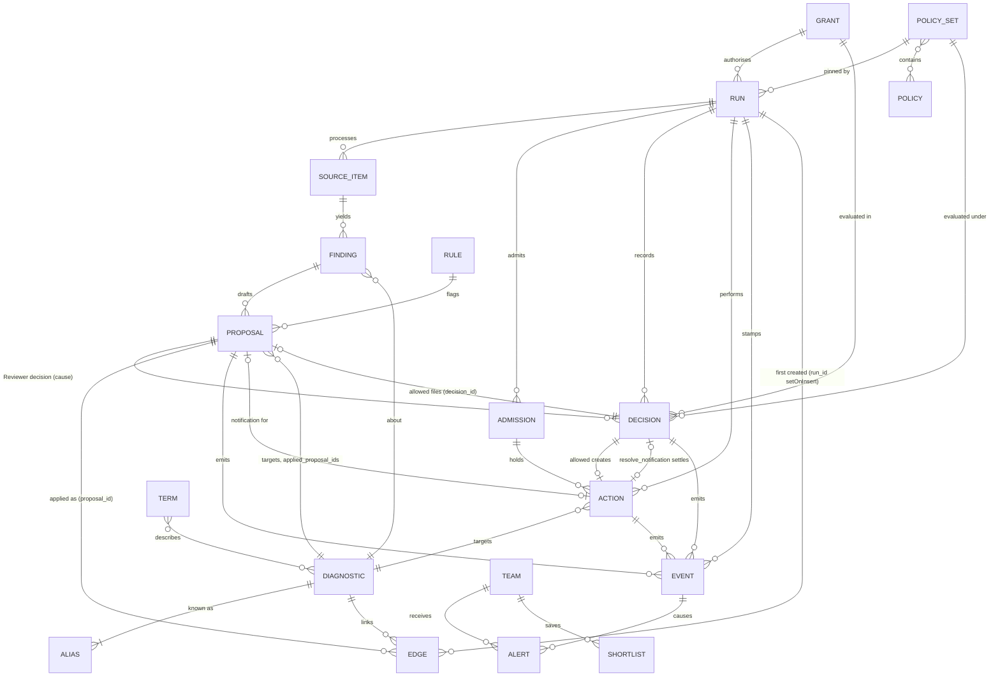

# Architecture Spine — DxProvida (DxP)

Terms follow the PRD Glossary. This is a one-day hackathon build: where a rule trades robustness for speed, speed wins.

**Pivot (13 Nov).** Per the approved sprint change proposal, DxP is built for Statement 1, "Agents You Can Audit". The governed agent is the product: no Record change and no external action without a named identity, a scoped grant, a policy check before the action and a replayable audit (AD-17 to AD-23). Build and validation happen on the organisers' Atlas Sandbox (AD-24). Decisions and routes that serve only deferred features are kept and marked **Deferred (pivot, 13 Nov)**; nobody builds them on Saturday.

**Readiness fixes (14 Nov).** `readiness-fixes-2026-11-14.md` (D1 to D57; D16 to D40 win over D1 to D15, and the final audit's D41 to D57 win in the same way) wins over this spine where they disagree; the ADs below are amended in place to match it.

**Slack replaces GitHub (14 Nov).** `sprint-change-proposal-2026-11-14-slack.md` (S1 to S13) wins over this spine and over the readiness fixes where they mention GitHub, a review issue, `dxp-review-sandbox` or reconciling against GitHub. The one external system is a Slack incoming webhook posting to `#all-mango-db-hackathon`; it only notifies, and approval and rejection happen in DxP. AD-13, AD-14, AD-18, AD-19, AD-20, AD-22 and the structural seed are amended in place to match it.

**Precedence.** This spine overrides the `dxp-*` skills. The skills are reference documentation only (D1); no skill code is copied or run. They say how to call each technology; where a skill's example disagrees with a rule here, the rule wins. Known differences: review is a MongoDB queue, not a LangGraph `interrupt`; a batch is one graph run with `Send`, not `.map` or `.starmap` across containers; the collection is `proposals`, not `proposed_changes`; IDs are derived strings, not ObjectId; live updates are a long-poll on `events`, not server-sent events; update triggers come from the extraction model, not a vector index; the database variable is `DXP_DB`; web types are generated from the API, not copied from the front-end skill.

## Design Paradigm

**Pipes-and-filters ingest feeding a policy-gated proposal ledger.** Source items flow one way through fixed filters: triage, extract, check, resolve, propose. The filters never touch a Record. They end by filing Proposed changes, and the ledger is the only thing that turns a Proposed change into a Record value. Every ledger write and every external call passes the policy gate first, inside a run that stamps its identity on everything it writes.

| Layer | Directory under `backend/dxp/` | Writes |
| --- | --- | --- |
| Foundation | `store`, `schema`, `identity`, `evidence`, `llm` | indexes and validators only |
| Governance | `runs`, `gate`, `actions` | `runs`, `admissions`, `decisions`, `policy_sets`, `actions`, `events`; `grants` and `policies` only through the seed script (AD-18) |
| Ingest filters | `sources`, `pipeline` | `source_items`, `findings`, unmatched `terms` |
| Ledger | `ledger` | `aliases`, `diagnostics`, `proposals` (the only writer; `Proposal.notification` is built at read time and never stored, D47), `edges`, `events`, status of ledger `actions` |
| Ledger helpers — **Deferred (pivot, 13 Nov)** | `rules`, `alerts` | `rules`, `check.flags` on pending `proposals`, `alerts`, `events` |
| Memory — **Deferred (pivot, 13 Nov)** | `memory` | Agent Memory, or `mem_*` collections |
| Read side | `search` | nothing |
| Edge | `api`, and `backend/modal_app.py` | `teams`, `audio`; `shortlists` deferred |
| Web | `web/` | nothing; it calls the API |

## Invariants & Rules



Imports follow these arrows only. Dashed modules are deferred. Only `modal_app` imports `api`; nothing imports `modal_app`. The backend imports nothing from `scripts/`. No code from `scripts/data/` or from any `dxp-*` skill is copied into `backend/` or `web/`, and none is run on Saturday; skills are reference documentation, and every line of project code is written during the event (D1). README disclosure of prepared material does not authorise its reuse. Files under `data/` are not loaded unless an organiser clears them in writing: A05 fetches the selected trials from the ClinicalTrials.gov API v2 by NCT ID, and A13 fetches the FDA companion diagnostics list, during the event.

### AD-1 — The ledger is the only writer of Records [ADOPTED]

- **Binds:** FR-11, FR-15, FR-16, FR-17, FR-29, FR-30, Story 9.3
- **Prevents:** agents, the review screen and the manual-entry form each writing Record values their own way; parallel writers corrupting a Record; an apply left half done; a live change reaching a Record without a Reviewer.
- **Rule:**
  - Only `ledger` creates a `diagnostics` document and writes its `fields`, `rev`, `search_text`, `facets`, `applied_proposal_ids` and its `edges`. Every value enters through `ledger.file(finding_id, change, mode, ctx)`, called once per admitted change (D46): agent finds, seed values, values on a new Diagnostic and values typed by hand. (Baseline load values: deferred.) `ctx` carries the principal, the `run_id` (null only for Reviewer and seed writes, AD-17) and the AD-17 stamp.
  - `ledger.file()`, `ledger.review_value()` and the decision apply call `gate.evaluate()` (AD-19) before any write, including `ensure_diagnostic()`. Blocked means no write at all.
  - In `live` mode an agent never applies; it only files Proposed changes (D28). Every change, to an existing Diagnostic or to one the run itself created, is filed as a `pending` Proposed change after the gate allows it, and is never applied directly (D8). It is applied only through a Reviewer decision (`POST /proposals/<p_id>/decision`), which is itself gated. Only the seed (`baseline` mode) applies at once.
  - `ledger.apply(proposal_id)` lives in `backend/dxp/ledger/apply.py`, owned by A06 (D26), so the seed and I1 do not depend on A14. A14's `ledger/decide.py` and `ledger/review.py` call it. It goes `pending` → `applying` → `applied` (D13, D27):
    1. Claim: `update_one({ _id: p_id, status: "pending" }, { $set: { status: "applying" } })`. No match: do nothing.
    2. Guarded update: one `update_one({ _id: dx_id, applied_proposal_ids: { $ne: p_id } }, ...)` that writes the value entry, pushes `p_id` to `applied_proposal_ids`, increments `rev`, rewrites `search_text` and `facets`. A second run matches nothing, so it is idempotent.
    3. Upsert the derived edges (AD-13). An edge's `run_id`, `seq` and `proposal_id` are set with `$setOnInsert`, so a later run never takes over an earlier run's edge; only `status` is `$set` (to `applied`).
    4. Emit `value_applied` with `dedupe_key = "value_applied|<p_id>"`, so a repeat emits nothing new (AD-10).
    5. Mark the proposal `applied`.
  - Recovery: `ledger.recover_applying()`, also in `ledger/apply.py`, runs at API start, at the start of every run and on every decision call (D26). A proposal stuck in `applying` reruns step 2 (a no-op if done), then always re-upserts its edges (step 3) and re-emits its event (step 4, deduplicated), whatever the guard returned, then step 5.
  - A Proposed change whose canonical value equals a `current` entry of that field is not filed.
  - A value whose check fails (AD-6) is never filed and never applied.

### AD-2 — One value-entry shape, one registry, one canonical form

- **Binds:** FR-5, FR-7, FR-15, FR-17, FR-22
- **Prevents:** a new trial overwriting an earlier one; the backend and web app naming fields differently; one drug or gene appearing as two values, two graph nodes or two Proposed changes.
- **Rule:**
  - `diagnostics.fields.<key>` is always a list of value entries in the shape below. Entries are never deleted.
  - Field keys, labels, cardinality, enums, the stage order and the low-confidence threshold live only in `backend/dxp/schema/registry.py`. The web app reads them from `GET /api/v1/schema`.
  - `value` is always a string in canonical form, produced only by `registry.canonical(field, raw)`. `label` keeps the text as written. Extra detail goes in `detail` and never affects identity.
  - A `single` field has at most one `current` entry. A `list` field adds entries.
  - When values are applied without review (AD-4), a `single` field that already has a `current` entry is not superseded: the new value stays `pending` for a Reviewer. `lifecycle_stage` follows AD-5 instead.
  - An edit or rejection keeps its `reason` on the entry (Story 2.3). Every entry carries the `action_id` and AD-17 `stamp` of the write that made or decided it.

```text
{ value_id, value, label, detail, state: current | superseded | rejected,
  review: unreviewed | accepted | edited | manual,
  evidence: { source_ref, source, source_url, source_date, quote } | { manual: true, submitter, note },
  check: { quote_found, supported, confidence, flags: [ { rule_id, note } ] },
  proposal_id, action_id, stamp, decided_by, decided_at, reason }
```

| Field | Cardinality | Canonical `value` |
| --- | --- | --- |
| `modality`, `regulatory_status`, `lifecycle_stage` | single | registry enum value |
| `provider` | single | `identity.normalise_name(provider)` |
| `clinical_uses`, `sample_types`, `tumour_stage_or_line` | list | registry enum value |
| `biomarkers` | list | HGNC approved symbol; for a non-gene analyte, a registry enum value |
| `tumour_types` | list | OncoTree code |
| `trials` | list | NCT ID, upper case; linked drugs for that trial go in `detail` |
| `linked_drugs` | list | generic name, lower case, resolved through `terms` |
| `study_results` | list | the supporting sentence with whitespace collapsed |

### AD-3 — Derived identity, insert-if-absent, never auto-merge [ADOPTED]

- **Binds:** FR-3, FR-4, FR-30
- **Prevents:** duplicate Source items, Findings, Proposed changes, Diagnostics, events, actions or Alerts when a batch runs in parallel, is retried by Modal or is run twice; a re-run resetting a decision already made.
- **Rule:**
  - `identity.derive(prefix, *parts)` is the only ID maker: the prefix plus the first 16 hex characters of SHA-256 over the parts joined with `|`.
  - `source_ref` is `<source>:<source_item_id>` using the `source` strings (`clinicaltrials.gov`, `pubmed`, `fda_cdx_list`, `openfda_device_pma`). It is the `_id` of `source_items` and the only way any other document refers to a Source item.
  - Finding ID: `derive("f_", source_ref, diagnostic_id)`. Proposed change ID: `derive("p_", finding_id, field, value)`; seed changes carry their own `p_` IDs the same way, from the Finding of their `fda_cdx_list` row (D20). Decision ID: AD-19. Action ID: AD-20. Admission ID: AD-21. Alert ID (deferred): `derive("alert_", team_id, diagnostic_id, kind, cause)`.
  - **Decision and action IDs never collide (D20).** Both derive from `(run_id or "-", kind, diagnostic_id, target)`, where `target` is the `action_id` (for `resolve_notification` only), else the `proposal_id`, else the `value_id` (value review), else `"<field>|<value>"`. A Reviewer decision or action adds a server-generated `request_id` as a last part, so a blocked Reviewer decision can be retried and gets a new Decision.
  - Writes of Findings, Proposed changes and actions are insert-if-absent (`$setOnInsert`). A second run never changes a document that exists.
  - `identity.normalise_name(text)` is the only name normaliser: Unicode NFKC, lower case, remove `®`, `™` and `©`, replace each run of non-alphanumeric characters with one space, trim.
  - A Diagnostic is found through `aliases`, whose `_id` is the normalised name. Its ID is `derive("dx_", id_alias)`. `ledger.ensure_diagnostic()` upserts the alias and the Diagnostic with `created_run_id` and `created_mode`; a duplicate-key error (`pymongo.errors.DuplicateKeyError`) means it exists, so read it.
  - **ID alias and row ID (D31).** For a seeded Diagnostic, the ID alias is `normalise_name()` of the FDA list's trade-name column, and the row ID (`source_item_id`, so `source_ref = fda_cdx_list:<row ID>`) is `<PMA or 510(k) number>:<first 8 hex characters of sha1 of the normalised row>`, because one number covers many drug rows (D45). Trade names are kept as the exact strings of the FDA list (for example "Guardant360® Liquid CDx"); `normalise_name()` removes "®" and folds case, so the ID alias has neither. For a Diagnostic a run creates, the ID alias is `normalise_name()` of the extracted assay name.
  - A Finding that names no assay uses the alias `approach:<modality>:<biomarker>`, with registry values, taking the first biomarker in alphabetical order or `any`.
  - Seed Diagnostics come from the FDA list of cleared or approved companion diagnostics, fetched during the event (A13, lung rows only, D1) into `source_items` with source `fda_cdx_list`. Every device and trade name string in a row passes through `normalise_name` as an alias. `data/fda/` is not read.
  - **Hand-written aliases (D31)**, written during the event by A02 and seeded with the Diagnostics: "FoundationOne Liquid" → FoundationOne Liquid CDx; "Guardant360" → Guardant360 CDx; "FoundationOne" (when not followed by "Liquid") → FoundationOne CDx.
  - **Extraction matches against the seeded aliases (D31).** A08 passes the seeded alias list into the extraction prompt; the extracted assay name must be one of those aliases or `new`. Only `new` creates a Diagnostic (subject to check 2).
  - Nothing merges two Diagnostics automatically.
  - The `raw_text` of a Source item that has Evidence pointing at it is never overwritten.

### AD-4 — Two ingest modes decide what is applied and what alerts

- **Binds:** FR-12, FR-13, FR-16, FR-30
- **Prevents:** the Baseline load flooding Teams with Alerts; live changes reaching a Record without a Reviewer; the two developers reading "new Diagnostic" differently.
- **Rule:** Every run, Proposed change and event carries `mode`.
  - `baseline`: the ledger applies each filed change at once (through `ledger.apply()`) with `review: unreviewed`. On Saturday only the seed uses it, under the seed grant (AD-18); the comprehensive Baseline load is deferred.
  - `live`: an agent never applies (D28). Every change, including one to a Diagnostic the run itself created, is filed as a `pending` Proposed change after the gate allows it, and is applied only through a Reviewer decision (AD-1, D8). Creating a Diagnostic outside the grant's scope is blocked by check 2 (AD-19).
  - A Proposed change has `status` in `pending | applying | applied | rejected` (AD-1). The Reviewer queue is a query on `proposals`.
  - A Reviewer accepts, edits or rejects an `unreviewed` value through `ledger.review_value()` (action kind `review_value`, gated with the Reviewer grant, D16), which sets `review` or `state` on that entry. On Saturday only seed values are `unreviewed`.
  - Values with `confidence` below the registry threshold are applied or queued as above and listed first in the Reviewer queue.
  - `dry_run` (Story 2.1, writes nothing): **Deferred (pivot, 13 Nov)**.

### AD-5 — Lifecycle stage is a registry field, ordered by the ledger

- **Binds:** FR-2, FR-11, FR-12
- **Prevents:** stage being judged two ways; stage moving backwards when items are processed in parallel; the Early research label being computed in two places.
- **Rule:** Extraction gives each Finding at most one `stage_evidence { stage, quote }`, filed as a change to `lifecycle_stage`. `ledger.apply()` enforces the order: its update only matches when the stored stage is earlier than the new one. Rows from the FDA list file `regulatory_approval` by rule, without a model call. `registry.is_early_research(stage)` is the only test for the label; it is true for `discovery` and `assay_development`, and the label is never stored. A Diagnostic with no stage evidence has stage `not_determined`.

### AD-6 — One Evidence check before filing, one gate on the read side

- **Binds:** FR-7, FR-8, FR-18, FR-22, FR-25, FR-29
- **Prevents:** screens disagreeing about which values may be shown; unsupported values replacing good ones; PubMed text leaving the backend.
- **Rule:**
  - `evidence.quote_in_source(quote, raw_text)` is the only quote check. It runs against `source_items.raw_text`.
  - The pipeline's check filter sets `quote_found`, `supported` and `confidence`. A value passes when `quote_found` and `supported` are both true. A value that does not pass is recorded on its Finding and goes no further. The policy gate's evidence check (AD-19) reads this same `check`; it never re-judges.
  - Every endpoint that returns Record data builds it with `search.readmodel`. The read model shows only entries that passed or are `manual`, adds the no-data state for an empty field, attaches the source name and its data date, and passes `synthetic` through. The web app applies no display rule of its own.
  - A hand-typed value has `evidence.manual` and `review: manual`, and is shown marked as manually sourced.
  - PubMed `raw_text` is stored only in `source_items`. It is never returned by the API, written to a file in the repository, sent in a trace that is shared, or put in a Slack message. A quote is at most 300 characters.

### AD-7 — One Learned rule mechanism, owned by DxP — **Deferred (pivot, 13 Nov)**

- **Binds:** FR-19
- **Prevents:** three mechanisms built by different hands; a rule that cannot be switched off; flags with no owner.
- **Rule:** A Learned rule is one document in `rules`: `{ field, text, status: draft | active | off, from_proposal_id, synthetic }`. Rules apply to every Team. A rejection or edit must carry a reason. `rules.draft()` asks the model for a plain-language rule; a Reviewer's confirmation sets it `active`. `rules.evaluate(field, value, quote)` is the only place a rule is applied: in the pipeline's check filter, and over every `pending` Proposed change for that field when a rule's status changes. Only `rules` writes `check.flags`, and only on `pending` Proposed changes. A rule adds or removes flags; it never rejects or withdraws. Setting a rule `off` removes its flags. `rules` is the source of truth. Agent Memory receives one copy when a rule first becomes `active`. The stretch rejection-to-policy draft (Story 9.11) is not a Learned rule; it follows AD-18.

### AD-8 — Memory sits behind one adapter; app state stays in DxP collections — **Deferred (pivot, 13 Nov)**

- **Binds:** FR-9, FR-19, FR-28
- **Prevents:** the preview SDK leaking into every module; the app depending on a memory search for facts it must read exactly; developers' test memories mixing with production.
- **Rule:**
  - Only `backend/dxp/memory` imports the Agent Memory SDK. Its interface is `remember_episode(team_id, session_id, kind, text)`, `recall(team_id, query) -> list[str]`, `save_rule(rule_id, field, text)` and `glossary(term) -> list[str]`.
  - Two backends, chosen by `DXP_MEMORY_BACKEND`: `agent_engine` and `collections`.
  - The memory user ID is `<DXP_DB>:<team_id>`. Rule copies use `<DXP_DB>:reviewers`.
  - Facts the app must read exactly live in DxP collections: `teams` (profile, `last_seen_seq`, `last_seen_at`, last Intended use), `shortlists`, `rules`, `terms`. "What changed since last visit" is a query on `events` after `last_seen_seq`.
  - Memory holds what a Team asked, opened and dismissed, and supplies the resume summary and agent context. Text recalled from a synthetic episode is labelled synthetic. Synthetic episodes are written with a `session_id` that starts `synthetic_`, and `recall` prefixes their text with `[synthetic] `.
  - Synonyms are owned by `search.terms`, reading `terms`. A curated link, such as liquid biopsy to ctDNA, carries `curated: true`. A term the pipeline cannot match is written to `terms` with `status: unmatched` for the Reviewer. Every `terms` document is a valid synonym document, `{ mappingType: "equivalent", synonyms: [...] }` plus DxP's own fields; an unmatched term is stored as `synonyms: [<term>]`. One invalid document stops the MongoDB Search index from building.
  - Agent Memory preview availability on the Atlas Sandbox is unconfirmed (AD-24).

### AD-9 — The web app talks to the API only; long work is a job [ADOPTED]

- **Binds:** FR-1, FR-4, FR-21, FR-27
- **Prevents:** a second data path from Next.js to MongoDB, to a model or to Slack; requests that die at Modal's 150-second cap.
- **Rule:** The web app's only backend is `NEXT_PUBLIC_API_URL` + `/api/v1`. No Next.js code opens a MongoDB connection, calls a model or posts to Slack. Anything that can run longer than 30 seconds is a run (AD-16, AD-17). The one long request is the 25-second long-poll in AD-10 and AD-23.

### AD-10 — One outbox feeds live updates and "what changed"

- **Binds:** FR-12, FR-13, FR-14, FR-27, FR-28, Stories 9.6, 9.7, 9.9
- **Prevents:** the action feed, the audit, the Graph view highlight and the resume summary each tracking change separately; events lost between polls; Alerts raised twice or not at all.
- **Rule:**
  - `store.emit_event()` is the only writer of `events`. The event `_id` is `seq`, the next integer, assigned by inserting and retrying on a duplicate key, so a higher `seq` is never visible before a lower one. Each event has a unique `dedupe_key`, so a retry emits nothing new and returns the stored event's `seq`. Every event carries the AD-17 `stamp`.
  - Event `type` is one of `diagnostic_created`, `value_applied`, `proposal_pending`, `proposal_rejected`, `run_status_changed`, `action_allowed`, `action_blocked`, `action_status_changed`; `rule_status_changed` and `alert_created` are deferred.
  - `GET /api/v1/changes?after=<seq>` (supporting, A12) returns events with a higher `seq`. If there are none it may wait up to 25 seconds, using a change stream only as a wake-up, then query again (AD-23). The query on `seq` is the only source of truth. Plain polling is acceptable.
  - **Deferred (pivot, 13 Nov):** `alerts.react()` runs once at the end of each `ledger` call, when `mode` is `live`. A Team matches a Diagnostic when its profile overlaps the Diagnostic's `facets` on modality, biomarker or linked drug. Tumour type alone is not a match.
  - **Deferred (pivot, 13 Nov):** First Alert: the Diagnostic's `created_mode` is `live`, the Team matches, and no first Alert exists for that pair. Diagnostics from the Baseline load never get a first Alert.
  - **Deferred (pivot, 13 Nov):** Update Alert: an applied change carries a trigger and the Team matches. Triggers are `stage_advance`, `line_of_therapy`, `used_in_trial` and `standard_of_care`. The ledger sets `stage_advance` when it applies a `lifecycle_stage` change. The extraction model sets the other three per Finding.

### AD-11 — All model calls go through one module

- **Binds:** FR-4, FR-5, FR-13, FR-18, FR-19, FR-21, Story 9.1
- **Prevents:** separate code paths together exceeding the rate limit, or using different clients and output methods; a run that cannot say which model and prompt produced an action.
- **Rule:** Only `backend/dxp/llm` calls Claude, through `langchain-anthropic` and nothing else. It holds the model IDs, retry and refusal handling, and returns parsed objects from the Pydantic models in `schema`. Structured output uses the JSON-schema method; no sampling parameters are sent. Every call is async. An ingest run may hold 16 calls at once; all other callers share 4. Triage uses the fast model; extraction, checking, rule drafting and query parsing use the stronger model. `llm` exposes `MODEL_IDS` and `PROMPT_VERSION`; the run reads them into its identity at start (AD-17).

### AD-12 — One graph run per job, fan-out inside it [ADOPTED]

- **Binds:** FR-1, FR-4
- **Prevents:** one trace per item exhausting the LangSmith allowance; one failed item discarding the batch; review state split between LangGraph and MongoDB.
- **Rule:** An ingest run is one LangGraph run in one Modal container, fanning out over Source items with `Send` and `max_concurrency` at most 16. Saturday's run covers the selected set of 20 trials, processed in the listed order (Saturday data, D30). With `DXP_DEMO_PACE` set, the run processes one item at a time and waits a few seconds per item, so the first item is NCT04712877 and a stop lands mid-run (D33). Each item node catches its own exceptions and returns a failure result. After extraction and before the gate, each item node admits every action through `runs.admit(run_id, item_key)`, one admission per action (AD-21, D22); `None` ends that step with no action, and the admission is released once in a `finally`. After the last item the pipeline calls `runs.finish(run_id)`; an error it cannot recover from marks the run `failed` (D23). Human review is not a graph node. The scheduled scan (deferred) and a manual start call the same run function.

### AD-13 — Graph node IDs and edges are derived by the ledger

- **Binds:** FR-26, FR-27, FR-43, Story 5.1
- **Prevents:** the backend and the Graph view inventing different node IDs; links lost when two changes land together; the impact view showing more or less than the run touched, or attributing context to the run.
- **Rule:** A node ID is `<type>:<value>`, with type in `diagnostic | biomarker | trial | drug | provider | tumour | notification` and the canonical `value` from AD-2. An edge is `{ _id: derive("e_", from, to, kind), from, to, kind, seq, run_id, proposal_id, status: applied }`, upserted by `ledger.apply()` (AD-1 step 3) with `run_id`, `seq` and `proposal_id` in `$setOnInsert`, so a later run never takes over an earlier run's edge (D27); an edge is removed only when the `single` value that produced it is superseded. `GET /api/v1/graph` returns nodes and links built from `edges`. With `?run_id=` it returns two kinds of element (D12):
  - **Changed:** only what the run itself created or changed: its value entries, Proposed changes and edges (each carrying that `run_id`), the touched Diagnostics, and one `notification:<action_id>` node per `notify_slack` action of the run, linked to its Diagnostic with kind `notification` and carrying the action's status. Each is `changed: true` with its `run_id`. A pending Proposed change of the run is a link with `status: pending` and its `proposal_id`, built at read time from `proposals`; an applied one comes from `edges` with `status: applied` (D29). Notification nodes and links are built at read time from `actions`, never stored in `edges`.
  - **Context:** a touched Diagnostic's other neighbours, returned only with `&context=true` ("Show context"), each `context: true`, `changed: false`, `run_id: null`. Context is never attributed to the run.
  - The web app does not derive links.

### AD-14 — The API contract is written once and types are generated

- **Binds:** all web-facing FRs, Stories 9.1 to 9.11
- **Prevents:** the web app and the backend each guessing routes and shapes; authority taken from a request body.
- **Rule:** This table is the single reference for routes and shapes, including every earlier Departure from `epics.md`. Response models are Pydantic classes in `backend/dxp/api/models.py`, matching the shapes below. `web/lib/types.ts` is generated from the API's `/openapi.json` with `openapi-typescript` and is never edited by hand. The web app calls the API only through `web/lib/api.ts`. Every request carries `X-DxP-Key`, which the web app sends from server-side code only; the API resolves the calling principal from it (AD-18). A run's authority comes from the grant named in `POST /runs` and checked against the caller (AD-17). A body field `actor`, where a deferred route still has one, is display text and never read for authority. Every route has exactly one status, here and nowhere else (D40): core, supporting, stretch, deferred or superseded. Routes marked deferred are not built on Saturday; no core screen depends on a supporting route (D37).

| Route under `/api/v1` | Returns | Status (owner) |
| --- | --- | --- |
| `GET /schema` | registry: fields, enums, stage order | core (A01, the only route A01 finishes) |
| `GET /whoami` | `Principal { id, name, kind, actions }`, resolved from the key; `actions` are those of the caller's current grant. B02 and B03 show Resolve only when `actions` includes `resolve_notification` (D53) | core (A03) |
| `POST /runs` `{ grant_id, set }` | `Run`; 401 only for an unknown key, 403 grant's latest version not active or caller not in `startable_by` (no run), 409 if one is `running` or `stopping`. No `team_id`: the grant defines the Team (D18) | core (A07) |
| `GET /runs`, `GET /runs/<run_id>` | `Run`; never calls Slack: starts the AD-21 sweep in the background and returns current state, `dispatching` actions the sweep is settling shown `reconciling` (D24) | core (A07) |
| `POST /runs/<run_id>/stop` | `Run`, `stopping` or `stopped`; starts the sweep in the background like `GET` | core (A07) |
| `GET /runs/<run_id>/audit` | `Audit` | core (A11) |
| `GET /runs/<run_id>/audit/audio` | audio of the audit summary | stretch (9.10, B06) |
| `GET /actions?run_id=&status=` | `{ items: Action[], next }` | core (A11) |
| `GET /actions/<action_id>` | `Action` with `authorised_by`: status and result | core (A11) |
| `GET /decisions/<decision_id>` | `Decision` with `authorised_by`: audit detail for any entry, allowed or blocked | core (A11) |
| `POST /actions/<action_id>/resolve` `{ outcome: delivered or failed, note }` | `{ action: Action, decision: Decision }`; Reviewer only, action kind `resolve_notification`, gated with the Reviewer's grant; settles an `unknown` notification after the Reviewer checks `#all-mango-db-hackathon` for the action ID; never posts (AD-20) | core (A09) |
| `GET /grants`, `GET /grants/<grant_id>` | `Grant`, latest version; `?version=` for an earlier one. The web app lists the grants whose `startable_by` includes the caller, each labelled with its Team; there is no separate Team picker (D18) | core (A03) |
| `GET /policies?status=` | `{ items: Policy[], policy_set_version }` | core (A03) |
| `POST /policies/<policy_id>/approve` `{ version }` | `Policy`; person principal only | stretch (9.11, A17) |
| `POST /jobs`, `GET /jobs`, `GET /jobs/<job_id>` | superseded by `/runs`; not built | superseded |
| `GET /teams` | `{ items: Team[] }` | core (A13) |
| `GET /teams/<team_id>` | `Team`; resume summary deferred | deferred (6.3), built only if a screen needs it |
| `POST /teams/<team_id>/seen` `{ seq }` | `Team`, sets `last_seen_seq` and `last_seen_at` | deferred (5.1) |
| `GET /diagnostics?<facet>=&q=` | `{ items: Record[], next }` | deferred (D40: no Diagnostics list; the Record page is reached from Review, Audit and Impact links) |
| `GET /diagnostics/<dx_id>` | `Record`, all entries with history | core (A18) |
| `POST /diagnostics/<dx_id>/values` `{ field, value, note }` | `Proposal` | deferred (4.7) |
| `POST /diagnostics/<dx_id>/values/<value_id>/review` `{ action: accept, edit or reject, value, reason }` | `{ record: Record, decision: Decision }`; action kind `review_value`, gated with the Reviewer's grant; `edit` and `reject` need a `reason` (D16) | core (A14) |
| `POST /query` `{ text, filters, team_id }` | `{ parsed, columns, rows: Record[] }` | deferred (4.2) |
| `GET /proposals?status=&field=&diagnostic_id=&run_id=` | `{ items: Proposal[], next }`; the Review count polls `?status=pending` until A12 passes (D40) | core (A14) |
| `GET /proposals/<p_id>` | `Proposal`, one proposal whatever its status; 404 for an unknown ID. The Review page's `?proposal=<p_id>` focus uses it; there is no `p_id=` query parameter (D42) | core (A14) |
| `POST /proposals/<p_id>/decision` `{ action: accept, edit or reject, value, reason }` | `{ proposal, decision, rule_draft }`; action kind `decide_proposal`; `decision` is the gate `Decision` (`run_id: null`, `cause`, server-generated `request_id`); `rule_draft` is null while AD-7 is deferred | core (A14) |
| `GET /rules`, `POST /rules/<rule_id>/status` `{ status }` | `Rule` | deferred (2.6) |
| `GET /alerts?team_id=`, `POST /alerts/<alert_id>/dismiss` | `Alert` | deferred (3.1) |
| `GET /alerts/<alert_id>/audio` | audio | deferred (3.4) |
| `GET /changes?after=<seq>&run_id=` | `{ events: Event[], last_seq }`; until A12 passes, the Run console polls `GET /runs/<run_id>` and `GET /runs/<run_id>/audit` (D40) | supporting (9.9, A12) |
| `GET /graph?run_id=&context=` | `{ nodes: Node[], links: Link[] }`; changed elements only unless `context=true` (AD-13); impact links hidden when the `impact` flag is off (D37) | supporting (5.1, A15) |
| `GET /graph` with `after`, `focus`, `depth` or `team_id` | as above | deferred (5.1, 6.4) |
| `GET /digest?team_id=` | `{ pending: Proposal[], alerts: Alert[] }` | deferred (3.3) |
| `GET /terms?status=unmatched` | `{ items: Term[] }` | deferred (4.8) |
| `POST /shortlists` `{ team_id, intended_use, query, diagnostic_ids }`, `GET /shortlists?team_id=` | `Shortlist` | deferred (4.4) |

Audio routes are the only non-JSON responses.

```text
Stamp      { kind: run | reviewer | seed, run_id, agent, initiated_by, principal, acting_for,
             grant_id, grant_version, model, prompt_version, policy_set_version }
             run: run_id set, principal = agent; reviewer: run_id null, principal = Reviewer,
             agent null, initiated_by = Reviewer; seed: { kind: seed, principal: seed, run_id: null } only (D19)
Principal  { id, name, kind: agent | person | seed, actions }      from GET /whoami; actions = the caller's current grant's actions (D53)
Run        { id, agent, initiated_by, model, prompt_version, policy_set_version, acting_for,
             grant_id, grant_version (pinned at start), team_id (from the grant), mode, source, set,
             status: running | stopping | stopped | done | failed, in_flight (count of admitted admissions),
               done: runs.finish after the last item; stopped: runs.settle after a stop;
               failed: only an error the pipeline cannot recover from (D23)
             counts: { total, done, failed, filed, allowed, blocked, unknown, not_admitted, early_research },
             active: [ { source_ref, step } ], failures: [ { source_ref, error } ],
             started_at, stopping_at, stopped_at, finished_at }
Grant      { id, grant_id, version, principal (the agent, person or seed it authorises), kind: agent | person | seed,
             acting_for, granted_by, startable_by: [principal ids], team_id, team_name,
             scope: { diagnostic_ids } | { all: true } (seed only, D16),
             destinations, actions, expires_at, status: active | revoked | expired, created_at }
Policy     { id, policy_id, version, status: draft | active | retired, applies_to,
             requires: { quote_found, supported, min_confidence }, text, author, approved_by, created_at }
PolicySet  { id (policy_set_version), members: ["<policy_id>@v<n>"], created_at }
Admission  { id, run_id, item_key, status: admitted | released | abandoned, admitted_at, expires_at, released_at }
Decision   { id (decision_id), run_id, agent, initiated_by, stamp, cause: { proposal_id, origin_run_id } | null,
             request_id (Reviewer decisions only, server-generated, D20),
             kind, inputs, evidence_ref: { source_ref, finding_id, proposal_id, quote, check },
             destination, target: { diagnostic_id, proposal_id, value_id },
             checks: [ { check, passed | n/a, detail } ], failed_check,
             grant_id, grant_version (evaluated), run_grant_version (pinned), policy_set_version,
             outcome: allowed | blocked, action_id | null, seq, decided_at, authorised_by }
             run: agent = run.agent, initiated_by = run.initiated_by; Reviewer: agent null,
             initiated_by = Reviewer; seed: agent "seed", initiated_by "seed" (D19).
             seq = the seq of its action_allowed or action_blocked event (D21)
Action     { id, decision_id, admission_id, run_id, kind, destination, target: { diagnostic_id, proposal_id, value_id },
             inputs, evidence_ref, stamp, error (abandoned_before_send | abandoned_in_flight | null),
             status: notify_slack: queued | dispatching | delivered | failed | unknown;
                     ledger kinds: queued | done | failed,
               reconciling: returned in place of dispatching while the background sweep settles it; never stored (D24)
             result: { http_status, response_body, posted_at, link_urls: { review_url, diagnostic_url } } (notify_slack; http_status and
                       response_body null when no response arrived) | { proposal_ids, value_ids } | null,
             resolution: { outcome: delivered | failed, note, decision_id, by, at } | null   (AD-20 manual resolution)
             proposed_at, decided_at (queued), claimed_at, observed_at, authorised_by }
AuditEntry { seq, decision_id, outcome: allowed | blocked, failed_check, checks, kind, destination,
             inputs, evidence_ref, stamp, cause, grant_id, grant_version, policy_set_version,
             action_id, status, result, resolution, decided_at, claimed_at, observed_at, authorised_by,
             proposal_review: { status: pending | applying | applied | rejected, decided_by, decided_at } | null }
             proposal_review is read live from proposals at request time (AD-22)
Audit      { run: Run, policies: Policy[], entries: AuditEntry[], after_run: AuditEntry[] }
             after_run: Reviewer decisions whose cause.origin_run_id is this run
authorised_by { principal, initiated_by, acting_for, granted_by, grant_id, grant_version, expires_at, policy_set_version }
Record     { id, name, lifecycle_stage, early_research, created_mode, rev, synthetic, applied_proposal_ids,
             fields: { <key>: { values: Value[], no_data } },
             completeness: { filled, of, thin, stale } }      completeness deferred (4.6)
Value      the AD-2 entry, plus evidence.data_as_of (from source_date)
Proposal   { id, diagnostic_id, diagnostic_name, field, value, label, current_value, evidence, check,
             status, mode, trigger, run_id, action_id, decision_id, stamp, decided_by, decided_at, reason,
             notification: { action_id, status, posted_at } | null }                    (D29, S10)
             notification is read-time only: A14 and A11 build it from the proposal's notify_slack
             action; nothing writes it to the proposal document (D47)
Event      { seq, type, mode, run_id, stamp, decision_id, action_id, outcome, failed_check, status,
             diagnostic_id, proposal_id, field, trigger, at }
Node       { id, type, label, lifecycle_stage, early_research, sample_type, url, run_id, changed, context }
Link       { source, target, kind, status: pending | applied, proposal_id, run_id, changed, context }   (D29)
Team       { id, name, profile: { modalities, biomarkers, linked_drugs }, last_seen_seq, last_seen_at, synthetic }
Rule       { id, field, text, status, from_proposal_id, synthetic }                       deferred
Alert      { id, team_id, diagnostic_id, diagnostic_name, kind: first | update, trigger, why,
             lifecycle_stage, from_stage, evidence, early_research, seq, at, dismissed }  deferred
Shortlist  { id, team_id, intended_use, query, diagnostic_ids, created_at }               deferred
```

`Run` absorbs the former `Job` and its Story 1.7 fields (`limit`, `started_at`, `finished_at`, `counts.filed`, `active`; `limit` is dropped); the former `actor` is `initiated_by`, and the executing principal is `agent` (AD-17). `Node.sample_type` is set for Diagnostics; `Node.url` is null for notification nodes, since a webhook post has no link to read back.

### AD-15 — Search reads derived fields that only the ledger writes — **Deferred (pivot, 13 Nov)**

- **Binds:** FR-9, FR-21, FR-22
- **Prevents:** the search index and the filters being built from the stored value entries in two different ways.
- **Rule:** On every apply the ledger rewrites two derived fields on the Diagnostic from its `current` entries: `search_text`, one plain-text summary, and `facets.<key>`, a flat list of canonical values per field. The Vector Search index with Automated Embedding is on `search_text` only. `search.query` filters on `facets` and ranks on `search_text`; it expands terms through `search.terms`. No other code indexes or filters on `fields`. On Saturday the ledger still writes `facets` (the `GET /diagnostics` facet filters use them); the search index, `search.query` and synonym expansion are deferred, and Automated Embedding on the sandbox is unconfirmed (AD-24).

### AD-16 — Source items are loaded once; runs read them, one at a time

- **Binds:** FR-1, FR-4, FR-30
- **Prevents:** a run on Modal looking for files that exist only on a laptop; two runs sharing one rate limit; a restarted run repeating finished work; PubMed text reaching a shared trace.
- **Rule:**
  - Source items reach MongoDB by `python -m dxp.sources.load --set selected` (A05), run from a laptop during the event. It fetches each NCT ID in `backend/dxp/sources/selected.json` (the 20 NCT IDs listed under Saturday data, in that order, D30) from the ClinicalTrials.gov API v2 and upserts it into `source_items` with `window: "selected"` (D54; docs call them "the selected trials"), `sets` and `source_date` (the trial's `last_update_posted`), which becomes `evidence.source_date`. The FDA companion diagnostics list is fetched the same way by A13 (`source_date` = fetch date). Membership comes from the NCT ID list, never from a date comparison. Files under `data/` are not read unless an organiser clears them in writing (D1).
  - A job is a run (AD-17): `POST /runs { grant_id, set }`; the grant defines the Team (D18). The set names its source and its order; runs started through the API are `live`. It processes the set's Source items that have no `processed_at`, and sets `processed_at` when an item's result is filed. Starting the same set again therefore resumes.
  - At most one run is `running` or `stopping` at a time. `POST /runs` returns 409 otherwise. A run with no progress for 10 minutes counts as stalled and does not block a new start.
  - The run function sets its Modal timeout to 3600 seconds. `modal_app.py` passes the run function to `api.create_app()`, and the API starts it with `.spawn()` on that object, never with `modal.Function.from_name`, so a `modal serve` API starts its own run and never production's. It is never called inside a request.
  - A run over `pubmed` runs with tracing off. Only a trace from a `clinicaltrials.gov` run is shared.
  - **Deferred (pivot, 13 Nov):** the scheduled scan first calls each `sources` adapter's `fetch(since)` to add new Source items, then starts a `live` run.

### AD-17 — Every run has one identity, stamped on every write, event and action

- **Binds:** Story 9.1, FR-1, FR-4
- **Prevents:** a change or external action nobody can attribute; a client naming who acts; the starter and the executor confused; stamps assembled differently in different modules.
- **Rule:**
  - A run is one document in `runs`, `_id` `run_<random>`. It replaces the AD-16 job: there is no `jobs` collection, and `run_id` is the former job ID.
  - A run has two identities (D4): `initiated_by`, the principal who started it, and `agent`, the executing agent principal named by the grant.
  - `POST /runs { grant_id, set }`, in order (D18; there is no `team_id` in the body, the grant defines the Team):
    1. Resolve the caller from `X-DxP-Key` (AD-18). Unknown key: 401. A key whose own grant is revoked or expired still resolves (D17).
    2. Load the latest version of `grant_id` (AD-18 selection). Not `active`, expired, or caller not in `startable_by`: 403, no run.
    3. Create the run with `agent` = the grant's `principal`, `initiated_by` = the caller, `team_id` and `acting_for` from the grant, `grant_id` and `grant_version` pinned, `policy_set_version` pinned (AD-18), `model` and `prompt_version` from `llm`.
  - No identity comes from the request body; a client-supplied name never confers permission. None of these fields changes during the run.
  - On Saturday the agent principal is `dxp-curator` and the agent grant is `lbdx@v1` (Team "Team Liquid Biopsy Dx"); the Reviewer is `sam` (`sam@v1`) and the seed is `seed` (`seed@v1`) (D56).
  - The worker executes with the agent's key (`DXP_AGENT_KEY`) and the `run_id`. `runs.context(run_id, key)` resolves the key and refuses unless it resolves to the run's `agent`. Every agent write requires a `run_id`; an agent write without one is refused.
  - `runs.stamp(run_id)` is the only stamp maker for run writes. It returns `Stamp` (AD-14) with `kind: run`.
  - Every document a run writes carries the stamp: Finding, Proposed change, value entry, edge (`run_id`), decision, event, action.
  - Reviewer decisions are written outside a run: `run_id: null`, a `kind: reviewer` stamp with the Reviewer's principal and grant (`sam@v1`), `agent: null`, `initiated_by: <reviewer principal>` (D19), a server-generated `request_id` (D20), and `cause: { proposal_id, origin_run_id }` on the decision. They need no run ID; agent writes do.
  - Seeding runs only from the command line with a dedicated seed key (`DXP_SEED_KEY`) under the seed grant (`seed@v1`, AD-18). Its writes carry `{ kind: "seed", principal: "seed" }` and `run_id: null`; its decisions carry `agent: "seed"`, `initiated_by: "seed"` (D19). No API route accepts the seed key.

### AD-18 — Grants and versioned policies live in Atlas; authority comes from the key

- **Binds:** Stories 9.2, 9.11
- **Prevents:** a client-supplied name conferring permission; an edited grant or policy erasing what authorised an earlier action; a policy set or grant version that cannot be reconstructed; malformed authority documents.
- **Rule:**
  - `store.ensure_indexes()` creates `grants`, `policies`, `policy_sets`, `runs`, `admissions`, `decisions` and `actions` with a `$jsonSchema` validator at creation, `validationLevel: strict`, `validationAction: error`.
  - The API hashes `X-DxP-Key` with SHA-256 and finds the principal by `key_hash` across all grant versions, whatever their status (D17); the latest version of that `grant_id` gives the principal and `acting_for`. 401 means only an unknown key. A revoked or expired grant is not a 401: it is caught by check 1 (AD-19) and recorded as a blocked Decision. The raw key is never stored, logged or traced. One key maps to one principal: the worker key (`DXP_AGENT_KEY`) to the agent, the web app's server-side key (`DXP_API_KEY`) to the Reviewer, the seed key (`DXP_SEED_KEY`) to `seed`, command line only.
  - **Keys (D48).** At 10:45 A03 generates `DXP_AGENT_KEY`, `DXP_API_KEY` and `DXP_SEED_KEY` locally into `.env`. `python -m dxp.gate.seed` computes each grant's `key_hash` from the environment at seed time; no key is ever committed. A04 puts `DXP_API_KEY` and `NEXT_PUBLIC_API_URL` into Vercel, and `DXP_AGENT_KEY`, `SLACK_WEBHOOK_URL`, `ANTHROPIC_API_KEY`, `MONGODB_URI` and `DXP_BASE_URL` into the Modal secret. `DXP_SEED_KEY` stays in the laptop's `.env` only.
  - Calling principal and executing principal are separate (AD-17): the web app's Reviewer key may start a run only when the Reviewer is in the agent grant's `startable_by`; the run's writes still execute as the grant's agent, and the worker key must resolve to `run.agent`.
  - A grant document: `{ _id: "<grant_id>@v<version>", grant_id, version, principal, kind: agent | person | seed, key_hash, acting_for, granted_by, startable_by: [principal ids], team_id, scope: { diagnostic_ids } | { all: true }, destinations, actions, expires_at, status: active | revoked | expired, created_at }`. `principal` is the agent, person or seed the grant authorises. Destinations: `ledger`, `slack:#all-mango-db-hackathon`. Actions: machine kinds `file_proposal`, `notify_slack` (agent) and `apply_value` (seed); human kinds `decide_proposal`, `review_value` (D16) and `resolve_notification` (S8). `scope: { all: true }` is valid only when `principal` is `seed`; the validator and `gate.seed` reject it on any other grant.
  - **The three grants seeded on Saturday (D16, D32):**
    - Agent grant `lbdx@v1` (Team "Team Liquid Biopsy Dx"): principal `dxp-curator`, kind `agent`, actions `[file_proposal, notify_slack]`, destinations `ledger` and `slack:#all-mango-db-hackathon`, `startable_by: [sam]`, `scope.diagnostic_ids` = the Diagnostics whose exact FDA trade names are "FoundationOne Liquid CDx", "Guardant360 CDx", "Guardant360® Liquid CDx" and "Agilent Resolution ctDx FIRST assay", matched through `normalise_name()` (D45). Every other Diagnostic, FoundationOne CDx among them, is out of scope.
    - Reviewer grant `sam@v1`: principal `sam` (display name Sam), kind `person`, actions `[decide_proposal, review_value, resolve_notification]`, destination `ledger`, `scope.diagnostic_ids` = the same IDs as the agent grant.
    - Seed grant `seed@v1`: principal `seed`, kind `seed`, actions `[apply_value]`, destination `ledger`, scope `{ all: true }`.
  - A policy document: `{ _id: "<policy_id>@v<version>", policy_id, version, status: draft | active | retired, applies_to: [action], requires: { quote_found, supported, min_confidence }, text, author, approved_by, created_at }`. `requires` accepts only these keys; `text` is description and never executed.
  - Grants and policies are never edited in place. A change inserts a new version; a revocation or expiry is a new version with `status: revoked` or `expired`. Earlier versions stay.
  - **Selection (D6):** for each `policy_id`, take the latest version first, then check its status; only policies whose latest version is `active` are members. Grants work the same way: latest version first, then status. A newer `revoked` or `expired` version blocks, even if an older version is `active`.
  - `policy_sets` collection: `{ _id: policy_set_version, members: ["<policy_id>@v<n>", ...], created_at }`, inserted if absent when a set is first used. `policy_set_version` is `derive("ps_", *sorted members)`. A run pins it at start; a Reviewer decision uses the current set. `authorised_by` and the audit read members from here (AD-22).
  - Grants and policies are hand-written and seeded by `python -m dxp.gate.seed` with the seed key. No route writes a grant. The only route that writes a policy is the stretch approval (9.11): a person principal turns a `draft` into a new `active` version. A model-drafted policy is a `requires` object from the supported keys, never model prose.

### AD-19 — The policy gate is inside the single write path and before every external call

- **Binds:** Story 9.3
- **Prevents:** a write or external call that skips the checks; a blocked action leaving a partial change; checks judged differently by different callers; a gate evaluation that leaves no record.
- **Rule:**
  - `gate.evaluate(ctx, action) -> Decision` (AD-14 shape) is the only policy check. `ledger.file()`, `ledger.review_value()`, the decision apply and `actions.dispatch()` call it before any write or call; `actions.resolve()` calls it before settling a notification. Nothing else writes a Record or posts to Slack.
  - Five checks, in order, stopping at the first failure:
    1. `grant_active`: the latest version of the run's `grant_id` (for a Reviewer write, the caller's grant) is `active` and `expires_at` is in the future (AD-18 selection). The decision records the version evaluated beside the run's pinned `grant_version`; if they differ and the latest is not `active`, the check fails.
    2. `team_scope`: the target Diagnostic, including one the action would create, is in `grant.scope.diagnostic_ids`, or the grant is the seed grant with `scope: { all: true }` (D16). Creating a Diagnostic outside scope is blocked here (D28).
    3. `destination_action`: `action.destination` is in `grant.destinations` and `action.kind` is in `grant.actions`. A `notify_slack` action's destination is always `slack:#all-mango-db-hackathon`; any other destination fails here (S2). `resolve_notification` has destination `ledger`, since it changes only DxP state.
    4. `evidence_checks`: only for `file_proposal` and `notify_slack` (D50), every `requires` key of the pinned policies that apply to `action.kind` is met by the change's AD-6 `check`. It records `n/a` for `apply_value` (seed), `decide_proposal`, `review_value` and `resolve_notification`; for the human kinds, an `edit` or `reject` without a `reason`, or a resolution without a `note`, is refused before the gate (D16).
    5. `run_authorised`: the action holds an `admitted` admission for this run, and the run is not `stopped` (AD-21). New admissions are granted only while `running`; an admitted action may finish while `stopping`. Outside a run (Reviewer, seed) it records `n/a`.
  - Policies are read at the run's pinned `policy_set_version` from `policy_sets`; the grant at its latest version, so a revocation blocks the next action.
  - **Once per change (D46).** The gate is evaluated once per change, never once per batch of changes: A10 calls `ledger.file` once for each admitted change, and each filed proposal gets its own admitted `notify_slack` action, so there is one Slack alert per proposal.
  - **Every evaluation is a decision (D5).** The gate inserts one `decisions` document, allowed or blocked: `decision_id = derive("dec_", run_id or "-", kind, diagnostic_id, target[, request_id])`, where `target` is the `action_id` (for `resolve_notification` only), else the `proposal_id`, else the `value_id`, else `"<field>|<value>"`, and `request_id` is added for Reviewer decisions only (D20). Insert-if-absent, so a repeat of the same run step finds the stored decision, while a retried Reviewer decision gets a new one. It keeps the run, `agent` and `initiated_by` (D19 for Reviewer and seed), `cause` (Reviewer only), kind, inputs, `evidence_ref` (source item, quote, check), destination, every check with result (`n/a` where it does not apply) and detail, `grant_id@version` evaluated, `policy_set_version`, `outcome` and timestamps.
  - **Decision order (D21).** `decision.seq` is the `seq` of its `action_allowed` or `action_blocked` event: the gate emits the event (deduplicated on the `decision_id`) and then sets `seq` on the decision.
  - Allowed: after the decision, the gate inserts the `actions` document with `decision_id` (`status: queued`, `proposed_at`, `decided_at`), sets the decision's `action_id`, and emits `action_allowed` with both IDs. The caller then acts. In `live` mode, "acting" is filing a `pending` Proposed change, never applying it, whether the Diagnostic is existing or created by this run (AD-1, AD-4, D28).
  - Blocked: the decision (`outcome: blocked`, `failed_check`) and one `action_blocked` event carrying `decision_id`. No `actions` document, no business-record change, no external call.
  - Ledger action kinds need no claim: their writes are idempotent (AD-1, AD-3). `ledger` sets the action `done` with `result { proposal_ids, value_ids }`, or `failed`.

### AD-20 — An external action is persisted before it is sent, claimed once, and records exactly what it observed

- **Binds:** Story 9.4 ("External action: a Slack alert for diagnostic evidence")
- **Prevents:** duplicate Slack alerts from retries or two workers; an alert that cannot be tied to its action; a timeout silently counted as success or failure; Slack becoming a second place where proposals are approved.
- **Rule:**
  - Only `backend/dxp/actions/slack.py` posts to Slack, through one incoming webhook to `#all-mango-db-hackathon`. The one external kind is `notify_slack`, with destination `slack:#all-mango-db-hackathon` (S1, S2).
  - **Notify only (S4).** The message carries links and no interactive elements: no approve or reject buttons, no Slack actions. Slack sends nothing back, and DxP exposes no Slack callback route. Approval and rejection happen only in DxP (AD-1).
  - **Configuration (S3).** `SLACK_WEBHOOK_URL` is a credential: it lives only in `.env` and in the Modal secret, and is never in the repository, a log, a trace, an event, an action document or a screen. `DXP_BASE_URL` is the production web address (the Vercel production URL). The sender refuses to start if either is unset.
  - **The message (S5).** A Block Kit alert: header "New diagnostic evidence for review" plus the action ID; the Diagnostic name; the evidence (the trial NCT ID with its ClinicalTrials.gov link and the quote, at most 300 characters, AD-6); the proposed change (for example "Add trial NCT04712877 to Trials"); who acted (the agent, the run ID, the grant `{grant_id}@v{version}` and the policy set `ps_…`); and the context line "Approve or reject in DxP. Slack only notifies."
  - **Links back to DxP (S6).** "Review in DxP" is `${DXP_BASE_URL}/review?proposal=<p_id>` (the Review page opens with that proposal focused, "Proposal not found" for an unknown ID); "Open diagnostic" is `${DXP_BASE_URL}/diagnostics/<dx_id>` (the Record page). Both URLs are stored in `result.link_urls { review_url, diagnostic_url }` (D44).
  - Action ID: `derive("act_", run_id or "-", kind, diagnostic_id, target[, request_id])`, with the same `target` and Reviewer `request_id` rule as the decision ID (AD-19, D20). The gate inserts it insert-if-absent, `queued`, before anything is sent; a repeat of the same step finds the existing document.
  - Claim: `update_one({ _id, status: "queued" }, { $set: { status: "dispatching", claimed_at } })`. Only the worker whose update matched posts. Any other status is never posted again.
  - **Outcome (S7).** A webhook post cannot be looked up afterwards, so the action records exactly what was observed. Every update below is conditional on `status: "dispatching"`, so a slow worker never overwrites a swept or resolved action (D24):
    - HTTP 200 with body `ok`: `delivered`, with `result { http_status, response_body, posted_at, link_urls { review_url, diagnostic_url } }` and `observed_at`.
    - HTTP 4xx other than 429 (for example `invalid_payload`, `no_service`, `channel_not_found`): `failed` with the status and body; never retried.
    - HTTP 429: nothing was posted. Retry once after `Retry-After`, still holding the claim (the action stays `dispatching`). A second 429 means `failed`.
    - Timeout, connection error or HTTP 5xx: the outcome is ambiguous, so `unknown`, with whatever status and body arrived. It is never retried automatically.
  - **Manual resolution (S8).** `POST /actions/<action_id>/resolve { outcome: delivered | failed, note }` (core, A09) lets a Reviewer settle an `unknown` notification after checking the channel for the action ID. `actions.resolve()` evaluates the gate as kind `resolve_notification` with the Reviewer's grant (destination `ledger`, `run_id: null`, server-generated `request_id`, `cause: { proposal_id, origin_run_id }`), so it is audited as a Decision with the Reviewer's stamp. Allowed: `update_one({ _id, status: "unknown" }, { $set: { status: <outcome>, resolution { outcome, note, decision_id, by, at } } })`. It never posts. An action that is not `unknown` is left unchanged.
  - **Abandoned admissions (D43).** `runs.sweep` returns the actions held by the admissions it abandoned. The background task in `api/routes_runs.py` then calls `actions.mark_unknown(action_id, "abandoned_in_flight")` for a `dispatching` one (conditional on `dispatching`, never re-sent) and `actions.mark_failed(action_id, "abandoned_before_send")` for a `queued` one, which was never sent (conditional on `queued`, D24). There is no reconcile by listing and no reconcile route.
  - **Read-time status.** `reconciling` is returned in place of `dispatching` while a background sweep for that run is settling it; it is never stored.
  - Every status change emits `action_status_changed`.
  - **Audit properties (S9).** Each notification action keeps its Decision (agent, `initiated_by`, grant evaluated, policy set, every check), its inputs and `evidence_ref`, its destination, its timestamps (queued as `decided_at`, `claimed_at`, `result.posted_at`, `observed_at`) and its result (HTTP status, Slack's response body, the link URLs sent). The webhook URL is never among them.

### AD-21 — Stop: admission is a leased document guarded by the run; stopping drains in-flight

- **Binds:** Story 9.5, FR-33, FR-38, Story 9.3
- **Prevents:** a stop and an admission racing; an action starting after stop; a double release; `stopped` shown while an action is still in flight; a run stuck in `stopping` after a worker dies.
- **Rule:**
  - The public API is `runs.admit`, `runs.release`, `runs.sweep`, `runs.settle` and `runs.finish`, implemented in `backend/dxp/runs/admissions.py` (A07) and re-exported from `runs` (D22). Every document uses these names.
  - `admissions` collection, unique on `(run_id, item_key)`: `{ _id: derive("adm_", run_id, item_key), run_id, item_key, status: admitted | released | abandoned, admitted_at, expires_at, released_at }`. One admission per action (D22): `item_key = "<source_ref>|<kind>|<diagnostic_id>|<proposal_id or '-'>"`. The admission is taken after extraction, before the gate. Lease: `expires_at` = `admitted_at` + 10 minutes.
  - `runs.admit(run_id, item_key) -> admission | None`: in one transaction, `update_one({ _id: run_id, status: "running" }, { $inc: { admitting: 1 } })` (the write on the run conflicts with a concurrent stop) and, if it matched, insert the admission. Not matched: abort, return `None`, nothing attempted, `counts.not_admitted` incremented. Duplicate key: return the existing admission if still `admitted`, else `None`. Every run action is admitted before `gate.evaluate()`.
  - `runs.release(admission_id)`, in a `finally`, once the action is blocked, `done`, `delivered`, `failed` or `unknown`: `update_one({ _id, status: "admitted" }, { $set: { status: "released", released_at } })`. A second release matches nothing and does nothing. Then `runs.settle(run_id)`.
  - `runs.settle(run_id)` only stops (D23): if no `admitted` admission remains for the run, `update_one({ _id, status: "stopping" }, { $set: { status: "stopped", stopped_at } })`. It never touches a `running` run.
  - `runs.finish(run_id)`, called by the pipeline after the last item: once no `admitted` admission remains, `update_one({ _id, status: "running" }, { $set: { status: "done", finished_at } })`. If the run is `stopping` by then, `settle` applies instead.
  - A run becomes `failed` only when the pipeline raises an error it cannot recover from (D23); an item failure is recorded in `failures` and the run continues.
  - `runs.stop(run_id)`: `update_one({ _id, status: "running" }, { $set: { status: "stopping", stopping_at } })`, then `settle`. Stopping a run that is `stopping`, `stopped`, `done` or `failed` changes nothing and returns it.
  - `runs.sweep(run_id) -> list[{ action_id, status }]` (D43): marks `admitted` admissions past `expires_at` as `abandoned` (conditional update) and returns the actions they held; it changes no action. `runs` imports nothing from `actions`. The background sweep task in `api/routes_runs.py` calls `runs.sweep`, then, for each returned action, `actions.mark_unknown(action_id, "abandoned_in_flight")` if it is `dispatching` (conditional on `dispatching`, never re-sent, AD-20) or `actions.mark_failed(action_id, "abandoned_before_send")` if it is `queued` (conditional on `queued`; it was never sent, D24), and finally `runs.settle(run_id)`. `GET /runs/<run_id>` and `POST /runs/<run_id>/stop` never call Slack inside the request: they start that task in the background and return current state, with `dispatching` actions the sweep is settling shown as `reconciling` (D24). Recovery of `applying` proposals runs at API start, at every run start and on every decision call (AD-1, D26).
  - Check 5 (AD-19) passes only for an action holding an `admitted` admission on a run that is not `stopped`. Admitted actions finish after stop and show as in flight; `Run.in_flight` is the count of `admitted` admissions.
  - Each run status change emits `run_status_changed`.
  - Reversal of a run is stretch and not designed here.

### AD-22 — The audit is reconstructed from `decisions`, `actions` and `events` alone

- **Binds:** Stories 9.6, 9.8, 9.10
- **Prevents:** an audit that depends on logs, traces or memory; "who authorised this" answered from state that has since changed; a blocked action with no inspectable record.
- **Rule:**
  - Each `decisions` document (AD-19) is written once and never changed, except `action_id` on an allowed one and `seq`, set from its event (D21). Inputs carry no secrets and no PubMed raw text.
  - Each `actions` document keeps `decision_id`, its inputs, `evidence_ref { source_ref, finding_id, proposal_id }`, stamp, destination, timestamps `proposed_at`, `decided_at` (queued), `claimed_at`, `observed_at`, and result: for a notification the HTTP status, Slack's response body, `posted_at` and the link URLs sent (S9); for a ledger action the proposal and value IDs. A manually resolved notification also keeps `resolution` with the Reviewer's `decision_id`. Only `status`, `result`, `resolution`, `error` and the later timestamps change after insert. The webhook URL is never stored.
  - **Notification result and live review status (S9).** For a `notify_slack` entry the audit shows the notification result (delivered with its time, failed, or unknown, and any manual resolution) and the proposal's live DxP review status (`proposal_review`: pending, applied or rejected, with who decided and when), read from `proposals` at request time. "Who authorised this?" still answers from the Decision's `authorised_by`.
  - `GET /runs/<run_id>/audit` returns the run, its pinned policies, one entry per decision of the run (allowed with its action's status and result, or blocked) ordered by decision `seq` (the `seq` of its `action_allowed` or `action_blocked` event, D21), then **"After the run"** (`after_run`): the Reviewer decisions whose `cause.origin_run_id` is this run. `search.audit` builds it, with no model call.
  - `GET /decisions/<decision_id>` is the detail for any entry, allowed or blocked. `GET /actions/<action_id>` stays for action status and results. "Who authorised" on every screen reads the Decision's `authorised_by` (D40).
  - `authorised_by` reads the grant at the decision's evaluated `grant_version` and the members of its `policy_set_version` from `policy_sets`, so later versions never change an earlier answer.
  - Value entries and Proposed changes carry `action_id`, so "who moved this value, under what authority" goes Record → value entry → action → decision → grant version and policy set. For the demo question ("Who filed trial NCT04712877 against FoundationOne Liquid CDx, and under what authority?") the path is the `trials` value or pending proposal → action → decision → agent, `initiated_by`, grant and policy set; the Reviewer's approval appears under "After the run".
  - The spoken briefing (stretch 9.10) reads only this response.

### AD-23 — The live feed uses change streams on the sandbox, polling as fallback

- **Binds:** Stories 9.7, 9.9, FR-27
- **Prevents:** the feed depending on a capability the sandbox may lack; the feed and the audit disagreeing.
- **Rule:**
  - The action feed is `GET /changes?after=<seq>&run_id=` over `events` (AD-10), in `search/changes.py` (A12). The query on `seq` is the only source of truth.
  - `DXP_FEED=change_stream`: `/changes` waits up to 25 seconds, woken by `events.watch()` on inserts. `DXP_FEED=poll`: it returns at once and the web app polls every 2 seconds. The response is the same either way.
  - Every run and action status change is an event, so the feed shows allowed, blocked, in flight and `unknown` without reading `actions`.
  - Change streams are confirmed on the Atlas Sandbox by 12:00 Saturday (PR A04), or `poll` is chosen.
  - `/changes` is supporting (A12). Until A12 passes its check, nothing core uses it (D37, D40): the Run console polls `GET /runs/<run_id>` and `GET /runs/<run_id>/audit`, and the Review count polls `GET /proposals?status=pending`.

### AD-24 — Build and validate on the organisers' Atlas Sandbox from the start

- **Binds:** Stories 8.1, 8.2; the finalists' sandbox rule
- **Prevents:** a demo that works only on our own cluster; core work depending on a feature the sandbox lacks.
- **Rule:**
  - Every developer and production database is on the organisers' Atlas Sandbox from 10:45 Saturday: one `DXP_DB` per developer, `DXP_DB=dxp_smoke` for the integrators' smoke test (never the demo database, D41), `DXP_DB=dxp` for the demo. Our own cluster is preparation only and never the final environment.
  - No core decision depends on a capability unconfirmed on the sandbox. Unconfirmed: Agent Memory preview, Automated Embedding and Vector Search, Search synonyms, change streams. Memory and search are deferred; the feed has its polling fallback (AD-23).
  - Validators are applied at collection creation (AD-18), which needs no `collMod`.
  - **Open item, owner Luis:** confirm on the sandbox, as soon as access arrives, Agent Memory preview, Automated Embedding, Vector Search and change streams.

## Consistency Conventions

| Concern | Convention |
| --- | --- |
| Naming | Python packages and modules `snake_case`. MongoDB collections plural `snake_case`. JSON keys `snake_case` end to end, with no case conversion in the web app. British spelling in identifiers that come from the Glossary (`tumour_types`). |
| IDs | Strings, never ObjectId. Prefixes `dx_`, `f_`, `p_`, `e_`, `dec_`, `act_`, `adm_`, `ps_`, `run_`, `rule_`, `alert_`, `team_`. All derived with `identity.derive`, except `run_` and `rule_`, which are random. Grant and policy documents use `<id>@v<version>`. (`job_` is retired; a job is a run.) |
| Display formats (D40) | Grants as `{grant_id}@v{version}` (for example `sam@v1`). Policy sets as `ps_ab12… (N policies)`: the first four hex characters after `ps_`, an ellipsis and the member count. Example IDs in screens and docs use the real forms, `run_…` and `act_…`, never invented forms such as `R-0031`, `A-0142`, `G-7@2` or "policy v3". |
| Dates | Stored as UTC BSON dates. In JSON, ISO 8601 with `Z`. A source date that arrives as text keeps its original string beside the parsed date. |
| Enums | Lower `snake_case`, defined in the registry, never free text. Source names are the exception and are the AD-3 `source` strings. |
| API | Success returns the resource or `{ items, next }`. Failure returns `{ error: { code, message } }` with a 4xx or 5xx status. A blocked action is not an error: it returns 200 with the `Decision`. |
| MongoDB access | Only `store` creates a client. One database, named by `DXP_DB`. Indexes and validators are created by `store.ensure_indexes()`. |
| Run tracing | Every document written by a run carries `run_id`, `mode` and the AD-17 `stamp`. Agent writes without a `run_id` are refused; only Reviewer and seed writes have `run_id: null`. |
| Authority | The calling principal comes only from `X-DxP-Key` (AD-18); a run's agent and grant come from the grant named in `POST /runs`, checked against `startable_by` (AD-17). No body field confers permission. |
| Synthetic data | Synthetic Team profiles, session history, Reviewer corrections and rules carry `synthetic: true`. |
| Attribution | The web app footer carries the credits line from `dxp-open-data-sources/references/terms.md`. Every Evidence shows its source and that source's data date. |
| Config | Environment variables only. `.env.example` (A01) lists, with no values (D48): `MONGODB_URI`, `DXP_DB`; `ANTHROPIC_API_KEY`; `DXP_API_KEY` (web server key, Reviewer), `DXP_AGENT_KEY` (worker key, agent), `DXP_SEED_KEY` (command line only); `SLACK_WEBHOOK_URL` (secret: `.env` and the Modal secret only, never committed, logged or shown, AD-20), `DXP_BASE_URL` (production web address for links back to DxP), `DXP_ALLOWED_ORIGINS` (read by `api/app.py`), `DXP_FEED`, `DXP_DEMO_PACE` (when set, the run processes one item at a time, a few seconds per item, D33); `NEXT_PUBLIC_API_URL`, `NEXT_PUBLIC_DXP_FEATURES`; `LANGSMITH_TRACING`, `LANGSMITH_API_KEY`, `LANGSMITH_PROJECT`. `DXP_MEMORY_BACKEND` is deferred. A03 generates the three DxP keys into `.env` at 10:45; Vercel holds `DXP_API_KEY` and `NEXT_PUBLIC_API_URL`; the Modal secret holds `DXP_AGENT_KEY`, `SLACK_WEBHOOK_URL`, `ANTHROPIC_API_KEY`, `MONGODB_URI` and `DXP_BASE_URL` (A04, AD-18). No secret in the repository. |
| Errors in filters | A filter returns a result or a failure record. It does not raise out of an item node. |
| Accessibility | Every Reviewer action and the stop control are reachable by keyboard and labelled. The audit view is the non-visual equivalent of the run impact view. |

## Stack

| Name | Version |
| --- | --- |
| Python | 3.13 |
| FastAPI | 0.162.5 |
| Pydantic | 2.14.3 |
| PyMongo (async API) | 4.19.0 |
| MongoDB Atlas | 8.0, on the organisers' Atlas Sandbox |
| LangGraph | 1.2.21 |
| langchain-anthropic | 1.7.10 |
| LangSmith SDK | 0.14.17 |
| Claude models | claude-haiku-5-5, claude-sonnet-5-5 |
| Slack incoming webhook | Block Kit message, one webhook to `#all-mango-db-hackathon` |
| agent-engine-sdk-memory (deferred) | 0.11.14 |
| tavily-python (deferred) | 0.8.5 |
| ElevenLabs Python SDK (stretch) | 2.78.0 |
| Modal | 1.6.4 |
| Next.js | 16.4.6 |
| React | 19.3.1 |
| TypeScript | 5.9 |
| openapi-typescript | 7.13.0 |
| react-force-graph-2d | 1.29.2 |

## Structural Seed

### System and deployment



| Environment | Web | Backend | Database |
| --- | --- | --- | --- |
| Developer | `next dev` | `modal serve`, own `MODAL_DEV_SUFFIX`; `DXP_DB` passed with `modal.Secret.from_dict` | own `DXP_DB` on the Atlas Sandbox, for example `dxp_luis` |
| Smoke test (integrators) | as for a developer | as for a developer | `DXP_DB=dxp_smoke` on the Atlas Sandbox, never `dxp` (D41) |
| Production (judges) | Vercel production URL | `modal deploy`, by one person | `DXP_DB=dxp` on the Atlas Sandbox |

- **Cluster.** The organisers' Atlas Sandbox, from 10:45 Saturday (AD-24). Our own cluster served Friday preparation only and is not the final environment. Its tier and the features it allows are set by the organisers.
- **Network.** If the sandbox lets us edit its access list, allow any address (`0.0.0.0/0`) as a temporary entry set to expire, protected by a strong database password. Otherwise use the access the organisers give. No second cluster.
- **Sandbox checks, as soon as access arrives (owner Luis).** (1) Change streams: `events.watch()` from a Modal function wakes on an insert; else `DXP_FEED=poll`. (2) Collections created with `$jsonSchema` validators reject a bad grant. (3) Agent Memory preview and Automated Embedding: record whether available; both stay deferred either way. (4) One `with_structured_output(..., method="json_schema")` call on each model inside the pinned Modal image, since `langchain-anthropic` 1.7.10 predates `anthropic` 2.8.0. (5) Under `modal serve`, `POST /runs` with 3 items writes to the developer's `DXP_DB`, not `dxp`. (6) One test alert posted from a Modal function with `SLACK_WEBHOOK_URL` from the Modal secret returns HTTP 200 `ok` and appears in `#all-mango-db-hackathon`; the test script is not reused, the notifier is written during the event (S12).
- **Open item, owner Luis, during A04.** Set `DXP_BASE_URL` to the Vercel production URL and confirm both alert links (`/review?proposal=<p_id>` and `/diagnostics/<dx_id>`) resolve on the deployed web app (Story 9.4). Keep `SLACK_WEBHOOK_URL` only in `.env` and the Modal secret.
- **Long runs.** Runs execute in the deployed app or with `modal run --detach` when longer than a few minutes. The scheduled scan is deferred.

### Operations on the day

| Situation | What to do |
| --- | --- |
| See a run's progress or failures | `GET /api/v1/runs/<run_id>`: counts, in-flight, and one failure line per item |
| A run stops part-way | Start a run on the same set; finished items are skipped (AD-16) |
| A notification is `unknown` | Look in `#all-mango-db-hackathon` for the action ID, then a Reviewer calls `POST /actions/<action_id>/resolve { outcome: delivered or failed, note }` (gated as `resolve_notification`, AD-20). Never re-post it by hand and never retry it automatically |
| A notification is `failed` (4xx) | Read `result.response_body` (for example `invalid_payload`, `no_service`, `channel_not_found`); fix the webhook or payload in the Modal secret or code. The failed action is never retried; a new run makes a new action |
| A run is stuck in `stopping` | An admission is still `admitted`. `GET /runs/<run_id>` starts the sweep in the background (`api/routes_runs.py`): past its lease `runs.sweep` marks the admission `abandoned` and returns the actions it held; `actions.mark_failed(action_id, "abandoned_before_send")` settles a `queued` one, `actions.mark_unknown(action_id, "abandoned_in_flight")` a `dispatching` one, never re-sent (AD-20, AD-21, D43); then `runs.settle` moves the run to `stopped` |
| A proposal is stuck in `applying` | `ledger.recover_applying()` reruns the guarded update, re-upserts the edges, re-emits the deduplicated event and marks it `applied` (AD-1); it runs at API start, at the next run and on the next decision |
| Bad data in a developer or smoke database | Drop that database (never `dxp`; the smoke test uses `DXP_DB=dxp_smoke`, D41), run `store.ensure_indexes()`, `dxp.gate.seed`, `dxp.sources.load --set selected`, `dxp.sources.fda_cdx` and `dxp.ledger.seed` again |
| LangSmith quota gone | Turn tracing off; progress is still in `runs` |
| A source API is down | Runs read `source_items`, so a running run is unaffected. The fetch from ClinicalTrials.gov and the FDA list (A05, A13) is done once, early; if a source is down then, retry. Files under `data/` are used only with an organiser's written clearance (D1) |
| Rate-limit errors | Lower the ingest limit in `llm`; do not start a second run |
| Reset before each take (D34, D41) | `scripts/reset_demo.py` and the post-seed snapshot belong to A13; A16 uses the script and documents it in `docs/demo-and-reset.md`, it does not create it. The snapshot is taken in I1's first step, after seeding and before any run: `mongodump` database `dxp` to a folder outside the repository. The reset runs before I2, before each rehearsal (A16), before the video and before the live demo. To reset, `delete_many({})` every collection (dropping would delete validators and indexes), `mongorestore` that dump. Alerts from earlier takes stay in `#all-mango-db-hackathon` (a webhook post cannot be deleted); a new run has a new `run_id`, so its action IDs never match old alerts. The reset runs before the video (16:30) and again between submission and the live demo (16:55 to 17:10) |

### Gated write path



Seed (command line only, `DXP_SEED_KEY`, `baseline` mode): `ledger.file()` → gate under `seed@v1` (scope `all: true`, checks 4 and 5 `n/a`, D50) → `ledger.apply()` at once, with `agent: "seed"`, `initiated_by: "seed"` and the seed stamp. No run, no admission.

### External action



### Core entities



`RULE`, `ALERT`, `SHORTLIST` and `TERM` are deferred. Reviewer and seed decisions have no `RUN` (`run_id: null`); a Reviewer decision links to its run only through `cause.origin_run_id`.

### MongoDB capabilities, for the video

| Capability | Where DxP uses it |
| --- | --- |
| `$jsonSchema` validation | `grants`, `policies`, `policy_sets`, `runs`, `admissions`, `decisions`, `actions` reject malformed authority and action documents, including `scope: { all: true }` on a non-seed grant (AD-18) |
| Transactions and unique indexes | Admission: a guarded write on the run and the insert in one transaction; `admissions` unique on `(run_id, item_key)` (AD-21) |
| Atomic conditional updates | Release once, settle and finish (AD-21), the action claim and the status-conditional `delivered`, `failed`, `unknown` and manual-resolution updates (AD-20), the proposal claim and the `applied_proposal_ids` guard (AD-1), edge `run_id` by `$setOnInsert` (AD-13) |
| Versioned documents | Grants, policies and recorded policy sets, never edited in place, so every audit answer replays (AD-18, AD-22) |
| Change streams | Wake-up for the live action feed, if confirmed on the sandbox (AD-23) |
| `$graphLookup` | Neighbourhood of a node over `edges` in the run impact view (FR-26) |
| Flexible documents | Registry-driven fields: a new field needs no migration |
| Agent Memory, episodic, procedural, taxonomic | **Deferred (pivot, 13 Nov)**; availability on the sandbox unconfirmed |
| Vector Search with Automated Embedding | **Deferred (pivot, 13 Nov)**; availability on the sandbox unconfirmed |
| Search synonym mappings | **Deferred (pivot, 13 Nov)** |

This replaces the mapping in the PRD addendum: update triggers come from the extraction model, not from a vector index.

Wording for the video: name only capabilities proven on the sandbox. Agent Memory is not named unless it ran there.

### Source tree

Owners in brackets where a file's owner is fixed by D15 or D36 or could be ambiguous; no two PRs own the same file. Fixes found during I1 and I2 go in small PRs reviewed by the owner of the file (D36).

```text
README.md              # [B07] alone; R1 adds the video link (D36)
.env.example           # [A01] every variable in the Config convention
docs/
  deploy.md            # [A04]
  demo-and-reset.md    # [A16] how to run scripts/reset_demo.py before each take (D34, D41)
  clearance.md         # [Luis] organiser clearance record for data/ and the logo (D1)
tools/
  gen_types.sh         # [A01] /openapi.json -> web/lib/types.ts with openapi-typescript
scripts/
  reset_demo.py        # [A13] the D34 reset and the post-seed snapshot (taken in I1's first step); A16 uses it (D41)
backend/
  uv.lock              # [A01]
  modal_app.py         # [A04] Modal app, ASGI mount, run function, deploy config; A04 edits no API file
  tests/conftest.py    # [A01]
  dxp/
    __init__.py        # [A01] as are all package __init__.py files, except evidence/__init__.py
    store/             # client, collections, indexes, validators, emit_event
    schema/            # registry.py, Pydantic models, enums
    identity/          # [A02] derive, normalise_name
      aliases.py       # [A02] hand-written aliases (D31), seeded with the Diagnostics
    evidence/          # [A08] quote_in_source, including evidence/__init__.py (D36)
    llm/               # the only Claude caller; MODEL_IDS, PROMPT_VERSION
    runs/              # [A07] start, context, stamp, stop
      admissions.py    # [A07] runs.admit, runs.release, runs.sweep, runs.settle, runs.finish (D22)
    gate/              # evaluate, the five checks
      decisions.py     # insert and read decision records (dec_ IDs), set seq from the event (D21)
      policy_sets.py   # [A03] latest-version-then-status selection, policy_set_version, policy_sets inserts
      seed.py          # [A03] python -m dxp.gate.seed: lbdx@v1 (dxp-curator), sam@v1 and seed@v1 grants, policies; key_hash from .env at seed time (D48, D56)
      seed_data/       # [A03] hand-written grant and policy documents (D36)
    actions/           # [A09] dispatch, claim, mark_unknown, mark_failed, resolve (resolve_notification) (D43)
      slack.py         # [A09] the only Slack caller: Block Kit alert, links from DXP_BASE_URL, webhook from SLACK_WEBHOOK_URL
    sources/           # adapters: fetch(since)
      load.py          # [A05] fetch selected.json NCT IDs from ClinicalTrials.gov API v2 into source_items, in order
      selected.json    # [A05] the 20 selected NCT IDs, in the Saturday data order (D30)
      fda_cdx.py       # [A13] fetch the FDA companion diagnostics list, keep lung rows, into source_items
    pipeline/          # LangGraph graph, filters, run function; DXP_DEMO_PACE; calls runs.finish
    ledger/            # ensure_diagnostic, file [A06]
      apply.py         # [A06] apply (claim, guarded update, edges, event), recover_applying (D26, D27)
      seed.py          # [A13] python -m dxp.ledger.seed: Diagnostics from fda_cdx_list source items, synthetic Teams
      decide.py        # [A14] Reviewer decisions on proposals (run_id null, request_id, cause); calls ledger.apply
      review.py        # [A14] review_value; calls the gate with kind review_value
    rules/             # deferred: draft, set_status, evaluate
    alerts/            # deferred: react, match
    memory/            # deferred: adapter and two backends
    search/            # readmodel [A18], graph [A15], audit [A11]; query and terms deferred
      changes.py       # [A12] /changes query on events, long-poll wake-up
    api/               # routers, models.py
      app.py           # [A01] create_app(); allowed origins read from DXP_ALLOWED_ORIGINS; GET /schema [A01]
      auth.py          # [A03] X-DxP-Key -> principal by key_hash across all grant versions (AD-18, D17)
      routes_runs.py   # [A07] /runs routes; background sweep: runs.sweep, actions.mark_unknown or mark_failed, runs.settle (D43)
      briefing.py      # [B06] stretch 9.10: audio from the audit response
web/                   # [B01] everything under web/ except lib/types.ts
  package.json         # [B01] gen:types script calls tools/gen_types.sh
  app/                 # Next.js App Router pages: Run console, Audit, Record and Review, Run impact
  lib/api.ts           # the only fetch wrapper
  lib/types.ts         # [A01] generated by tools/gen_types.sh, never edited by hand
  components/          # action feed, audit table, review queue, graph
data/                  # downloaded before the event; history only, not loaded without written organiser clearance (D1)
scripts/data/          # prepared download scripts; history only, never copied or run (D1)
```

### Saturday data

- **Nothing prepared is loaded (D1).** Files under `data/` are not read unless an organiser clears them in writing on Saturday morning. All data is fetched during the event.
- **Seed, no model calls**, in this order: grants (`lbdx@v1` for `dxp-curator`, `sam@v1`, `seed@v1`, D56) and policies by `dxp.gate.seed` (A03); the FDA companion diagnostics list fetched by A13 (`dxp.sources.fda_cdx`), lung rows only; then `dxp.ledger.seed` files them through the ledger in `baseline` mode under `seed@v1`, with the seed key and stamp (AD-17), using the AD-3 ID alias, row ID and hand-written aliases; synthetic Teams. The first step of I1 (15 minutes) runs the grant seed, the selected-set load and the FDA seed on the sandbox (D38), then takes the post-seed snapshot with A13's `scripts/reset_demo.py` (D41).
- **Team scope (D32, D45).** The agent grant `lbdx@v1` (Team "Team Liquid Biopsy Dx") covers the exact FDA trade names "FoundationOne Liquid CDx", "Guardant360 CDx", "Guardant360® Liquid CDx" and "Agilent Resolution ctDx FIRST assay", matched through `normalise_name()`. Every other Diagnostic is out of scope, so proposals for it are blocked by check 2.
- **The selected set (D30):** twenty public ClinicalTrials.gov trials that name an FDA-listed lung assay, fetched by NCT ID from the ClinicalTrials.gov API v2 by A05 (`dxp.sources.load --set selected`). `selected.json` holds them in this order, and the run processes them in this order:
  1. NCT04712877
  2. NCT06284317
  3. NCT04591431
  4. NCT05715229
  5. NCT03248089
  6. NCT03615443
  7. NCT05361564
  8. NCT04265534
  9. NCT04698681
  10. NCT03576937
  11. NCT04624373
  12. NCT04566614
  13. NCT06918782
  14. NCT05846594
  15. NCT04223596
  16. NCT04087473
  17. NCT03199651
  18. NCT03521154
  19. NCT06146920
  20. NCT05935384
- **The run, on camera:** `clinicaltrials.gov`, the selected set, `live` mode, traced, `DXP_DEMO_PACE` set, under the agent grant `lbdx@v1` as `dxp-curator` (D9, D33, D56). NCT04712877 names FoundationOne Liquid CDx (plasma) and FoundationOne CDx (tissue), both FDA-seeded; I1 asserts that both of its Findings resolve to those two seeded Diagnostics (D31):
  - the proposal adding NCT04712877 to FoundationOne Liquid CDx's `trials` is **allowed**: a pending proposal plus a delivered Slack alert in `#all-mango-db-hackathon`, whose "Review in DxP" link opens the focused proposal;
  - the same trial's proposal for FoundationOne CDx is **blocked before execution**: check 2 (`team_scope`) fails.
  - The gate runs once per change and each filed proposal gets its own alert (D46). I1 asserts at least that the NCT04712877 trial proposal for FoundationOne Liquid CDx is filed and its alert delivered, and that the FoundationOne CDx change is blocked.
- **Demo order (D33)**, the same for the 60-second video and the live demo:
  1. start the run;
  2. the allowed proposal and its Slack alert arriving in `#all-mango-db-hackathon`, then the blocked one (no proposal, no Slack message);
  3. stop the run while items remain;
  4. Sam opens the alert's "Review in DxP" link and approves the pending proposal in DxP (it appears under "After the run");
  5. ask "Who filed trial NCT04712877 against FoundationOne Liquid CDx, and under what authority?" in the Audit view.
- **Reset before each take (D34, D41):** `scripts/reset_demo.py` (A13) restores the post-seed snapshot with `mongodump` and `mongorestore` (Operations on the day) before I2, before each rehearsal (A16), before the video (16:30) and between submission and the live demo (16:55 to 17:10). The integrators' smoke test uses `DXP_DB=dxp_smoke`, never `dxp`.
- No stage transition is demonstrated.
- **Deferred (pivot, 13 Nov):** the Baseline jobs (`recent_baseline_narrow`, PubMed `small`) and the PubMed live job.

## Capability → Architecture Map

| Capability | Lives in | Governed by |
| --- | --- | --- |
| Governed agent actions (Epic 9) | `runs`, `gate`, `actions`, `ledger`, `search.audit`, `api`, `web` | AD-1, AD-14, AD-17 to AD-24 |
| External action: Slack alert for diagnostic evidence (Story 9.4) | `actions/slack.py`, `actions`, `gate`, `search.audit`, `web` review (`?proposal=` focus) and Record page | AD-14, AD-18, AD-19, AD-20, AD-21, AD-22 |
| §4.1 Monitoring and Maturity gate (FR-1 to FR-4, FR-30) | `sources`, `pipeline`, `modal_app` | AD-3, AD-4, AD-5, AD-11, AD-12, AD-16 |
| §4.2 Records with Evidence (FR-5, FR-7 to FR-9) | `schema`, `evidence`, `ledger`, `search` | AD-1, AD-2, AD-6; AD-8 and AD-15 deferred |
| §4.3 Lifecycle tracking and Alerts (FR-11 to FR-14) — Alerts deferred | `pipeline`, `ledger`, `alerts`, `api` | AD-4, AD-5, AD-10, AD-14 |
| §4.4 Agent proposals and review (FR-15 to FR-20) — Learned rules deferred | `ledger`, `rules`, `api`, `web` review | AD-1, AD-2, AD-4, AD-6, AD-7, AD-10, AD-14, AD-19 |
| §4.5 Intended-use shortlisting (FR-21, FR-22, FR-24, FR-25) — deferred | `search`, `api`, `web` table | AD-6, AD-9, AD-11, AD-14, AD-15 |
| §4.6 Graph view (FR-26, FR-27) — as the run impact view | `ledger`, `search`, `web` graph | AD-10, AD-13, AD-14, AD-23 |
| §4.7 Memory across sessions (FR-28) — deferred | `memory`, `api`, `store` | AD-8, AD-10, AD-14 |
| §4.8 Category landscape (FR-29) — deferred | `search`, `ledger` | AD-1, AD-2, AD-6, AD-14 |

## Deferred

- **Pivot, 13 Nov.** Find, Categories, the broad Home dashboard, Tavily and scheduled scans, quick capture, the comprehensive Baseline load, Learned-rule enforcement, Team Alerts, memory and resume. Their ADs and routes stay, marked; nobody builds them on Saturday.
- **Stretch, only if the allowed-and-blocked loop is green by 14:30.** Spoken audit briefing (9.10), rejection drafting a policy for approval (9.11), narrowly scoped reversal of a run.
- **The P1 cut line.** Set in the scoping session, superseded by the pivot.
- **Provider-website scan through Tavily.** It is one more `sources` adapter behind `fetch(since)` and needs a domain allow-list.
- **Merging duplicate Diagnostics.** Not built. If added, a merge is a Proposed change.
- **Versions of a Source item.** Saturday's data has one version of each item. A changed text must be stored as a new item version, which is not designed here; AD-3 only forbids overwriting.
- **Lifecycle stage per clinical use, and its accuracy.** One stage per Diagnostic on Saturday. Stage labels can be added to the Gold set.
- **FR-6, FR-10, FR-23.** Later development. They add registry fields and need no new rule.
- **Login and tenancy.** One key per principal (AD-18) stands in; no user login.
- **Shortlists and export (FR-24, FR-25).** Routes are recorded in AD-14 as deferred. An export is built from the read model.
- **Digest delivery (FR-20).** The in-app page from `GET /digest`. Other channels later.
- **Audio briefing for Alerts (FR-14).** Replaced by the stretch spoken audit briefing (9.10), generated on request and cached in `audio`.
- **Capture on the go (§4.9).** If built, a submission is a Source item with `source: manual`.
- **Maturity gate thresholds.** None on Saturday.
- **Gold-set accuracy harness (SM-5).** A script over the pipeline's extract filter. Gold-set files hold IDs and labels, never PubMed text.
- **Tests.** Each FR's and story's acceptance criteria are the checks. No framework is mandated.
- **Cost.** The Claude skill's estimate stands. No budget control is built.
- **Claude Agent SDK.** Not used. Revisit after the hackathon.
