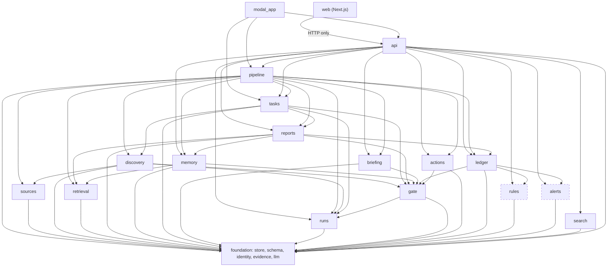
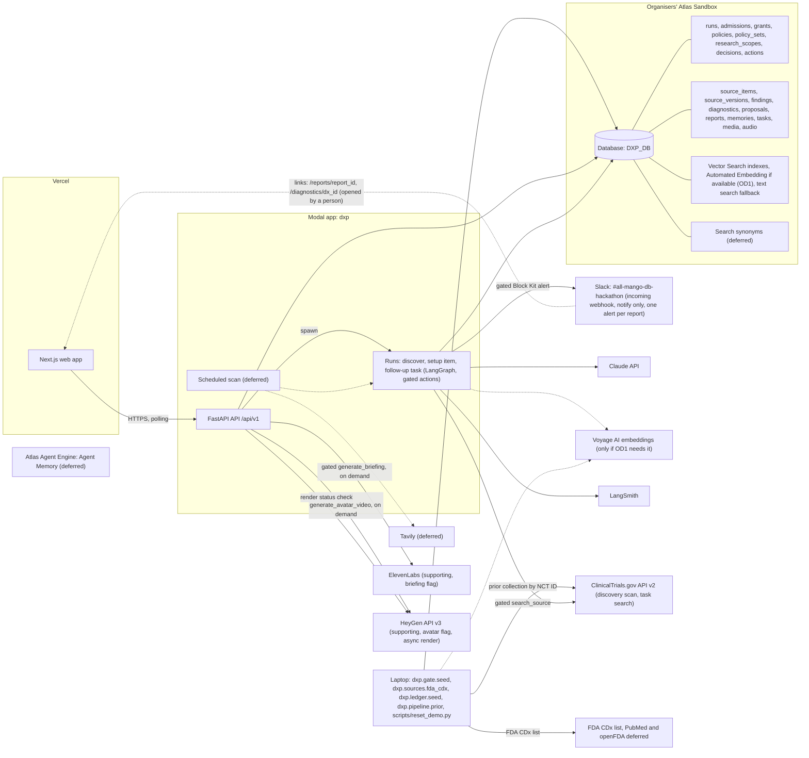
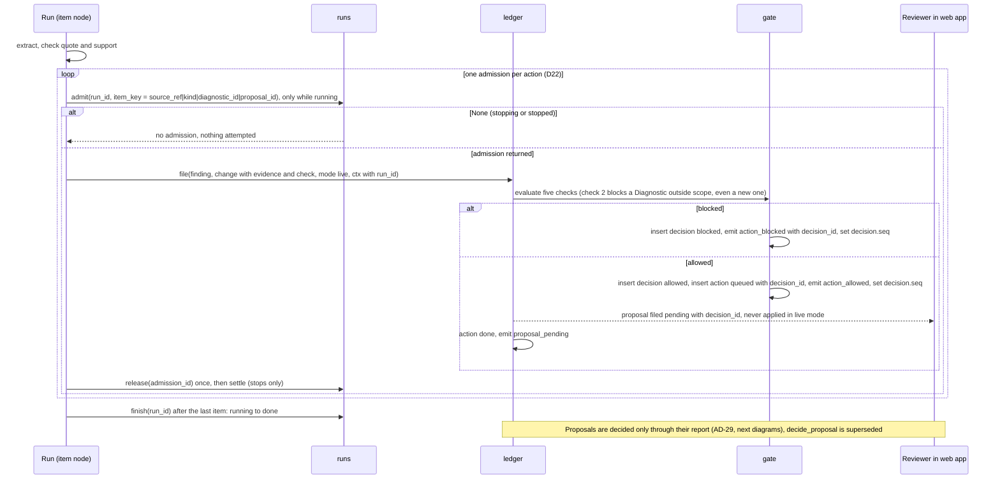
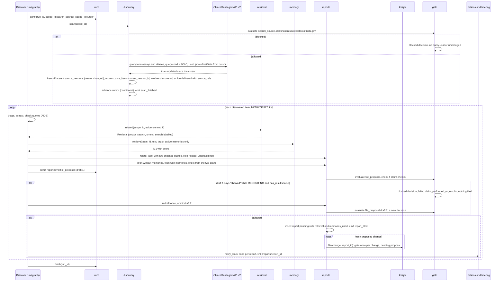
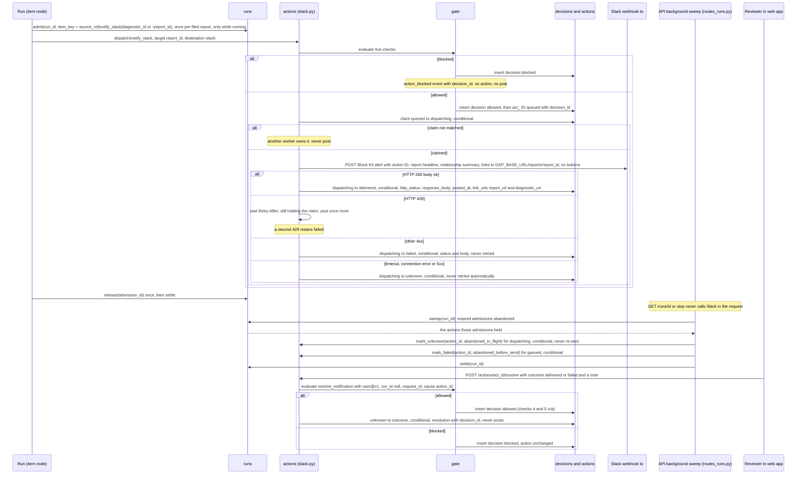
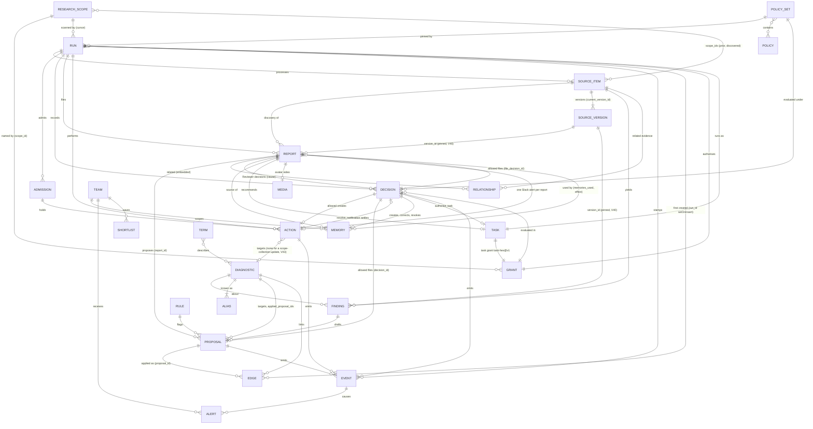

# Architecture Spine — DxProvida (DxP)

Terms follow the PRD Glossary. This is a one-day hackathon build: where a rule trades robustness for speed, speed wins.

**Pivot (13 Nov).** Per the approved sprint change proposal, DxP is built for Statement 1, "Agents You Can Audit". The governed agent is the product: no Record change and no external action without a named identity, a scoped grant, a policy check before the action and a replayable audit (AD-17 to AD-23). Build and validation happen on the organisers' Atlas Sandbox (AD-24). Decisions and routes that serve only deferred features are kept and marked **Deferred (pivot, 13 Nov)**; nobody builds them on Saturday.

**Readiness fixes (14 Nov).** `readiness-fixes-2026-11-14.md` (D1 to D57; D16 to D40 win over D1 to D15, and the final audit's D41 to D57 win in the same way) wins over this spine where they disagree; the ADs below are amended in place to match it.

**Slack replaces GitHub (14 Nov).** `sprint-change-proposal-2026-11-14-slack.md` (S1 to S13) wins over this spine and over the readiness fixes where they mention GitHub, a review issue, `dxp-review-sandbox` or reconciling against GitHub. The one external system is a Slack incoming webhook posting to `#all-mango-db-hackathon`; it only notifies, and approval and rejection happen in DxP. AD-13, AD-14, AD-18, AD-19, AD-20, AD-22 and the structural seed are amended in place to match it.

**Discovery agent (14 Nov).** `sprint-change-proposal-2026-11-14-discovery-agent.md` (V1 to V24, sections 2 to 8) wins over every earlier planning document and over this spine where they disagree; D1 to D57 and S1 to S13 still apply wherever V1 to V24 do not replace them. DxP is a proactive diagnostic-evidence research agent: it discovers new trials within one research scope, relates them to existing evidence through retrieval, remembers reviewer corrections, files a gated pending research report, and proposes one follow-up task that runs under its own grant once a Reviewer approves. Governance (AD-17 to AD-24) supports that loop. The baseline plan is section 7's recommended cuts 1 to 5: I2 folded into the rehearsal's first pass; PRs bundled (A19 with A20, A21 with A22, A23 inside A06, A18 with A14, A07 with A11); A12, A15, B05 and A17 cut; the ElevenLabs briefing (B06) supporting behind the `briefing` flag; the HeyGen avatar video (Story 10.12, B08, Vlad) supporting behind the `avatar` flag (V13, updated 14 Nov); B04 built by two builders. The ADs below are amended in place; AD-25 to AD-30 are new. DxP supports research review and gives no medical advice.

**Review of PR #8 and the registry check (14 Nov).** Sections 10 and 11 of the same proposal (V25 to V37) win over V1 to V24, and V33 to V37 win over V25 to V27; the ADs below are amended in place to match.
- **Framing (V25, V33).** The scope is "Plasma ctDNA genotyping assays in NSCLC", all stages. The demo discovery is a new trial signal worth investigating: "This study investigates molecular profiling using blood (ctDNA) and tumour tissue in early-stage (IA2 to III) lung cancer, to find actionable drivers before surgery. No results posted." No report, alert, briefing, avatar or narration says a trial studies or uses a named assay, or shows any assay's performance. The expected relationship to the prior collection is `extends`, with two checked quotes, or none (AD-26).
- **Mentions and aliases (V34, V37).** The hand-written aliases are removed: only exact FDA trade names after `normalise_name()` resolve (AD-3). An assay name in a trial record is a mention, recorded verbatim, never proof of use; FoundationOne CDx (tissue) and FoundationOne Liquid CDx (plasma cfDNA) are never merged. Unresolved names and the intervention ambiguity are report uncertainties (AD-27).
- **Allowed and blocked (V35, V37).** Allowed: one pending update adding the trial to the scope's evidence collection; no assay record changes (AD-27). Blocked (guaranteed): the agent's proposed link of the record's "FoundationOne CDx" mention to the plasma scope, by check 2 (AD-19).
- **Gap and task (V26, V27, V33).** Every report names one evidence gap; the recommended task answers it; approval accepts the report's own update and authorises the task, whose findings stay pending (AD-27, AD-29).
- **Core cut line (V28).** Core, never cut: discovery, a relationship with quotes, a memory changing the report, a policy block, the Slack notification opening the report, the human decision, the audit trail, stop; the task's authorisation is core but cheap. Slip order for supporting work: B08 (avatar), then B06 (briefing), then the memory correct and revoke screen, then a second discovery item; follow-up task execution (A25) is now stretch, not a supporting cut (V39). A24 (decision, promotion, authorisation) and A25 (task execution) are split again.
- **Media on demand (V29).** "Generate briefing" and "Render avatar" on the report page, gated under `sam@v1`; nothing renders automatically; one avatar render for the demo report only; nothing waits on either; the script is always shown as text (AD-30).
- **Schedule (V30, V31, V36).** I3 is approval, promotion, authorisation and audit (14:45 to 15:00); the rehearsal runs 15:00 to 16:10. That leaves 20 minutes of hard float at the 16:30 freeze, conditional on the merge milestones (the L2 proof at 12:30 and the 13:00 desk decision); the task joins I3 (to 15:15, using 15 of the 20 minutes) only if A25 is merged and the loop is green by 14:30; the base forecast is green at about 14:35, so this is stretch (V39). L1 (only A06 and A08 start at 10:45 as drafts, each with a 20-minute rebase budget; contract changes after 11:45 go through the contract keeper) and L2 (Vlad merges only A05, A13, A14 and A09, once green and passed by the review agent and the contract keeper; proof at 12:30 with A05 and A13) are risks approved by Luis. Fallback if either fails by 13:00: one desk, the V28 cut line at once (A25, which is stretch, plus B06 and B08 out), one rehearsal pass and no float.
- **The anchor (V36).** Verified live at 10:45: whichever in-scope early-stage trial is actually updated after the chosen cursor. NCT04712877 is the expected candidate (AD-25).
- **Longitudinal value (V32).** The cursor and the Team's memories accumulate over time; the demo shows one turn of the loop.

**Review of the branch (14 Nov, V38 to V44).** Section 12 of the same proposal wins over V1 to V37 where they differ; it is approved by Luis (14 Nov). The ADs below are amended in place to match.
- **Approval continues the work (V38).** With `task_run` on (read by the backend from `DXP_FEATURES`; `NEXT_PUBLIC_DXP_FEATURES` only controls display), an approved report's gated `authorise_task` saves the Decision, the task, its grant and the task in status `queued` in one transaction; the task then starts automatically as its own `task:` run with the derived run ID `derive("run_", task_id)`, insert-if-absent. If another run is active it stays `queued` and the run-finish path, the background sweep and the API start hook start it (`tasks.dispatch_next()`). With the flag off the task is authorised, never queued, and the report says "Follow-up task authorised; not run". There is no task start button (AD-29).
- **Task execution is stretch (V39).** A25, Story 10.9 and I3b are stretch; the supporting cut order is B08, B06, the memory correct and revoke screen, then a second discovery item. Nothing claims completed follow-up work unless the task ran in that recording or demo.
- **Source versions (V40).** Immutable `source_versions` plus `source_items.current_version_id`; every record that uses source content pins the exact `version_id`, and advancing the pointer never changes reviewed or accepted evidence (AD-25).
- **The script is core (V41).** `reports.script_for()` (`reports/script.py`, A19+A20) builds the report's text script at filing; B06 and B08 only consume it (AD-30).
- **Capped search wording (V42).** A task with no match answers "No matching results found among the records searched", always with the query, the number of records searched and the limit.
- **No resolved Diagnostic (V43).** Every step handles `diagnostic_id: null` (AD-1, AD-19, AD-20, AD-27); I1 and I3 assert it.
- **Rehearsal source check (V44).** One report and its script are checked against the exact source version they used and, separately, that version against the live record ("changed since the run" is not an error).

**Precedence.** This spine overrides the `dxp-*` skills. The skills are reference documentation only (D1); no skill code is copied or run. They say how to call each technology; where a skill's example disagrees with a rule here, the rule wins. Known differences: review is a MongoDB queue, not a LangGraph `interrupt`; a batch is one graph run with `Send`, not `.map` or `.starmap` across containers; the collection is `proposals`, not `proposed_changes`; IDs are derived strings, not ObjectId; screens poll the API (D40), with no server-sent events and no change-stream feed (A12 cut, 14 Nov); update triggers come from the extraction model, not a vector index; Vector Search is used only for related-evidence and memory retrieval (AD-15), never as evidence; reviewer memory lives in DxP's own Atlas collections, not the Agent Memory preview SDK (AD-28); the database variable is `DXP_DB`; web types are generated from the API, not copied from the front-end skill.

## Design Paradigm

**A scoped discovery scan and pipes-and-filters ingest feeding gated research reports over a policy-gated proposal ledger.** A discovery run scans one source within one research scope (AD-25). Source items flow one way through fixed filters: triage, extract, check, resolve, retrieve related evidence and memories, relate, draft the report, propose. The filters never touch a Record. They end by filing one pending research report and its Proposed changes; the ledger is the only thing that turns a Proposed change into a Record value, and only a Reviewer's report decision promotes them (AD-29). Every ledger write, every report, memory and task write, and every external call (the source scan, Slack, ElevenLabs, HeyGen) passes the policy gate first, inside a run that stamps its identity on everything it writes, or under the Reviewer's grant.

| Layer | Directory under `backend/dxp/` | Writes |
| --- | --- | --- |
| Foundation | `store`, `schema`, `identity`, `evidence`, `llm` | indexes, validators and search indexes only |
| Governance | `runs`, `gate`, `actions` | `runs`, `admissions`, `decisions`, `policy_sets`, `actions`, `events`; `grants`, `policies` and `research_scopes` only through the seed script, except the task grant issued by `gate.grants.issue_task_grant()` for an allowed `authorise_task` (AD-18, AD-29) |
| Discovery and ingest filters | `sources`, `discovery`, `pipeline` | `source_items`, `source_versions` (insert only, V40), `findings`, unmatched `terms`; `research_scopes.cursor` (only `discovery`, AD-25) |
| Retrieval | `retrieval` | the `embedding` field on `source_items`, `findings` and `memories` (only when embeddings are computed by DxP, AD-15) |
| Reports | `reports` | `reports` (the only writer; relationships are embedded, AD-26, AD-27) |
| Memory | `memory` (repurposed: Atlas collections, not the preview SDK) | `memories` (the only writer, AD-28) |
| Tasks | `tasks` | `tasks` (the only writer, AD-29); starts a task's run only through `tasks.dispatch_next()` (V38) |
| Briefing and avatar | `briefing` | `audio` (the cached report briefing) and `media` (the avatar render record), AD-30 |
| Ledger | `ledger` | `aliases`, `diagnostics`, `source_items.collections` (the scope evidence collection, V35), `proposals` (the only writer; `Proposal.notification` is built at read time and never stored, D47), `edges`, `events`, status of ledger `actions` |
| Ledger helpers — **Deferred (pivot, 13 Nov)** | `rules`, `alerts` | `rules`, `check.flags` on pending `proposals`, `alerts`, `events` |
| Read side | `search` | nothing |
| Edge | `api`, and `backend/modal_app.py` | `teams`; `shortlists` deferred |
| Web | `web/` | nothing; it calls the API |

## Invariants & Rules



Imports follow these arrows only. Dashed modules are deferred. `gate`, `runs` and `actions` import nothing from `memory`, `retrieval` or `reports`: a memory can inform a draft but can never reach a grant, a policy or a check (AD-28). `reports` does not import `tasks`; the report decision route (`api/routes_report_decision.py`) calls `reports.decide()`, then `tasks.authorise()` and, when `task_run` is on, `tasks.dispatch_next()`, then `memory.create()` (AD-29). `pipeline` calls only `tasks.run()` (for a `task:` run) and `tasks.dispatch_next()` (after a run ends); `runs` imports nothing from `tasks` (V38). Only `modal_app` imports `api`; nothing imports `modal_app`. The backend imports nothing from `scripts/`. No code from `scripts/data/` or from any `dxp-*` skill is copied into `backend/` or `web/`, and none is run on Saturday; skills are reference documentation, and every line of project code is written during the event (D1). README disclosure of prepared material does not authorise its reuse. Files under `data/` are not loaded unless an organiser clears them in writing: A05 fetches the prior collection from the ClinicalTrials.gov API v2 by NCT ID and builds the discovery scan that finds new trials (AD-25), and A13 fetches the FDA companion diagnostics list, during the event. Memory M1 is created by Sam through the real UI during setup, never seeded from a file (V15).

### AD-1 — The ledger is the only writer of Records [ADOPTED]

- **Binds:** FR-11, FR-15, FR-16, FR-17, FR-29, FR-30, Story 9.3, Story 10.8
- **Prevents:** agents, the review screen and the manual-entry form each writing Record values their own way; parallel writers corrupting a Record; an apply left half done; a live change reaching a Record without a Reviewer.
- **Rule:**
  - Only `ledger` creates a `diagnostics` document and writes its `fields`, `rev`, `search_text`, `facets`, `applied_proposal_ids` and its `edges`. Every value enters through `ledger.file(finding_id, change, mode, ctx)`, called once per admitted change (D46): agent finds, seed values, prior-collection values (AD-25), values on a new Diagnostic and values typed by hand. (The comprehensive Baseline load: deferred.) `ctx` carries the principal, the `run_id` (null only for Reviewer and seed writes, AD-17), the `report_id` when the change belongs to a research report (AD-27) and the AD-17 stamp.
  - `ledger.file()`, `ledger.review_value()` and the decision apply call `gate.evaluate()` (AD-19) before any write, including `ensure_diagnostic()`. Blocked means no write at all.
  - In `live` mode an agent never applies; it only files Proposed changes (D28). Every change, to an existing Diagnostic or to one the run itself created, is filed as a `pending` Proposed change after the gate allows it, and is never applied directly (D8). It is applied only through a Reviewer's report decision (`POST /reports/<report_id>/decision`, kind `decide_report`, AD-29), which is itself gated and applies the report's pending proposals through `ledger.apply()`. The per-proposal decision route is superseded (V8, AD-14). Only `baseline` mode (the seed and the prior collection, both under `seed@v1`) applies at once.
  - `ledger.apply(proposal_id)` lives in `backend/dxp/ledger/apply.py`, owned by A06 (D26), so the seed and I1 do not depend on A14. `reports/decide.py` (A24) and A14's `ledger/review.py` call it. It goes `pending` → `applying` → `applied` (D13, D27):
    1. Claim: `update_one({ _id: p_id, status: "pending" }, { $set: { status: "applying" } })`. No match: do nothing.
    2. Guarded update: one `update_one({ _id: dx_id, applied_proposal_ids: { $ne: p_id } }, ...)` that writes the value entry, pushes `p_id` to `applied_proposal_ids`, increments `rev`, rewrites `search_text` and `facets`. A second run matches nothing, so it is idempotent. **A proposal with `diagnostic_id: null` (the scope evidence collection, AD-27, V43)** takes no Diagnostic path: its guarded update is `update_one({ _id: source_ref, "collections.<scope_id>.proposal_id": { $ne: p_id } }, { $set: { "collections.<scope_id>": { status: accepted, proposal_id, version_id } } })`, it writes no `diagnostics` document, value entry, alias, `search_text` or `facets`, and step 3 upserts no edge.
    3. Upsert the derived edges (AD-13). An edge's `run_id`, `seq` and `proposal_id` are set with `$setOnInsert`, so a later run never takes over an earlier run's edge; only `status` is `$set` (to `applied`).
    4. Emit `value_applied` with `dedupe_key = "value_applied|<p_id>"`, so a repeat emits nothing new (AD-10).
    5. Mark the proposal `applied`.
  - Recovery: `ledger.recover_applying()`, also in `ledger/apply.py`, runs at API start, at the start of every run and on every decision call (D26). A proposal stuck in `applying` reruns step 2 (a no-op if done), then always re-upserts its edges (step 3) and re-emits its event (step 4, deduplicated), whatever the guard returned, then step 5. A report stuck in `accepting` is finished by `reports.recover_accepting()` (AD-29), which the same callers run right after it; `ledger` never imports `reports`.
  - A Proposed change whose canonical value equals a `current` entry of that field is not filed.
  - A value whose check fails (AD-6) is never filed and never applied.

### AD-2 — One value-entry shape, one registry, one canonical form

- **Binds:** FR-5, FR-7, FR-15, FR-17, FR-22
- **Prevents:** a new trial overwriting an earlier one; the backend and web app naming fields differently; one drug or gene appearing as two values, two graph nodes or two Proposed changes.
- **Rule:**
  - `diagnostics.fields.<key>` is always a list of value entries in the shape below. Entries are never deleted.
  - Field keys, labels, cardinality, enums, the stage order and the low-confidence threshold live only in `backend/dxp/schema/registry.py`. The web app reads them from `GET /api/v1/schema`.
  - `value` is always a string in canonical form, produced only by `registry.canonical(field, raw)`. `label` keeps the text as written. Extra detail goes in `detail` and never affects identity.
  - A `single` field has at most one `current` entry. A `list` field adds entries.
  - When values are applied without review (AD-4), a `single` field that already has a `current` entry is not superseded: the new value stays `pending` for a Reviewer. `lifecycle_stage` follows AD-5 instead.
  - An edit or rejection keeps its `reason` on the entry (Story 2.3). Every entry carries the `action_id` and AD-17 `stamp` of the write that made or decided it.

```text
{ value_id, value, label, detail, state: current | superseded | rejected,
  review: unreviewed | accepted | edited | manual,
  evidence: { source_ref, version_id, source, source_url, source_date, quote } | { manual: true, submitter, note },   (version_id: V40)
  check: { quote_found, supported, confidence, flags: [ { rule_id, note } ] },
  proposal_id, action_id, stamp, decided_by, decided_at, reason }
```

| Field | Cardinality | Canonical `value` |
| --- | --- | --- |
| `modality`, `regulatory_status`, `lifecycle_stage` | single | registry enum value |
| `provider` | single | `identity.normalise_name(provider)` |
| `clinical_uses`, `sample_types`, `tumour_stage_or_line` | list | registry enum value |
| `biomarkers` | list | HGNC approved symbol; for a non-gene analyte, a registry enum value |
| `tumour_types` | list | OncoTree code |
| `trials` | list | NCT ID, upper case; linked drugs for that trial go in `detail` |
| `linked_drugs` | list | generic name, lower case, resolved through `terms` |
| `study_results` | list | the supporting sentence with whitespace collapsed |

### AD-3 — Derived identity, insert-if-absent, never auto-merge [ADOPTED]

- **Binds:** FR-3, FR-4, FR-30
- **Prevents:** duplicate Source items, Findings, Proposed changes, Diagnostics, events, actions or Alerts when a batch runs in parallel, is retried by Modal or is run twice; a re-run resetting a decision already made.
- **Rule:**
  - `identity.derive(prefix, *parts)` is the only ID maker: the prefix plus the first 16 hex characters of SHA-256 over the parts joined with `|`.
  - `source_ref` is `<source>:<source_item_id>` using the `source` strings (`clinicaltrials.gov`, `pubmed`, `fda_cdx_list`, `openfda_device_pma`). It is the `_id` of `source_items` and the only way any other document refers to a Source item.
  - Source version ID (V40): `derive("sv_", source_ref, last_update_post_date, content_hash)`, where `content_hash` is the first 16 hex characters of SHA-256 over the normalised `raw_text`. Finding ID: `derive("f_", version_id, diagnostic_id)` (V40; was `source_ref`), so a changed trial yields new Findings and the earlier ones stay. Proposed change ID: `derive("p_", finding_id, field, value)`; seed changes carry their own `p_` IDs the same way, from the Finding of their `fda_cdx_list` row (D20). Decision ID: AD-19. Action ID: AD-20. Admission ID: AD-21. Alert ID (deferred): `derive("alert_", team_id, diagnostic_id, kind, cause)`.
  - **Discovery-agent IDs (14 Nov).** Report ID: `derive("rep_", run_id, source_ref)`, one report per discovered Source item per run. Relationship ID: `derive("rel_", report_id, source_ref, related_ref)`, where `related_ref` is a `source_ref` or a `finding_id`. Memory ID: `derive("mem_", team_id, decision_id)` (the Reviewer decision that created it); each version is stored as `<memory_id>@v<version>`. Task ID: `derive("task_", report_id)`, one task per report; its run ID is `derive("run_", task_id)`, the only derived run ID, so a task can never start two runs (V38); its grant ID is `task-<the 16 hex characters of task_id>`, stored as `task-<hex>@v1`. Scope IDs are hand-written (`scope_` plus a slug) and seeded by A03 (AD-25).
  - **Decision and action IDs never collide (D20).** Both derive from `(run_id or "-", kind, diagnostic_id or "-", target)`, where `target` is, in this order: the `action_id` (for `resolve_notification` only); the `memory_id@v<version>` (`correct_memory`, `revoke_memory`); `"<task_id>|<source_ref>"` (`file_related_evidence`), or the `task_id` (`authorise_task`); `"<report_id>|draft<n>"` (the report-level `file_proposal`, n = 1 or 2, AD-27), or the `report_id` (`decide_report`, `create_memory`, `notify_slack`, `generate_briefing`, `generate_avatar_video`); `"<scope_id>|<cursor>"` (`search_source` in a discovery scan) or `"<task_id>|search"` (`search_source` in a task run); else the `proposal_id`, else the `value_id` (value review), else `"<field>|<value>"`. A Reviewer decision or action adds a server-generated `request_id` as a last part, so a blocked Reviewer decision can be retried and gets a new Decision.
  - Writes of Findings, Proposed changes and actions are insert-if-absent (`$setOnInsert`). A second run never changes a document that exists.
  - `identity.normalise_name(text)` is the only name normaliser: Unicode NFKC, lower case, remove `®`, `™` and `©`, replace each run of non-alphanumeric characters with one space, trim.
  - A Diagnostic is found through `aliases`, whose `_id` is the normalised name. Its ID is `derive("dx_", id_alias)`. `ledger.ensure_diagnostic()` upserts the alias and the Diagnostic with `created_run_id` and `created_mode`; a duplicate-key error (`pymongo.errors.DuplicateKeyError`) means it exists, so read it.
  - **ID alias and row ID (D31).** For a seeded Diagnostic, the ID alias is `normalise_name()` of the FDA list's trade-name column, and the row ID (`source_item_id`, so `source_ref = fda_cdx_list:<row ID>`) is `<PMA or 510(k) number>:<first 8 hex characters of sha1 of the normalised row>`, because one number covers many drug rows (D45). Trade names are kept as the exact strings of the FDA list (for example "Guardant360® Liquid CDx"); `normalise_name()` removes "®" and folds case, so the ID alias has neither. For a Diagnostic a run creates, the ID alias is `normalise_name()` of the extracted assay name.
  - A Finding that names no assay uses the alias `approach:<modality>:<biomarker>`, with registry values, taking the first biomarker in alphabetical order or `any`.
  - Seed Diagnostics come from the FDA list of cleared or approved companion diagnostics, fetched during the event (A13, lung rows only, D1) into `source_items` with source `fda_cdx_list`. Every device and trade name string in a row passes through `normalise_name` as an alias. `data/fda/` is not read.
  - **No hand-written aliases (V34, replacing D31).** The aliases "FoundationOne Liquid", "Guardant360" and "FoundationOne" are removed. Only an exact FDA trade-name match, after `normalise_name()`, resolves to a seeded Diagnostic.
  - **Extraction matches exact seeded names only (V34).** A08 passes the seeded names into the extraction prompt; the extracted assay name must be one of those exact names or `unresolved`, kept exactly as the source writes it. An unresolved name creates no Diagnostic and is never mapped to an approved product; the report lists it under uncertainties (AD-27).
  - **A name in a record is a mention (V37).** A name found in a trial record (for example in an intervention's `otherNames`) is recorded verbatim as a mention, never as evidence that the trial used that product. A mention that resolves by exact name to a seeded Diagnostic may be proposed as a link, which the gate judges like any other (AD-19 check 2). FoundationOne CDx (tissue) and FoundationOne Liquid CDx (plasma cfDNA) are separate Diagnostics and are never merged.
  - Nothing merges two Diagnostics automatically.
  - The `raw_text` of a Source item that has Evidence pointing at it is never overwritten. Since V40 no source content is overwritten at all: a changed trial gets a new immutable `source_versions` document and `source_items.current_version_id` moves (AD-25).

### AD-4 — Two ingest modes decide what is applied and what alerts

- **Binds:** FR-12, FR-13, FR-16, FR-30
- **Prevents:** the Baseline load flooding Teams with Alerts; live changes reaching a Record without a Reviewer; the two developers reading "new Diagnostic" differently.
- **Rule:** Every run, Proposed change and event carries `mode`.
  - `baseline`: the ledger applies each filed change at once (through `ledger.apply()`) with `review: unreviewed`. On Saturday only the FDA seed and the prior collection (AD-25, V2) use it, both from the command line under the seed grant (AD-18); their values are accepted knowledge, the evidence a discovery is related to. The comprehensive Baseline load is deferred.
  - `live`: an agent never applies (D28). Every change, including one to a Diagnostic the run itself created, is filed as a `pending` Proposed change after the gate allows it, and is applied only through a Reviewer decision (AD-1, D8). Creating a Diagnostic outside the grant's scope is blocked by check 2 (AD-19).
  - A Proposed change has `status` in `pending | applying | applied | rejected` (AD-1). In `live` mode every Proposed change belongs to one research report (`report_id`, AD-27); the Reviewer works from the pending-reports list, a query on `reports`, and a report's decision decides all of its proposals together (AD-29).
  - A Reviewer accepts, edits or rejects an `unreviewed` value through `ledger.review_value()` (action kind `review_value`, gated with the Reviewer grant, D16), which sets `review` or `state` on that entry. On Saturday only seed values are `unreviewed`.
  - Values with `confidence` below the registry threshold are applied or queued as above and listed first in the Reviewer queue.
  - `dry_run` (Story 2.1, writes nothing): **Deferred (pivot, 13 Nov)**.

### AD-5 — Lifecycle stage is a registry field, ordered by the ledger

- **Binds:** FR-2, FR-11, FR-12
- **Prevents:** stage being judged two ways; stage moving backwards when items are processed in parallel; the Early research label being computed in two places.
- **Rule:** Extraction gives each Finding at most one `stage_evidence { stage, quote }`, filed as a change to `lifecycle_stage`. `ledger.apply()` enforces the order: its update only matches when the stored stage is earlier than the new one. Rows from the FDA list file `regulatory_approval` by rule, without a model call. `registry.is_early_research(stage)` is the only test for the label; it is true for `discovery` and `assay_development`, and the label is never stored. A Diagnostic with no stage evidence has stage `not_determined`.

### AD-6 — One Evidence check before filing, one gate on the read side

- **Binds:** FR-7, FR-8, FR-18, FR-22, FR-25, FR-29
- **Prevents:** screens disagreeing about which values may be shown; unsupported values replacing good ones; PubMed text leaving the backend.
- **Rule:**
  - `evidence.quote_in_source(quote, raw_text)` is the only quote check. It runs against the `raw_text` of the exact source version the quote is drawn from (`source_versions`, V40), never the current pointer.
  - The pipeline's check filter sets `quote_found`, `supported` and `confidence`. A value passes when `quote_found` and `supported` are both true. A value that does not pass is recorded on its Finding and goes no further. The policy gate's evidence check (AD-19) reads this same `check`; it never re-judges.
  - Every endpoint that returns Record data builds it with `search.readmodel`. The read model shows only entries that passed or are `manual`, adds the no-data state for an empty field, attaches the source name and its data date, and passes `synthetic` through. The web app applies no display rule of its own.
  - A hand-typed value has `evidence.manual` and `review: manual`, and is shown marked as manually sourced.
  - **Reports (14 Nov).** Every quote in a research report (the discovery's supporting quotes, both quotes of each relationship, AD-26) passes through `evidence.quote_in_source()` against the `raw_text` of the source version it names (`version_id`, V40). A similarity score is never a substitute for a quote. A report claim is also checked against the source's own structured fields (status, `has_results`) by the gate's claim checks (AD-19 check 4, V7); the read model shows a report's checked quotes only.
  - PubMed `raw_text` is stored only in `source_items`. It is never returned by the API, written to a file in the repository, sent in a trace that is shared, or put in a Slack message. A quote is at most 300 characters.

### AD-7 — One Learned rule mechanism, owned by DxP — **Deferred (pivot, 13 Nov)**

- **Binds:** FR-19
- **Prevents:** three mechanisms built by different hands; a rule that cannot be switched off; flags with no owner.
- **Rule:** A Learned rule is one document in `rules`: `{ field, text, status: draft | active | off, from_proposal_id, synthetic }`. Rules apply to every Team. A rejection or edit must carry a reason. `rules.draft()` asks the model for a plain-language rule; a Reviewer's confirmation sets it `active`. `rules.evaluate(field, value, quote)` is the only place a rule is applied: in the pipeline's check filter, and over every `pending` Proposed change for that field when a rule's status changes. Only `rules` writes `check.flags`, and only on `pending` Proposed changes. A rule adds or removes flags; it never rejects or withdraws. Setting a rule `off` removes its flags. `rules` is the source of truth. Agent Memory receives one copy when a rule first becomes `active`. The rejection-to-policy draft (Story 9.11, A17) is **cut (14 Nov)**; policies stay hand-written (NFR15). Reviewer memories (AD-28) are not Learned rules: they inform a draft and never flag, block or change a permission.

### AD-8 — Memory sits behind one adapter; app state stays in DxP collections — **Deferred (pivot, 13 Nov); superseded in part by AD-28 (14 Nov)**

**Status (14 Nov, V6, V18).** The Agent Memory preview SDK, `DXP_MEMORY_BACKEND`, the episode, resume and glossary interface below and synonyms stay **deferred**. `backend/dxp/memory` is repurposed for reviewer memory in DxP's own Atlas collection `memories` (AD-28); it imports no preview SDK. The bullets below describe the deferred design only.

- **Binds:** FR-9, FR-19, FR-28
- **Prevents:** the preview SDK leaking into every module; the app depending on a memory search for facts it must read exactly; developers' test memories mixing with production.
- **Rule:**
  - Only `backend/dxp/memory` imports the Agent Memory SDK. Its interface is `remember_episode(team_id, session_id, kind, text)`, `recall(team_id, query) -> list[str]`, `save_rule(rule_id, field, text)` and `glossary(term) -> list[str]`.
  - Two backends, chosen by `DXP_MEMORY_BACKEND`: `agent_engine` and `collections`.
  - The memory user ID is `<DXP_DB>:<team_id>`. Rule copies use `<DXP_DB>:reviewers`.
  - Facts the app must read exactly live in DxP collections: `teams` (profile, `last_seen_seq`, `last_seen_at`, last Intended use), `shortlists`, `rules`, `terms`. "What changed since last visit" is a query on `events` after `last_seen_seq`.
  - Memory holds what a Team asked, opened and dismissed, and supplies the resume summary and agent context. Text recalled from a synthetic episode is labelled synthetic. Synthetic episodes are written with a `session_id` that starts `synthetic_`, and `recall` prefixes their text with `[synthetic] `.
  - Synonyms are owned by `search.terms`, reading `terms`. A curated link, such as liquid biopsy to ctDNA, carries `curated: true`. A term the pipeline cannot match is written to `terms` with `status: unmatched` for the Reviewer. Every `terms` document is a valid synonym document, `{ mappingType: "equivalent", synonyms: [...] }` plus DxP's own fields; an unmatched term is stored as `synonyms: [<term>]`. One invalid document stops the MongoDB Search index from building.
  - Agent Memory preview availability on the Atlas Sandbox is unconfirmed (AD-24).

### AD-9 — The web app talks to the API only; long work is a job [ADOPTED]

- **Binds:** FR-1, FR-4, FR-21, FR-27
- **Prevents:** a second data path from Next.js to MongoDB, to a model or to Slack; requests that die at Modal's 150-second cap.
- **Rule:** The web app's only backend is `NEXT_PUBLIC_API_URL` + `/api/v1`. No Next.js code opens a MongoDB connection, calls a model or posts to Slack. Anything that can run longer than 30 seconds is a run (AD-16, AD-17). The one long request is the 25-second long-poll in AD-10 and AD-23.

### AD-10 — One outbox feeds live updates and "what changed"

- **Binds:** FR-12, FR-13, FR-14, FR-27, FR-28, Stories 9.6, 9.7, 9.9
- **Prevents:** the action feed, the audit, the Graph view highlight and the resume summary each tracking change separately; events lost between polls; Alerts raised twice or not at all.
- **Rule:**
  - `store.emit_event()` is the only writer of `events`. The event `_id` is `seq`, the next integer, assigned by inserting and retrying on a duplicate key, so a higher `seq` is never visible before a lower one. Each event has a unique `dedupe_key`, so a retry emits nothing new and returns the stored event's `seq`. Every event carries the AD-17 `stamp`.
  - Event `type` is one of `diagnostic_created`, `value_applied`, `proposal_pending`, `proposal_rejected`, `run_status_changed`, `action_allowed`, `action_blocked`, `action_status_changed`, and (14 Nov) `scan_finished` (with the cursor before and after), `report_filed`, `report_decided` (`accepted` or `rejected`), `memory_changed` (`created`, `corrected` or `revoked`), `task_status_changed`, `related_evidence_filed`; `rule_status_changed` and `alert_created` are deferred.
  - `GET /api/v1/changes?after=<seq>` (A12) is **cut (14 Nov)**: screens poll the resource routes (D40), and the events stay the audit's ordering source (AD-22). Change streams are not used (OD5).
  - **Deferred (pivot, 13 Nov):** `alerts.react()` runs once at the end of each `ledger` call, when `mode` is `live`. A Team matches a Diagnostic when its profile overlaps the Diagnostic's `facets` on modality, biomarker or linked drug. Tumour type alone is not a match.
  - **Deferred (pivot, 13 Nov):** First Alert: the Diagnostic's `created_mode` is `live`, the Team matches, and no first Alert exists for that pair. Diagnostics from the Baseline load never get a first Alert.
  - **Deferred (pivot, 13 Nov):** Update Alert: an applied change carries a trigger and the Team matches. Triggers are `stage_advance`, `line_of_therapy`, `used_in_trial` and `standard_of_care`. The ledger sets `stage_advance` when it applies a `lifecycle_stage` change. The extraction model sets the other three per Finding.

### AD-11 — All model calls go through one module

- **Binds:** FR-4, FR-5, FR-13, FR-18, FR-19, FR-21, Story 9.1
- **Prevents:** separate code paths together exceeding the rate limit, or using different clients and output methods; a run that cannot say which model and prompt produced an action.
- **Rule:** Only `backend/dxp/llm` calls Claude, through `langchain-anthropic` and nothing else. It holds the model IDs, retry and refusal handling, and returns parsed objects from the Pydantic models in `schema`. Structured output uses the JSON-schema method; no sampling parameters are sent. Every call is async. An ingest run may hold 16 calls at once; all other callers share 4. Triage uses the fast model; extraction, checking, relationship classification, report drafting (including the redraft after a blocked claim) and briefing scripts use the stronger model; rule drafting and query parsing are deferred. `llm` exposes `MODEL_IDS` and `PROMPT_VERSION`; the run reads them into its identity at start (AD-17). `llm` calls Claude only; embeddings are computed by Atlas Automated Embedding or by `retrieval` (AD-15), never by `llm`.

### AD-12 — One graph run per job, fan-out inside it [ADOPTED]

- **Binds:** FR-1, FR-4, Stories 10.1 to 10.4, 10.9
- **Prevents:** one trace per item exhausting the LangSmith allowance; one failed item discarding the batch; review state split between LangGraph and MongoDB.
- **Rule:** A run is one LangGraph run in one Modal container, fanning out over Source items with `Send` and `max_concurrency` at most 16. A run's `set` (AD-16) picks its graph:
  - `discover` (Saturday's on-camera run): first node is `discovery.scan(scope_id)` (AD-25), one admitted, gated `search_source` action; its result is the discovered Source items, ordered by `last_update_posted` descending. Then, per item: triage, extract, check (AD-6), retrieve related evidence (AD-15) and active memories (AD-28), classify relationships (AD-26), draft the report, file it through the gate with the claim checks (AD-27, AD-19 check 4; one redraft after a block), file its Proposed changes (`ledger.file`, once per change, D46), then one `notify_slack` per filed report (V11). The run never generates a briefing or an avatar video; both are requested on demand from the report page (AD-30, V29).
  - `nct:<NCT ID>`: the same per-item graph over one Source item fetched by NCT ID, with no scan; used only in setup to produce the report on NCT05715229 that Sam corrects into M1 (V15).
  - `task:<task_id>`: the follow-up task graph (AD-29; A25, stretch, V39; started only by `tasks.dispatch_next()`, V38): one `search_source`, then one `file_related_evidence` per result, up to the task's limit.
  - With `DXP_DEMO_PACE` set, the run processes one item at a time and waits a few seconds per item, so the first discovered item is NCT04712877 (OD2) and a stop on a second run lands mid-run (V16). Each item node catches its own exceptions and returns a failure result. After extraction and before the gate, each item node admits every action through `runs.admit(run_id, item_key)`, one admission per action (AD-21, D22); `None` ends that step with no action, and the admission is released once in a `finally`. After the last item the pipeline calls `runs.finish(run_id)`; an error it cannot recover from marks the run `failed` (D23). Human review is not a graph node. The scheduled scan (deferred) and a manual start call the same run function.

### AD-13 — Graph node IDs and edges are derived by the ledger

**Status (14 Nov, section 7 cut 3).** The ledger still writes `edges` exactly as below (AD-1 step 3), so the derivation stays fixed. `GET /graph` (A15) and the run impact view (B05) are **cut**: the report shows its relationships as a list (AD-26). The read-time `changed` and `context` rules below apply only if the graph is revived after the event.

- **Binds:** FR-26, FR-27, FR-43, Story 5.1
- **Prevents:** the backend and the Graph view inventing different node IDs; links lost when two changes land together; the impact view showing more or less than the run touched, or attributing context to the run.
- **Rule:** A node ID is `<type>:<value>`, with type in `diagnostic | biomarker | trial | drug | provider | tumour | notification` and the canonical `value` from AD-2. An edge is `{ _id: derive("e_", from, to, kind), from, to, kind, seq, run_id, proposal_id, status: applied }`, upserted by `ledger.apply()` (AD-1 step 3) with `run_id`, `seq` and `proposal_id` in `$setOnInsert`, so a later run never takes over an earlier run's edge (D27); an edge is removed only when the `single` value that produced it is superseded. `GET /api/v1/graph` returns nodes and links built from `edges`. With `?run_id=` it returns two kinds of element (D12):
  - **Changed:** only what the run itself created or changed: its value entries, Proposed changes and edges (each carrying that `run_id`), the touched Diagnostics, and one `notification:<action_id>` node per `notify_slack` action of the run, linked to its Diagnostic with kind `notification` and carrying the action's status. Each is `changed: true` with its `run_id`. A pending Proposed change of the run is a link with `status: pending` and its `proposal_id`, built at read time from `proposals`; an applied one comes from `edges` with `status: applied` (D29). Notification nodes and links are built at read time from `actions`, never stored in `edges`.
  - **Context:** a touched Diagnostic's other neighbours, returned only with `&context=true` ("Show context"), each `context: true`, `changed: false`, `run_id: null`. Context is never attributed to the run.
  - The web app does not derive links.

### AD-14 — The API contract is written once and types are generated

- **Binds:** all web-facing FRs, Stories 9.1 to 9.11, 10.1 to 10.12
- **Prevents:** the web app and the backend each guessing routes and shapes; authority taken from a request body.
- **Contract additions (14 Nov).** A01 adds the `Scope`, `Report`, `Relationship`, `Retrieval`, `MemoryUse`, `Memory`, `Task`, `Media` and (V40) `SourceVersion` shapes and the routes below. The action kinds are now: machine `search_source`, `file_proposal`, `file_related_evidence`, `notify_slack` (agent and task grants) and `apply_value` (seed); human `decide_report`, `authorise_task`, `create_memory`, `correct_memory`, `revoke_memory`, `review_value`, `resolve_notification`, and the on-demand external kinds `generate_briefing` and `generate_avatar_video` (Reviewer, V29); `decide_proposal` is superseded by `decide_report` (V8).
- **Rule:** This table is the single reference for routes and shapes, including every earlier Departure from `epics.md`. Response models are Pydantic classes in `backend/dxp/api/models.py`, matching the shapes below. `web/lib/types.ts` is generated from the API's `/openapi.json` with `openapi-typescript` and is never edited by hand. The web app calls the API only through `web/lib/api.ts`. Every request carries `X-DxP-Key`, which the web app sends from server-side code only; the API resolves the calling principal from it (AD-18). A run's authority comes from the grant named in `POST /runs` and checked against the caller (AD-17). A body field `actor`, where a deferred route still has one, is display text and never read for authority. Every route has exactly one status, here and nowhere else (D40): core, supporting, stretch, deferred or superseded. Routes marked deferred are not built on Saturday; no core screen depends on a supporting route (D37).

| Route under `/api/v1` | Returns | Status (owner) |
| --- | --- | --- |
| `GET /schema` | registry: fields, enums, stage order | core (A01, the only route A01 finishes) |
| `GET /whoami` | `Principal { id, name, kind, actions }`, resolved from the key; `actions` are those of the caller's current grant. B02 and B03 show Resolve only when `actions` includes `resolve_notification` (D53) | core (A03) |
| `POST /runs` `{ grant_id, set }` | `Run`; `set` is `discover` (agent grant, AD-25) or `nct:<NCT ID>` (setup only); 401 only for an unknown key, 403 grant's latest version not active or expired, caller not in `startable_by`, or any `task:` set (no run: task runs start only through `tasks.dispatch_next()`, V38), 409 if one is `running` or `stopping`. No `team_id`: the grant defines the Team (D18) | core (A07 with A11) |
| `GET /runs`, `GET /runs/<run_id>` | `Run`; never calls Slack: starts the AD-21 sweep in the background and returns current state, `dispatching` actions the sweep is settling shown `reconciling` (D24) | core (A07 with A11) |
| `POST /runs/<run_id>/stop` | `Run`, `stopping` or `stopped`; starts the sweep in the background like `GET` | core (A07 with A11) |
| `GET /runs/<run_id>/audit` | `Audit`, with the V14 additions (AD-22) | core (A07 with A11) |
| `GET /runs/<run_id>/audit/audio` | audio of the audit summary | superseded (9.10 replaced by the report briefing, V12) |
| `GET /actions?run_id=&status=` | `{ items: Action[], next }` | core (A07 with A11) |
| `GET /actions/<action_id>` | `Action` with `authorised_by`: status and result | core (A07 with A11) |
| `GET /decisions/<decision_id>` | `Decision` with `authorised_by`: audit detail for any entry, allowed or blocked | core (A07 with A11) |
| `GET /scopes`, `GET /scopes/<scope_id>` | `Scope`, with its cursor | core (A05) |
| `GET /reports?status=&run_id=` | `{ items: Report[], next }`; the pending-reports list polls `?status=pending` (D40) | core (A19 with A20) |
| `GET /reports/<report_id>` | `Report`, whatever its status; 404 for an unknown ID. The Slack "Review in DxP" link opens its page (V10, V11) | core (A19 with A20) |
| `POST /reports/<report_id>/decision` `{ action: approve or reject, note, correction }` | `{ report, decisions: Decision[], task: Task or null, memory: Memory or null }`; Reviewer only. `approve` is gated as `decide_report`, then `authorise_task`; `reject` (note required) or `approve` with a `correction` is gated as `create_memory`. Each gate evaluation is its own Decision (`run_id: null`, server-generated `request_id`, `cause: { report_id, origin_run_id }`). A report not `pending` returns it unchanged with its existing decisions, task and run, completing only a missing step (AD-29, V38). With `task_run` on (backend `DXP_FEATURES`) the task is saved `queued` and starts automatically; there is no button (V38). After an approval the response states "Approved: 1 update accepted. Follow-up task authorised; its findings will be pending review." with the flag on, or "Approved: 1 update accepted. Follow-up task authorised; not run." with it off (V27, V38) | core (A24) |
| `POST /reports/<report_id>/briefing` | `{ briefing, decision: Decision }`; Reviewer only, "Generate briefing" on the report page, gated as `generate_briefing` under `sam@v1` (V29) | supporting (10.11, B06), `briefing` flag |
| `GET /reports/<report_id>/briefing` | audio (the cached briefing); 404 while none exists | supporting (10.11, B06), `briefing` flag |
| `POST /reports/<report_id>/avatar` | `{ media: Media, decision: Decision }`; Reviewer only, "Render avatar" on the report page, gated as `generate_avatar_video` under `sam@v1`; returns at once (V29) | supporting (10.12, B08), `avatar` flag |
| `GET /reports/<report_id>/avatar` | `Media { status: rendering, ready or unavailable, video_url }`; checks a `rendering` video's status with HeyGen in the background and returns current state, never waits (AD-30) | supporting (10.12, B08), `avatar` flag |
| `GET /memories?team_id=&status=`, `GET /memories/<memory_id>` | `Memory`, latest version, with `?version=` for an earlier one | core (A21 with A22) |
| `POST /memories/<memory_id>/correct` `{ text, note }`, `POST /memories/<memory_id>/revoke` `{ note }` | `{ memory: Memory, decision: Decision }`; Reviewer only, gated as `correct_memory` or `revoke_memory`; `note` required before the gate | supporting (10.6, A21 with A22); third in the slip order, after B08 and B06 |
| `GET /tasks?report_id=`, `GET /tasks/<task_id>` | `Task`, with its run ID and status (`authorised`, `queued`, `running`, `done`, `failed`, `blocked`, `stopped`) | core (A24); running the task is A25, stretch (V39) |
| `POST /actions/<action_id>/resolve` `{ outcome: delivered or failed, note }` | `{ action: Action, decision: Decision }`; Reviewer only, action kind `resolve_notification`, gated with the Reviewer's grant; settles an `unknown` notification after the Reviewer checks `#all-mango-db-hackathon` for the action ID; never posts (AD-20) | core (A09) |
| `GET /grants`, `GET /grants/<grant_id>` | `Grant`, latest version; `?version=` for an earlier one. The web app lists the grants whose `startable_by` includes the caller, each labelled with its Team; there is no separate Team picker (D18) | core (A03) |
| `GET /policies?status=` | `{ items: Policy[], policy_set_version }` | core (A03) |
| `POST /policies/<policy_id>/approve` `{ version }` | `Policy`; person principal only | cut (9.11, A17; 14 Nov) |
| `POST /jobs`, `GET /jobs`, `GET /jobs/<job_id>` | superseded by `/runs`; not built | superseded |
| `GET /teams` | `{ items: Team[] }` | core (A13) |
| `GET /teams/<team_id>` | `Team`; resume summary deferred | deferred (6.3), built only if a screen needs it |
| `POST /teams/<team_id>/seen` `{ seq }` | `Team`, sets `last_seen_seq` and `last_seen_at` | deferred (5.1) |
| `GET /diagnostics?<facet>=&q=` | `{ items: Record[], next }` | deferred (D40: no Diagnostics list; the "Accepted knowledge" view is reached from the report, the Slack "Open diagnostic" link and Audit links) |
| `GET /diagnostics/<dx_id>` | `Record`, accepted knowledge only by default, all entries with history; the "Accepted knowledge" view (V10) | core (A14 with A18) |
| `POST /diagnostics/<dx_id>/values` `{ field, value, note }` | `Proposal` | deferred (4.7) |
| `POST /diagnostics/<dx_id>/values/<value_id>/review` `{ action: accept, edit or reject, value, reason }` | `{ record: Record, decision: Decision }`; action kind `review_value`, gated with the Reviewer's grant; `edit` and `reject` need a `reason` (D16) | core (A14 with A18) |
| `POST /query` `{ text, filters, team_id }` | `{ parsed, columns, rows: Record[] }` | deferred (4.2) |
| `GET /proposals?status=&field=&diagnostic_id=&run_id=&report_id=` | `{ items: Proposal[], next }`; the report page lists its proposals with `?report_id=` | core (A14 with A18) |
| `GET /proposals/<p_id>` | `Proposal`, one proposal whatever its status; 404 for an unknown ID (D42) | core (A14 with A18) |
| `POST /proposals/<p_id>/decision` `{ action: accept, edit or reject, value, reason }` | `{ proposal, decision, rule_draft }`; action kind `decide_proposal` | superseded (V8): proposals are decided through their report, `POST /reports/<report_id>/decision`; not built |
| `GET /rules`, `POST /rules/<rule_id>/status` `{ status }` | `Rule` | deferred (2.6) |
| `GET /alerts?team_id=`, `POST /alerts/<alert_id>/dismiss` | `Alert` | deferred (3.1) |
| `GET /alerts/<alert_id>/audio` | audio | deferred (3.4) |
| `GET /changes?after=<seq>&run_id=` | `{ events: Event[], last_seq }`; the Run console polls `GET /runs/<run_id>` and `GET /runs/<run_id>/audit` instead (D40) | cut (9.9, A12; 14 Nov) |
| `GET /graph?run_id=&context=` | `{ nodes: Node[], links: Link[] }`; changed elements only unless `context=true` (AD-13) | cut (5.1, A15; 14 Nov); the report's relationship list replaces it |
| `GET /graph` with `after`, `focus`, `depth` or `team_id` | as above | deferred (5.1, 6.4) |
| `GET /digest?team_id=` | `{ pending: Proposal[], alerts: Alert[] }` | deferred (3.3) |
| `GET /terms?status=unmatched` | `{ items: Term[] }` | deferred (4.8) |
| `POST /shortlists` `{ team_id, intended_use, query, diagnostic_ids }`, `GET /shortlists?team_id=` | `Shortlist` | deferred (4.4) |

Audio routes are the only non-JSON responses. A route marked cut is not built and nothing depends on it.

```text
Stamp      { kind: run | reviewer | seed, run_id, agent, initiated_by, principal, acting_for,
             grant_id, grant_version, model, prompt_version, policy_set_version }
             run: run_id set, principal = agent; reviewer: run_id null, principal = Reviewer,
             agent null, initiated_by = Reviewer; seed: { kind: seed, principal: seed, run_id: null } only (D19)
Principal  { id, name, kind: agent | person | seed, actions }      from GET /whoami; actions = the caller's current grant's actions (D53)
Run        { id, agent, initiated_by, model, prompt_version, policy_set_version, acting_for,
             grant_id, grant_version (pinned at start), team_id (from the grant), mode, source, set,
             kind: discover | items | task (from set), scope_id, task_id (task runs only; their id is derive("run_", task_id), V38),
             scan: { cursor_from, cursor_to, query, source_refs } | null   (discover runs, AD-25)
             status: running | stopping | stopped | done | failed, in_flight (count of admitted admissions),
               done: runs.finish after the last item; stopped: runs.settle after a stop;
               failed: only an error the pipeline cannot recover from (D23)
             counts: { total, done, failed, filed, reports, allowed, blocked, unknown, not_admitted, early_research },
             active: [ { source_ref, step } ], failures: [ { source_ref, error } ],
             started_at, stopping_at, stopped_at, finished_at }
Grant      { id, grant_id, version, principal (the agent, person or seed it authorises), kind: agent | person | seed,
             acting_for, granted_by, startable_by: [principal ids], team_id, team_name,
             scope: { diagnostic_ids, scope_id } | { all: true } (seed only, D16),
             destinations, actions, limits: { max_results } | null (task grants), task_id | null,
             expires_at, status: active | revoked | expired, created_at }
Scope      { id (scope_id), name, team_id, assays: [the four exact D45 strings], aliases, condition,
             source: clinicaltrials.gov, cursor: { last_update_post_date, set_at, set_by_run_id } }   (AD-25)
Policy     { id, policy_id, version, status: draft | active | retired, applies_to,
             requires: { quote_found, supported, min_confidence }, text, author, approved_by, created_at }
PolicySet  { id (policy_set_version), members: ["<policy_id>@v<n>"], created_at }
Admission  { id, run_id, item_key, status: admitted | released | abandoned, admitted_at, expires_at, released_at }
Decision   { id (decision_id), run_id, agent, initiated_by, stamp,
             cause: { proposal_id | report_id | memory_id | action_id, origin_run_id } | null,
             request_id (Reviewer decisions only, server-generated, D20),
             kind, inputs, evidence_ref: { source_ref, version_id, finding_id, proposal_id, report_id, quote, check },   (version_id pinned, V40)
             destination, target: { diagnostic_id (null for a scope-collection update, V43), proposal_id, value_id, report_id, memory_id, task_id, scope_id },
             claims: [ { claim_kind, text, passed, detail } ]   (check 4 claim checks, AD-19; empty when n/a)
             retrieval: Retrieval | null, memories_used: MemoryUse[]   (report-level file_proposal only, V14)
             checks: [ { check, passed | n/a, detail } ], failed_check,
             grant_id, grant_version (evaluated), run_grant_version (pinned), policy_set_version,
             outcome: allowed | blocked, action_id | null, seq, decided_at, authorised_by }
             run: agent = run.agent, initiated_by = run.initiated_by; Reviewer: agent null,
             initiated_by = Reviewer; seed: agent "seed", initiated_by "seed" (D19).
             seq = the seq of its action_allowed or action_blocked event (D21)
Action     { id, decision_id, admission_id, run_id, kind, destination, target (as Decision.target),
             inputs, evidence_ref, stamp, error (abandoned_before_send | abandoned_in_flight | null),
             status: external kinds (notify_slack, search_source, generate_briefing, generate_avatar_video):
                       queued | dispatching | delivered | failed | unknown;
                     DxP kinds (file_proposal, file_related_evidence, apply_value and the Reviewer kinds): queued | done | failed,
               reconciling: returned in place of dispatching while the background sweep settles it; never stored (D24)
             result: { http_status, response_body, posted_at, link_urls: { report_url, diagnostic_url } } (notify_slack; http_status and
                       response_body null when no response arrived)
                     | { http_status, cursor_from, cursor_to, source_refs, count } (search_source)
                     | { audio_id } (generate_briefing) | { media_id, provider_video_id } (generate_avatar_video, render accepted)
                     | { proposal_ids, value_ids, report_id, memory_id, task_id } | null,
             resolution: { outcome: delivered | failed, note, decision_id, by, at } | null   (AD-20 manual resolution)
             proposed_at, decided_at (queued), claimed_at, observed_at, authorised_by }
AuditEntry { seq, decision_id, outcome: allowed | blocked, failed_check, checks, kind, destination,
             inputs, evidence_ref, stamp, cause, grant_id, grant_version, policy_set_version,
             action_id, status, result, resolution, decided_at, claimed_at, observed_at, authorised_by,
             proposal_review: { status: pending | applying | applied | rejected, decided_by, decided_at } | null,
             report_id, task_id, memory_id, claims,
             scan: { cursor_from, cursor_to, source_refs } | null          (search_source entries)
             retrieval: Retrieval | null, memories_used: MemoryUse[],     (report entries)
             relationships: Relationship[],                                (report entries: labels and both quotes)
             report_review: { status: pending | accepting | accepted | rejected, decided_by, decided_at } | null }
             proposal_review and report_review are read live from proposals and reports at request time (AD-22)
Audit      { run: Run, policies: Policy[], sources: [ { source_ref, window, source_date } ],
             entries: AuditEntry[], after_run: AuditEntry[],
             linked_runs: [ { run_id, kind: task, task_id, status } ] }
             after_run: Reviewer decisions whose cause.origin_run_id is this run (report decisions, task
             authorisation, memory creation); linked_runs: task runs authorised from this run's reports (V14)
authorised_by { principal, initiated_by, acting_for, granted_by, grant_id, grant_version, expires_at, policy_set_version }
Record     { id, name, lifecycle_stage, early_research, created_mode, rev, synthetic, applied_proposal_ids,
             fields: { <key>: { values: Value[], no_data } },
             completeness: { filled, of, thin, stale } }      completeness deferred (4.6)
Value      the AD-2 entry, plus evidence.data_as_of (from source_date)
Proposal   { id, diagnostic_id (null for a scope-collection update, with target { scope_id }, V43), diagnostic_name, field, value, label, current_value, evidence (with version_id, V40), check,
             status, mode, trigger, run_id, report_id, action_id, decision_id, stamp, decided_by, decided_at, reason,
             notification: { action_id, status, posted_at } | null }                    (D29, S10)
             notification is read-time only: A14 and A11 build it from the notify_slack action of the
             proposal's report (one alert per report, V11); nothing writes it to the proposal document (D47)
Event      { seq, type, mode, run_id, stamp, decision_id, action_id, outcome, failed_check, status,
             diagnostic_id, proposal_id, report_id, memory_id, task_id, field, trigger, at }
Node       { id, type, label, lifecycle_stage, early_research, sample_type, url, run_id, changed, context }
Link       { source, target, kind, status: pending | applied, proposal_id, run_id, changed, context }   (D29)
Team       { id, name, profile: { modalities, biomarkers, linked_drugs }, last_seen_seq, last_seen_at, synthetic }
Rule       { id, field, text, status, from_proposal_id, synthetic }                       deferred
Alert      { id, team_id, diagnostic_id, diagnostic_name, kind: first | update, trigger, why,
             lifecycle_stage, from_stage, evidence, early_research, seq, at, dismissed }  deferred
Shortlist  { id, team_id, intended_use, query, diagnostic_ids, created_at }               deferred
Retrieval  { method: vector_search | text_search, index, top_k, filter: { scope_id | team_id, status, tags },
             items: [ { ref (source_ref | finding_id | memory_id), version_id (source items, V40), score } ] }   (AD-15; the UI says "related by
             text search" when method is text_search, never "Vector Search")
Relationship { id (rel_), related_ref, related_kind: source_item | finding, related_title,
             label: supports | contradicts | extends | new_question | related_unestablished,
             rationale, new_quote: { source_ref, version_id, text, quote_found }, related_quote: { source_ref, version_id, text, quote_found },   (V40)
             similarity, retrieval_method, origin: discovery | task:<task_id>, status: pending | accepted, filed_by_decision_id }
             label is related_unestablished unless both quotes are found (AD-26); similarity never stands in for a quote
MemoryUse  { memory_id, version, author, source: { decision_id, report_id }, score,
             effect: { target (sentence or label), before, after } | null }   null effect: "retrieved, no change" (AD-28)
Report     { id (report_id), run_id, scope_id, team_id, source_ref, version_id (the source version used, V40), nct_id, headline, status_line,
             discovery: { summary, quotes: [ { text, quote_found, version_id } ], trial_status, has_results,
                          intervention_text (verbatim), mentions: [ { name (verbatim), resolved_diagnostic_id | null } ] },   (V37)
             related: Relationship[], uncertainties: [ text ], gap (one question, V26), retrieval: Retrieval, memories_used: MemoryUse[],
             proposal_ids, diagnostic_ids (empty when no Diagnostic resolves, V43), recommended_task: { kind: search_related, params: { condition, stage, testing, has_results, max } },
             draft: 1 | 2, blocked_draft_decision_id | null, stamp, file_decision_id,
             status: pending | accepting | accepted | rejected, decided_by, decided_at, note,
             task_id | null, memory_id | null, notification: { action_id, status, posted_at } | null (read time),
             script, script_hash (the grounded text script, built at filing by reports.script_for, V41),
             briefing: { status: none | ready | failed, audio_id } , avatar: Media | null, created_at }
Memory     { id (memory_id), version, team_id, author, source: { decision_id, report_id }, text,
             tags: { assay, claim_kind }, status: active | corrected | revoked, supersedes (memory_id@v<n>) | null,
             decision_id (the gate decision that wrote this version), created_at }   (no embedding in responses)
Task       { id (task_id), report_id, kind: search_related, question (the report's gap), params: { condition, stage: "early", testing: [ "ctDNA or plasma", "tissue profiling" ], has_results: true, max: 5 },
             grant_id (task-<hex>), grant_version: 1, status: authorised | queued | running | done | failed | blocked | stopped,
             error: abandoned | null, queued_at,
             run_id (derive("run_", task_id)) | null, authorised_by_decision_id,
             result: { answer, with_posted_results: [ nct_id ], query, searched_count, limit, source_refs, related_ids } | null, created_at }
             (findings are pending related evidence, never accepted knowledge, V27; `answer` is one sentence answering `question`; with_posted_results may be empty, and then `answer` is "No matching results found among the records searched"; the query, searched_count and limit are always shown, V42. Inserted `queued` with task_run on, `authorised` and never queued with it off, V38)
SourceVersion { id (version_id, sv_), source_ref, last_update_post_date, content_hash, raw_text (never returned by the API),
             evidence_text, overall_status, has_results, interventions (verbatim), previous_version_id | null, run_id | null, fetched_at }
             immutable; source_items.current_version_id points at the current one (AD-25, V40)
Media      { id (media_id), report_id, kind: avatar_video, provider: heygen, provider_video_id,
             status: rendering | ready | unavailable, video_url | null, script_hash, decision_id, created_at, checked_at }
```

`Run` absorbs the former `Job` and its Story 1.7 fields (`limit`, `started_at`, `finished_at`, `counts.filed`, `active`; `limit` is dropped); the former `actor` is `initiated_by`, and the executing principal is `agent` (AD-17). `Node.sample_type` is set for Diagnostics; `Node.url` is null for notification nodes, since a webhook post has no link to read back.

### AD-15 — Search reads derived fields that only the ledger writes; retrieval reads embeddings through one module — **Retrieval adopted (14 Nov, V3); Find, `search.query` and synonyms deferred**

- **Binds:** FR-9, FR-21, FR-22, Story 10.2
- **Prevents:** the search index and the filters being built from the stored value entries in two different ways; two modules embedding or querying vectors differently; a text-search result presented as Vector Search; a similarity score passed off as evidence.
- **Rule:**
  - On every apply the ledger rewrites two derived fields on the Diagnostic from its `current` entries: `search_text`, one plain-text summary, and `facets.<key>`, a flat list of canonical values per field. No other code indexes or filters on `fields`. `search.query` over `search_text` (Find), the Diagnostic-level index and synonym expansion through `search.terms` stay **deferred**.
  - **Retrieval (adopted).** Only `backend/dxp/retrieval` (A19 with A20) embeds text or runs `$vectorSearch` or `$search`. It embeds three texts: each Source item's `evidence_text` (title, brief summary, conditions, interventions and status, built from `raw_text` at load), each Finding's `summary`, and each memory version's `text` (AD-28).
  - **Embedding path (OD1), chosen once at setup by `DXP_EMBEDDING`:** `auto`, Atlas Automated Embedding on those text fields, if the sandbox supports it; else `voyage`, `retrieval.embed()` calls the Voyage AI embeddings API with `VOYAGE_API_KEY` (only if the key is cleared) and writes `embedding` on the document; else `none`.
  - **Indexes.** `retrieval.ensure_indexes()` (run in setup, after the prior collection is loaded, I1 step 1) creates Vector Search indexes `vs_source_items`, `vs_findings` and `vs_memories`, each with filter fields (`scope_ids`, `team_id`, `status`, `tags.assay`, `tags.claim_kind`), and the text-search fallback indexes `ts_source_items`, `ts_findings` and `ts_memories`. Setup waits until each index is queryable (about 10 minutes, section 6) before Sam's correction and the snapshot.
  - `retrieval.related(scope_id, text, k=5, exclude=[source_ref]) -> Retrieval` returns the top related Source items and Findings in the same scope; `retrieval.memories(team_id, text, tags, k=3) -> Retrieval` is used only by `memory` (AD-28). Each returns `Retrieval` (AD-14) with `method`, index, `top_k`, filter and per-item `score`.
  - **Honest fallback.** If `DXP_EMBEDDING=none` or a vector query fails, the same call runs Atlas Search text search (`$search`) and returns `method: text_search`; if no search index can be built either, a `$text` query on a regular text index, also `method: text_search`. The report, the audit and the video then say "related by text search", never "Vector Search".
  - A score is stored and shown beside each related item. It never stands in for a quote, never sets a relationship label (AD-26) and never enters a gate check.
  - Search synonym mappings and the Agent Memory preview stay deferred.

### AD-16 — Source items are loaded once; runs read them, one at a time

- **Binds:** FR-1, FR-4, FR-30
- **Prevents:** a run on Modal looking for files that exist only on a laptop; two runs sharing one rate limit; a restarted run repeating finished work; PubMed text reaching a shared trace.
- **Rule:**
  - **Three ways in (14 Nov, V2).** Every Source item is upserted into `source_items` by `sources` with `window`, `sets`, `scope_ids`, `evidence_text` (AD-15) and `source_date` (the trial's `last_update_posted`), which becomes `evidence.source_date`. Files under `data/` are not read unless an organiser clears them in writing (D1).
    - **Prior collection** (`window: "prior"`): `python -m dxp.pipeline.prior` (A05), from a laptop in setup with the seed key, fetches by NCT ID the D30 trials in `backend/dxp/sources/selected.json` whose `last_update_posted` is before the scope's cursor (AD-25), excluding NCT05715229 and any trial updated on or after the cursor, then extracts and files their values through the ledger in `baseline` mode under `seed@v1` (AD-4), so they are accepted knowledge to relate to. Membership comes from the NCT ID list plus the cursor date.
    - **Discovered** (`window: "discovered"`): written only by `discovery.scan()` inside a `discover` run (AD-25).
    - **Setup item** (`window: "setup"`): NCT05715229, fetched by NCT ID for the setup run `set: "nct:NCT05715229"`, whose report Sam corrects into M1 (V15).
    - The FDA companion diagnostics list is fetched by A13 as before (`source_date` = fetch date).
  - A job is a run (AD-17): `POST /runs { grant_id, set }`; the grant defines the Team (D18). `set` is `discover`, `nct:<NCT ID>` or `task:<task_id>` (AD-12); runs started through the API are `live`. A `discover` run processes the items its own scan returned; any run skips an item with `processed_at` for its scope and current version, and sets it when an item's report is filed, so a changed trial (a new version, V40) is processed again. Restarting a stopped `discover` run rescans from the unchanged cursor (it advances only after a finished scan, AD-25) and skips processed items, so it resumes.
  - At most one run is `running` or `stopping` at a time. `POST /runs` returns 409 otherwise. A run with no progress for 10 minutes counts as stalled and does not block a new start.
  - The run function sets its Modal timeout to 3600 seconds. `modal_app.py` passes the run function to `api.create_app()`, and the API starts it with `.spawn()` on that object, never with `modal.Function.from_name`, so a `modal serve` API starts its own run and never production's. It is never called inside a request.
  - A run over `pubmed` runs with tracing off. Only a trace from a `clinicaltrials.gov` run is shared.
  - **Deferred (pivot, 13 Nov; still deferred, V18):** the scheduled scan. If built, it starts the same `discover` run.

### AD-17 — Every run has one identity, stamped on every write, event and action

- **Binds:** Story 9.1, FR-1, FR-4
- **Prevents:** a change or external action nobody can attribute; a client naming who acts; the starter and the executor confused; stamps assembled differently in different modules.
- **Rule:**
  - A run is one document in `runs`, `_id` `run_<random>`. It replaces the AD-16 job: there is no `jobs` collection, and `run_id` is the former job ID.
  - A run has two identities (D4): `initiated_by`, the principal who started it, and `agent`, the executing agent principal named by the grant.
  - `POST /runs { grant_id, set }`, in order (D18; there is no `team_id` in the body, the grant defines the Team):
    1. Resolve the caller from `X-DxP-Key` (AD-18). Unknown key: 401. A key whose own grant is revoked or expired still resolves (D17).
    2. Load the latest version of `grant_id` (AD-18 selection). Not `active`, expired, or caller not in `startable_by`: 403, no run.
    3. Create the run with `agent` = the grant's `principal`, `initiated_by` = the caller, `team_id` and `acting_for` from the grant, `grant_id` and `grant_version` pinned, `policy_set_version` pinned (AD-18), `model` and `prompt_version` from `llm`.
  - No identity comes from the request body; a client-supplied name never confers permission. None of these fields changes during the run.
  - On Saturday the agent principal is `dxp-curator` and the agent grant is `lbdx@v1` (Team "Team Liquid Biopsy Dx"); the Reviewer is `sam` (`sam@v1`) and the seed is `seed` (`seed@v1`) (D56).
  - **Task runs (V9).** A follow-up task runs as its own run with `grant_id` = its task grant (`task-<hex>@v1`, AD-29), `agent: dxp-curator`, `initiated_by: sam` (the Reviewer whose approval authorised it), run ID `derive("run_", task_id)`, started only by `tasks.dispatch_next()`, never by a client (V38), `task_id` set, and the scope from the task grant. Its writes are stamped like any run's; its decisions are evaluated against the task grant, never `lbdx@v1`.
  - The worker executes with the agent's key (`DXP_AGENT_KEY`) and the `run_id`. `runs.context(run_id, key)` resolves the key and refuses unless it resolves to the run's `agent`. Every agent write requires a `run_id`; an agent write without one is refused.
  - `runs.stamp(run_id)` is the only stamp maker for run writes. It returns `Stamp` (AD-14) with `kind: run`.
  - Every document a run writes carries the stamp: Finding, Proposed change, report, relationship, value entry, edge (`run_id`), decision, event, action, media.
  - Reviewer decisions are written outside a run: `run_id: null`, a `kind: reviewer` stamp with the Reviewer's principal and grant (`sam@v1`), `agent: null`, `initiated_by: <reviewer principal>` (D19), a server-generated `request_id` (D20), and `cause: { report_id | memory_id | action_id | proposal_id, origin_run_id }` on the decision. Memories, task documents and task grants written by a Reviewer decision carry the same Reviewer stamp. They need no run ID; agent writes do.
  - Seeding runs only from the command line with a dedicated seed key (`DXP_SEED_KEY`) under the seed grant (`seed@v1`, AD-18). Its writes carry `{ kind: "seed", principal: "seed" }` and `run_id: null`; its decisions carry `agent: "seed"`, `initiated_by: "seed"` (D19). No API route accepts the seed key.

### AD-18 — Grants and versioned policies live in Atlas; authority comes from the key

- **Binds:** Stories 9.2, 10.1, 10.5, 10.6, 10.8, 10.9 (9.11 cut)
- **Prevents:** a client-supplied name conferring permission; an edited grant or policy erasing what authorised an earlier action; a policy set or grant version that cannot be reconstructed; malformed authority documents; a follow-up task running with the agent's whole authority; a memory changing what anyone may do.
- **Rule:**
  - `store.ensure_indexes()` creates `grants`, `policies`, `policy_sets`, `research_scopes`, `runs`, `admissions`, `decisions`, `actions`, `reports`, `memories` and `tasks` with a `$jsonSchema` validator at creation, `validationLevel: strict`, `validationAction: error`.
  - The API hashes `X-DxP-Key` with SHA-256 and finds the principal by `key_hash` across all grant versions that carry one, whatever their status (D17); task grants carry no `key_hash` (the worker key resolves to `dxp-curator` through `lbdx@v1`, and the run names the task grant); the latest version of that `grant_id` gives the principal and `acting_for`. 401 means only an unknown key. A revoked or expired grant is not a 401: it is caught by check 1 (AD-19) and recorded as a blocked Decision. The raw key is never stored, logged or traced. One key maps to one principal: the worker key (`DXP_AGENT_KEY`) to the agent, the web app's server-side key (`DXP_API_KEY`) to the Reviewer, the seed key (`DXP_SEED_KEY`) to `seed`, command line only.
  - **Keys (D48).** At 10:45 A03 generates `DXP_AGENT_KEY`, `DXP_API_KEY` and `DXP_SEED_KEY` locally into `.env`. `python -m dxp.gate.seed` computes each grant's `key_hash` from the environment at seed time; no key is ever committed. A04 puts `DXP_API_KEY` and `NEXT_PUBLIC_API_URL` into Vercel, and `DXP_AGENT_KEY`, `SLACK_WEBHOOK_URL`, `ANTHROPIC_API_KEY`, `MONGODB_URI`, `DXP_BASE_URL` and, when available, `VOYAGE_API_KEY` (OD1), `ELEVENLABS_API_KEY` (OD3) and `HEYGEN_API_KEY` (OD7) into the Modal secret, with the backend flag setting `DXP_FEATURES` (V38). `DXP_SEED_KEY` stays in the laptop's `.env` only.
  - Calling principal and executing principal are separate (AD-17): the web app's Reviewer key may start a run only when the Reviewer is in the agent grant's `startable_by`; the run's writes still execute as the grant's agent, and the worker key must resolve to `run.agent`.
  - A grant document: `{ _id: "<grant_id>@v<version>", grant_id, version, principal, kind: agent | person | seed, key_hash | null (task grants), acting_for, granted_by, startable_by: [principal ids], team_id, scope: { diagnostic_ids, scope_id } | { all: true }, destinations, actions, limits: { max_results } | null, task_id | null, expires_at, status: active | revoked | expired, created_at }`. `principal` is the agent, person or seed the grant authorises. Destinations: `ledger`, `slack:#all-mango-db-hackathon`, `source:clinicaltrials.gov`, `tts:elevenlabs`, `video:heygen`. Actions: machine kinds `search_source`, `file_proposal`, `file_related_evidence`, `notify_slack`, `generate_briefing`, `generate_avatar_video` (agent and task grants) and `apply_value` (seed); human kinds `decide_report`, `authorise_task`, `create_memory`, `correct_memory`, `revoke_memory` (V6, V8), `review_value` (D16) and `resolve_notification` (S8); `decide_proposal` is superseded (V8) and granted to no one. `scope: { all: true }` is valid only when `principal` is `seed`; the validator and `gate.seed` reject it on any other grant.
  - **The grants seeded on Saturday (D16, D32, V1):**
    - Agent grant `lbdx@v1` (Team "Team Liquid Biopsy Dx"): principal `dxp-curator`, kind `agent`, actions `[search_source, file_proposal, notify_slack]`, destinations `source:clinicaltrials.gov`, `ledger` and `slack:#all-mango-db-hackathon`, `startable_by: [sam]`, `scope.scope_id` = the research scope "Plasma ctDNA genotyping assays in NSCLC" (AD-25), `scope.diagnostic_ids` = the Diagnostics whose exact FDA trade names are "FoundationOne Liquid CDx", "Guardant360 CDx", "Guardant360® Liquid CDx" and "Agilent Resolution ctDx FIRST assay", matched through `normalise_name()` (D45). Every other Diagnostic, FoundationOne CDx (tissue) among them, is out of scope. Since V29 the run makes no briefing or avatar, so `generate_briefing` and `generate_avatar_video` are not on this grant.
    - Reviewer grant `sam@v1`: principal `sam` (display name Sam), kind `person`, actions `[decide_report, authorise_task, create_memory, correct_memory, revoke_memory, review_value, resolve_notification, generate_briefing, generate_avatar_video]`, destinations `ledger`, `tts:elevenlabs` and `video:heygen` (the two media kinds on demand, V29; on the grant whether or not their flags are on), `scope.scope_id` and `scope.diagnostic_ids` the same as the agent grant.
    - Seed grant `seed@v1`: principal `seed`, kind `seed`, actions `[apply_value]`, destination `ledger`, scope `{ all: true }`.
  - **Task grants (V8, written during the event, never seeded).** `task-<hex>@v1`, one per authorised task: principal `dxp-curator`, kind `agent`, `key_hash: null`, `granted_by: sam`, `acting_for` as `lbdx@v1`, `startable_by: [sam]`, `team_id` and `scope` copied from `lbdx@v1` (same `scope_id` and `diagnostic_ids`), actions `[search_source, file_related_evidence]` only, destinations `source:clinicaltrials.gov` and `ledger`, `limits: { max_results: 5 }`, `task_id`, `expires_at` = issue time + 1 hour. It is written only by `gate.grants.issue_task_grant(task, decision)`, called by `tasks.authorise()` after an allowed `authorise_task` decision (AD-29), and validated by the same `$jsonSchema`; a task grant with any other action, destination or a longer expiry is rejected.
  - **Research scopes (V1).** One `research_scopes` document per scope, seeded by `dxp.gate.seed` with the grants (AD-25). Only `discovery` writes its `cursor`.
  - A policy document: `{ _id: "<policy_id>@v<version>", policy_id, version, status: draft | active | retired, applies_to: [action], requires: { quote_found, supported, min_confidence, claim_checks: [claim_performed_or_results | claim_planned | claim_preclinical] }, text, author, approved_by, created_at }`. `requires` accepts only these keys; `text` is description and never executed. The three claim-accuracy policies (V7) are hand-written, `applies_to: [file_proposal]`, and seeded with the others.
  - **Memories never change authority (V6).** No grant, policy, policy set or gate check reads `memories`; a memory's text is never copied into a grant or policy, and no memory route writes one.
  - Grants and policies are never edited in place. A change inserts a new version; a revocation or expiry is a new version with `status: revoked` or `expired`. Earlier versions stay.
  - **Selection (D6):** for each `policy_id`, take the latest version first, then check its status; only policies whose latest version is `active` are members. Grants work the same way: latest version first, then status. A newer `revoked` or `expired` version blocks, even if an older version is `active`.
  - `policy_sets` collection: `{ _id: policy_set_version, members: ["<policy_id>@v<n>", ...], created_at }`, inserted if absent when a set is first used. `policy_set_version` is `derive("ps_", *sorted members)`. A run pins it at start; a Reviewer decision uses the current set. `authorised_by` and the audit read members from here (AD-22).
  - Grants and policies are hand-written and seeded by `python -m dxp.gate.seed` with the seed key. The only route that writes a grant is the report decision, and only a task grant, through the gated `authorise_task` (above). No route writes a policy: the policy approval (9.11, A17) is cut.

### AD-19 — The policy gate is inside the single write path and before every external call

- **Binds:** Story 9.3, Stories 10.1, 10.7, 10.8, 10.9, 10.11, 10.12
- **Prevents:** a write or external call that skips the checks; a blocked action leaving a partial change; checks judged differently by different callers; a gate evaluation that leaves no record; an unsupported claim ("showed", "detected") reaching a filed report.
- **Rule:**
  - `gate.evaluate(ctx, action) -> Decision` (AD-14 shape) is the only policy check. `discovery.scan()`, `ledger.file()`, `ledger.review_value()`, `reports.file()`, `reports.add_related()`, `reports.decide()`, `tasks.authorise()` (inside its one transaction, V38), `memory.create()`, `memory.correct()`, `memory.revoke()`, `briefing.generate()`, `briefing.render_avatar()` and `actions.dispatch()` call it before any write or call; `actions.resolve()` calls it before settling a notification. Nothing else writes a Record, a report, a memory, a task or a task grant, queries a source, or posts to Slack, ElevenLabs or HeyGen.
  - Five checks, in order, stopping at the first failure:
    1. `grant_active`: the latest version of the run's `grant_id` (for a Reviewer write, the caller's grant) is `active` and `expires_at` is in the future (AD-18 selection). The decision records the version evaluated beside the run's pinned `grant_version`; if they differ and the latest is not `active`, the check fails. A task grant past its one-hour expiry fails here.
    2. `team_scope`: the target Diagnostic, including one the action would create, is in `grant.scope.diagnostic_ids`, or the grant is the seed grant with `scope: { all: true }` (D16). Creating a Diagnostic outside scope is blocked here (D28). For `search_source`, the query's assay terms and condition are those of `grant.scope.scope_id` (AD-25) and the requested result count is within `grant.limits.max_results` when set; for `file_related_evidence`, the item is in that scope and the task's count of filed items stays within the limit (V9); for report kinds, every Diagnostic the report proposes against is in scope, and an update to the scope's evidence collection (V35) targets `grant.scope.scope_id`; a change with `diagnostic_id: null` is judged on its `target.scope_id` alone and looks up no Diagnostic (V43); a proposed link of a mention that resolves to an out-of-scope Diagnostic (on the demo path, the record's "FoundationOne CDx" mention against the plasma scope, which excludes the tissue assay) fails here, and the blocked Decision cites the mention and the scope rule (V37); for memory kinds, the memory's `team_id` is the grant's Team. Leaving the scope or exceeding the limit is blocked and recorded here.
    3. `destination_action`: `action.destination` is in `grant.destinations` and `action.kind` is in `grant.actions`. A `notify_slack` action's destination is always `slack:#all-mango-db-hackathon`; any other destination fails here (S2). `search_source` has destination `source:clinicaltrials.gov`, `generate_briefing` `tts:elevenlabs`, `generate_avatar_video` `video:heygen`; `resolve_notification` and every other DxP-state kind has destination `ledger`.
    4. `evidence_checks`: for `file_proposal`, `file_related_evidence`, `notify_slack`, `generate_briefing` and `generate_avatar_video` (D50, extended 14 Nov), every `requires` key of the pinned policies that apply to `action.kind` is met. `quote_found`, `supported` and `min_confidence` read the change's AD-6 `check` (for a report, every supporting quote and both quotes of each established relationship). **Claim checks (V7, A23 inside A06, `gate/claims.py`)** run on the report-level `file_proposal`, decided from the source's own fields (`overall_status`, `has_results`) and checked quotes, never from a model's judgement:
       - `claim_performed_or_results`: a sentence stating the assay was performed, detected something, showed or produced results needs `has_results: true`, or a checked quote saying it was performed with results;
       - `claim_planned`: when the status is `NOT_YET_RECRUITING` or `RECRUITING`, or the trial is otherwise planned, the report must describe it as planned or ongoing;
       - `claim_preclinical`: cell-line or animal evidence must be labelled preclinical.
       Each claim the drafter tagged is recorded in `Decision.claims` with its result. For `notify_slack`, `generate_briefing` and `generate_avatar_video`, check 4 passes only when the report they derive from was filed allowed and their text uses only that report's fields (AD-30). It records `n/a` for `search_source`, `apply_value` (seed) and the human kinds (`decide_report`, `authorise_task`, `create_memory`, `correct_memory`, `revoke_memory`, `review_value`, `resolve_notification`); for the human kinds, an `edit` or `reject` without a `reason`, a report rejection or memory change without a `note`, or a resolution without a `note`, is refused before the gate (D16).
    5. `run_authorised`: the action holds an `admitted` admission for this run, and the run is not `stopped` (AD-21). New admissions are granted only while `running`; an admitted action may finish while `stopping`. Outside a run (Reviewer, seed) it records `n/a`.
  - **A blocked claim and the one redraft (V7).** A report draft that fails a claim check is blocked before filing: one blocked Decision (target `"<report_id>|draft1"`), no report, no proposals, no alert. The run may redraft once, with the failed claims and the source fields in the prompt; the redraft is a new evaluation with its own Decision (target `"<report_id>|draft2"`). A second block ends the item with a failure line; nothing is filed.
  - Policies are read at the run's pinned `policy_set_version` from `policy_sets`; the grant at its latest version, so a revocation blocks the next action.
  - **Once per change (D46), one alert per report (V11).** The gate is evaluated once per change, never once per batch of changes: A10 calls `ledger.file` once for each admitted change of a filed report. Slack is notified once per filed report, not per proposal: each filed report gets one admitted `notify_slack` action (target `report_id`). This replaces D46's per-proposal alert.
  - **Every evaluation is a decision (D5).** The gate inserts one `decisions` document, allowed or blocked: `decision_id = derive("dec_", run_id or "-", kind, diagnostic_id or "-", target[, request_id])`, with `target` chosen by the AD-3 order (action, memory version, task, report draft or report, scan, proposal, value, field and value), and `request_id` added for Reviewer decisions only (D20). Insert-if-absent, so a repeat of the same run step finds the stored decision, while a retried Reviewer decision gets a new one. It keeps the run, `agent` and `initiated_by` (D19 for Reviewer and seed), `cause` (Reviewer only), kind, inputs, `evidence_ref` (source item, quote, check), destination, every check with result (`n/a` where it does not apply) and detail, `grant_id@version` evaluated, `policy_set_version`, `outcome` and timestamps.
  - **Decision order (D21).** `decision.seq` is the `seq` of its `action_allowed` or `action_blocked` event: the gate emits the event (deduplicated on the `decision_id`) and then sets `seq` on the decision.
  - Allowed: after the decision, the gate inserts the `actions` document with `decision_id` (`status: queued`, `proposed_at`, `decided_at`), sets the decision's `action_id`, and emits `action_allowed` with both IDs. The caller then acts. In `live` mode, "acting" is filing a `pending` Proposed change, never applying it, whether the Diagnostic is existing or created by this run (AD-1, AD-4, D28).
  - Blocked: the decision (`outcome: blocked`, `failed_check`) and one `action_blocked` event carrying `decision_id`. No `actions` document, no business-record change, no external call.
  - DxP-state action kinds need no claim: their writes are idempotent (AD-1, AD-3). The owning module (`ledger`, `reports`, `memory`, `tasks`) sets the action `done` with its `result`, or `failed`. The external kinds `search_source`, `generate_briefing` and `generate_avatar_video` use the AD-20 claim and observed-outcome rules with their own sender; `search_source` is a read, so a timeout is `failed` and the scan simply ends without advancing the cursor.

### AD-20 — An external action is persisted before it is sent, claimed once, and records exactly what it observed

- **Binds:** Story 9.4 ("External action: a Slack alert for diagnostic evidence"), V11; the claim and observed-outcome rules also bind the other external kinds (`search_source`, `generate_briefing`, `generate_avatar_video`, AD-25, AD-30), each with its own sender module
- **Prevents:** duplicate Slack alerts from retries or two workers; an alert that cannot be tied to its action; a timeout silently counted as success or failure; Slack becoming a second place where proposals are approved.
- **Rule:**
  - Only `backend/dxp/actions/slack.py` posts to Slack, through one incoming webhook to `#all-mango-db-hackathon`. The one external kind is `notify_slack`, with destination `slack:#all-mango-db-hackathon` (S1, S2).
  - **Notify only (S4).** The message carries links and no interactive elements: no approve or reject buttons, no Slack actions. Slack sends nothing back, and DxP exposes no Slack callback route. Approval and rejection happen only in DxP (AD-1).
  - **Configuration (S3).** `SLACK_WEBHOOK_URL` is a credential: it lives only in `.env` and in the Modal secret, and is never in the repository, a log, a trace, an event, an action document or a screen. `DXP_BASE_URL` is the production web address (the Vercel production URL). The sender refuses to start if either is unset.
  - **One alert per report (V11, replaces D46's per-proposal alert).** The run dispatches one `notify_slack` action per filed report, target `report_id`, after the report and its proposals are filed.
  - **The message (S5, amended by V11).** A Block Kit alert: header "New research report for review" plus the action ID; the report headline (the discovery, for example NCT04712877 as a new trial signal worth investigating, V33, with its ClinicalTrials.gov link and status; never a claim that the trial studies or uses a named assay, V37); the relationship summary (counts by label, the strongest relationship and its checked quote, at most 300 characters, AD-6); who acted (the agent, the run ID, the grant `{grant_id}@v{version}` and the policy set `ps_…`); and the context line "Approve or reject in DxP. Slack only notifies."
  - **Links back to DxP (S6, amended by V11).** "Review in DxP" is `${DXP_BASE_URL}/reports/<report_id>` (the report page; "Report not found" for an unknown ID); "Open diagnostic" is `${DXP_BASE_URL}/diagnostics/<dx_id>` (accepted knowledge for the report's first in-scope Diagnostic), sent only when the report proposes against one; on the demo path the report changes no assay record (V35), so only "Review in DxP" is sent and `diagnostic_url` is null. Nothing in the message, the action or its links assumes a `dx_id` (V43). The URLs sent are stored in `result.link_urls { report_url, diagnostic_url }` (D44).
  - Action ID: `derive("act_", run_id or "-", kind, diagnostic_id or "-", target[, request_id])`, with the same `target` and Reviewer `request_id` rule as the decision ID (AD-19, D20). The gate inserts it insert-if-absent, `queued`, before anything is sent; a repeat of the same step finds the existing document.
  - Claim: `update_one({ _id, status: "queued" }, { $set: { status: "dispatching", claimed_at } })`. Only the worker whose update matched posts. Any other status is never posted again.
  - **Outcome (S7).** A webhook post cannot be looked up afterwards, so the action records exactly what was observed. Every update below is conditional on `status: "dispatching"`, so a slow worker never overwrites a swept or resolved action (D24):
    - HTTP 200 with body `ok`: `delivered`, with `result { http_status, response_body, posted_at, link_urls { report_url, diagnostic_url } }` and `observed_at`.
    - HTTP 4xx other than 429 (for example `invalid_payload`, `no_service`, `channel_not_found`): `failed` with the status and body; never retried.
    - HTTP 429: nothing was posted. Retry once after `Retry-After`, still holding the claim (the action stays `dispatching`). A second 429 means `failed`.
    - Timeout, connection error or HTTP 5xx: the outcome is ambiguous, so `unknown`, with whatever status and body arrived. It is never retried automatically.
  - **Manual resolution (S8).** `POST /actions/<action_id>/resolve { outcome: delivered | failed, note }` (core, A09) lets a Reviewer settle an `unknown` notification after checking the channel for the action ID. `actions.resolve()` evaluates the gate as kind `resolve_notification` with the Reviewer's grant (destination `ledger`, `run_id: null`, server-generated `request_id`, `cause: { action_id, origin_run_id }`), so it is audited as a Decision with the Reviewer's stamp. Allowed: `update_one({ _id, status: "unknown" }, { $set: { status: <outcome>, resolution { outcome, note, decision_id, by, at } } })`. It never posts. An action that is not `unknown` is left unchanged.
  - **Abandoned admissions (D43).** `runs.sweep` returns the actions held by the admissions it abandoned. The background task in `api/routes_runs.py` then calls `actions.mark_unknown(action_id, "abandoned_in_flight")` for a `dispatching` one (conditional on `dispatching`, never re-sent) and `actions.mark_failed(action_id, "abandoned_before_send")` for a `queued` one, which was never sent (conditional on `queued`, D24). There is no reconcile by listing and no reconcile route.
  - **Read-time status.** `reconciling` is returned in place of `dispatching` while a background sweep for that run is settling it; it is never stored.
  - Every status change emits `action_status_changed`.
  - **Audit properties (S9).** Each notification action keeps its Decision (agent, `initiated_by`, grant evaluated, policy set, every check), its inputs and `evidence_ref`, its destination, its timestamps (queued as `decided_at`, `claimed_at`, `result.posted_at`, `observed_at`) and its result (HTTP status, Slack's response body, the link URLs sent). The webhook URL is never among them.

### AD-21 — Stop: admission is a leased document guarded by the run; stopping drains in-flight

- **Binds:** Story 9.5, FR-33, FR-38, Story 9.3
- **Prevents:** a stop and an admission racing; an action starting after stop; a double release; `stopped` shown while an action is still in flight; a run stuck in `stopping` after a worker dies.
- **Rule:**
  - The public API is `runs.admit`, `runs.release`, `runs.sweep`, `runs.settle` and `runs.finish`, implemented in `backend/dxp/runs/admissions.py` (A07) and re-exported from `runs` (D22). Every document uses these names.
  - `admissions` collection, unique on `(run_id, item_key)`: `{ _id: derive("adm_", run_id, item_key), run_id, item_key, status: admitted | released | abandoned, admitted_at, expires_at, released_at }`. One admission per action (D22): `item_key = "<source_ref or scope_id or task_id>|<kind>|<diagnostic_id or '-'>|<target>"`, with `target` as in AD-3 (`proposal_id`, `"<report_id>|draft<n>"`, `report_id`, `"<scope_id>|<cursor>"`, …, or `-`). The admission is taken after extraction (for the scan, before the query; in a task run, before each search and each filing), before the gate. Lease: `expires_at` = `admitted_at` + 10 minutes.
  - `runs.admit(run_id, item_key) -> admission | None`: in one transaction, `update_one({ _id: run_id, status: "running" }, { $inc: { admitting: 1 } })` (the write on the run conflicts with a concurrent stop) and, if it matched, insert the admission. Not matched: abort, return `None`, nothing attempted, `counts.not_admitted` incremented. Duplicate key: return the existing admission if still `admitted`, else `None`. Every run action is admitted before `gate.evaluate()`.
  - `runs.release(admission_id)`, in a `finally`, once the action is blocked, `done`, `delivered`, `failed` or `unknown`: `update_one({ _id, status: "admitted" }, { $set: { status: "released", released_at } })`. A second release matches nothing and does nothing. Then `runs.settle(run_id)`.
  - `runs.settle(run_id)` only stops (D23): if no `admitted` admission remains for the run, `update_one({ _id, status: "stopping" }, { $set: { status: "stopped", stopped_at } })`. It never touches a `running` run.
  - `runs.finish(run_id)`, called by the pipeline after the last item: once no `admitted` admission remains, `update_one({ _id, status: "running" }, { $set: { status: "done", finished_at } })`. If the run is `stopping` by then, `settle` applies instead.
  - A run becomes `failed` only when the pipeline raises an error it cannot recover from (D23); an item failure is recorded in `failures` and the run continues.
  - `runs.stop(run_id)`: `update_one({ _id, status: "running" }, { $set: { status: "stopping", stopping_at } })`, then `settle`. Stopping a run that is `stopping`, `stopped`, `done` or `failed` changes nothing and returns it.
  - `runs.sweep(run_id) -> list[{ action_id, status }]` (D43): marks `admitted` admissions past `expires_at` as `abandoned` (conditional update) and returns the actions they held; it changes no action. `runs` imports nothing from `actions`. The background sweep task in `api/routes_runs.py` calls `runs.sweep`, then, for each returned action, `actions.mark_unknown(action_id, "abandoned_in_flight")` if it is `dispatching` (conditional on `dispatching`, never re-sent, AD-20) or `actions.mark_failed(action_id, "abandoned_before_send")` if it is `queued` (conditional on `queued`; it was never sent, D24), and finally `runs.settle(run_id)`. For a task's run, the same task sets the task `failed` (`error: abandoned`) by a conditional update on `running`, never restarting it, and then calls `tasks.dispatch_next()` so a `queued` task left by a crash starts (V38). `GET /runs/<run_id>` and `POST /runs/<run_id>/stop` never call Slack inside the request: they start that task in the background and return current state, with `dispatching` actions the sweep is settling shown as `reconciling` (D24). Recovery of `applying` proposals runs at API start, at every run start and on every decision call (AD-1, D26).
  - Check 5 (AD-19) passes only for an action holding an `admitted` admission on a run that is not `stopped`. Admitted actions finish after stop and show as in flight; `Run.in_flight` is the count of `admitted` admissions.
  - Each run status change emits `run_status_changed`.
  - Reversal of a run is stretch and not designed here.

### AD-22 — The audit is reconstructed from `decisions`, `actions` and `events` alone

- **Binds:** Stories 9.6, 9.8, V14
- **Prevents:** an audit that depends on logs, traces or memory; "who authorised this" answered from state that has since changed; a blocked action with no inspectable record.
- **Rule:**
  - Each `decisions` document (AD-19) is written once and never changed, except `action_id` on an allowed one and `seq`, set from its event (D21). Inputs carry no secrets and no PubMed raw text.
  - Each `actions` document keeps `decision_id`, its inputs, `evidence_ref { source_ref, finding_id, proposal_id }`, stamp, destination, timestamps `proposed_at`, `decided_at` (queued), `claimed_at`, `observed_at`, and result: for a notification the HTTP status, Slack's response body, `posted_at` and the link URLs sent (S9); for a ledger action the proposal and value IDs. A manually resolved notification also keeps `resolution` with the Reviewer's `decision_id`. Only `status`, `result`, `resolution`, `error` and the later timestamps change after insert. The webhook URL is never stored.
  - **Notification result and live review status (S9).** For a `notify_slack` entry the audit shows the notification result (delivered with its time, failed, or unknown, and any manual resolution) and the proposal's live DxP review status (`proposal_review`: pending, applied or rejected, with who decided and when), read from `proposals` at request time. "Who authorised this?" still answers from the Decision's `authorised_by`.
  - `GET /runs/<run_id>/audit` returns the run, its pinned policies, one entry per decision of the run (allowed with its action's status and result, or blocked) ordered by decision `seq` (the `seq` of its `action_allowed` or `action_blocked` event, D21), then **"After the run"** (`after_run`): the Reviewer decisions whose `cause.origin_run_id` is this run. `search.audit` builds it, with no model call.
  - `GET /decisions/<decision_id>` is the detail for any entry, allowed or blocked. `GET /actions/<action_id>` stays for action status and results. "Who authorised" on every screen reads the Decision's `authorised_by` (D40).
  - `authorised_by` reads the grant at the decision's evaluated `grant_version` and the members of its `policy_set_version` from `policy_sets`, so later versions never change an earlier answer.
  - Value entries and Proposed changes carry `action_id`, so "who moved this value, under what authority" goes Record → value entry → action → decision → grant version and policy set.
  - **Audit additions (V14; A07 with A11, B03).** `search.audit` also returns, from stored documents only: the sources fetched, with the scan cursor before and after (from the `search_source` action's `result` and `Run.scan`); the retrieval (method, index, top-k, scores) and the memories used with their effect (from the report-level `file_proposal` Decision's `retrieval` and `memories_used`, written at evaluation time, so a later memory correction never changes the answer); the relationship labels with both quotes (from `reports`); the blocked claim with its failed claim check (`Decision.claims`); the report decision, task authorisation and memory creation under "After the run", with `report_review` read live; and the follow-up task's run in `linked_runs`, whose own audit (`GET /runs/<task_run_id>/audit`) shows its grant `task-<hex>@v1`, its `search_source` and `file_related_evidence` decisions, and any limit or scope block.
  - **The demo question (V16 step 10).** "What did the agent find, which memory changed its wording, what was blocked, and who authorised the follow-up?" is answered by the discovery run's audit: the `search_source` entry and sources (found), the report entry's `memories_used` with M1's author and effect (memory), the blocked `file_proposal` Decision on the record's "FoundationOne CDx" mention (always) and any blocked draft-1 Decision (blocked), and the `authorise_task` Decision under "After the run" with its `authorised_by` (Sam, `sam@v1`, policy set), linked to the task run. The report decision entry reads "Approved: 1 update accepted. Follow-up task authorised; its findings will be pending review." and every item the task filed is shown `pending` (V27).
  - **No resolved Diagnostic and version pinning (V43, V40).** An entry for a `diagnostic_id: null` change (the scope evidence collection) shows its `target.scope_id` and never assumes a `dx_id` or links an "Accepted knowledge" view; every entry's `evidence_ref` carries the `version_id` that was used, so the audit shows the reviewed version even after `source_items.current_version_id` moves.
  - The spoken briefing and the avatar video (AD-30) read only report fields, never this response.

### AD-23 — The live feed uses change streams on the sandbox, polling as fallback — **Cut (14 Nov, section 7 cut 3)**

**Status.** A12 and `GET /changes` are cut; change streams are no longer needed (OD5). Every screen polls its resource routes (D40): the Run console `GET /runs/<run_id>` and `GET /runs/<run_id>/audit`, the pending-reports list `GET /reports?status=pending`, the report page `GET /reports/<report_id>` and, while rendering, `GET /reports/<report_id>/avatar`. `DXP_FEED` is retired. The rule below is kept for the record only.

- **Binds:** Stories 9.7, 9.9, FR-27
- **Prevents:** the feed depending on a capability the sandbox may lack; the feed and the audit disagreeing.
- **Rule:**
  - The action feed is `GET /changes?after=<seq>&run_id=` over `events` (AD-10), in `search/changes.py` (A12). The query on `seq` is the only source of truth.
  - `DXP_FEED=change_stream`: `/changes` waits up to 25 seconds, woken by `events.watch()` on inserts. `DXP_FEED=poll`: it returns at once and the web app polls every 2 seconds. The response is the same either way.
  - Every run and action status change is an event, so the feed shows allowed, blocked, in flight and `unknown` without reading `actions`.
  - Change streams are confirmed on the Atlas Sandbox by 12:00 Saturday (PR A04), or `poll` is chosen.
  - `/changes` is supporting (A12). Until A12 passes its check, nothing core uses it (D37, D40): the Run console polls `GET /runs/<run_id>` and `GET /runs/<run_id>/audit`, and the Review count polls `GET /proposals?status=pending`.

### AD-24 — Build and validate on the organisers' Atlas Sandbox from the start

- **Binds:** Stories 8.1, 8.2; the finalists' sandbox rule
- **Prevents:** a demo that works only on our own cluster; core work depending on a feature the sandbox lacks.
- **Rule:**
  - Every developer and production database is on the organisers' Atlas Sandbox from 10:45 Saturday: one `DXP_DB` per developer, `DXP_DB=dxp_smoke` for the integrators' smoke test (never the demo database, D41), `DXP_DB=dxp` for the demo. Our own cluster is preparation only and never the final environment.
  - No core decision depends on a capability unconfirmed on the sandbox without an honest fallback. Retrieval needs Vector Search with Automated Embedding, or a cleared Voyage AI key (OD1); its fallback is text search, labelled as such (AD-15). Reviewer memory uses ordinary collections plus the same retrieval. The Agent Memory preview and Search synonyms stay deferred; change streams are no longer needed (AD-23 cut, OD5).
  - Validators are applied at collection creation (AD-18), which needs no `collMod`.
  - **Open dependencies (section 8), owner Luis unless noted:**

| # | Dependency | Fallback |
| --- | --- | --- |
| OD1 | The sandbox supports Vector Search indexes and Automated Embedding; or a Voyage AI key is allowed | `DXP_EMBEDDING=none`: text search, labelled "related by text search" (AD-15) |
| OD2 | The live ClinicalTrials.gov API still returns NCT04712877 as updated after the cursor, `RECRUITING`, without results | Choose the cursor and confirm the target trial at 10:45 by a manual query; any in-scope trial updated since the cursor works, and the claim checks apply the same way (AD-25) |
| OD3 | ElevenLabs key and quota | The script stays on the page as text and the player says "unavailable" (V29) |
| OD4 | Organiser clearance items from D1 and D57 (prepared data, logo, Slack channel volume) | As in D1 and D57 |
| OD5 | Change streams on the sandbox | No longer needed (A12 cut) |
| OD6 | `mongodump` and `mongorestore` against the sandbox for the reset | Reset by rerunning setup (grants, scope, FDA seed, prior collection, indexes, the setup run and Sam's correction), which takes longer |
| OD7 | HeyGen API key and plan; render time for a ~20-second video; the one demo render must finish before the report is opened on camera (owner Vlad, B08) | An account check at 10:45, off the critical path; if it fails, B08 is not built. Otherwise the report shows "Rendering" or "Avatar unavailable" with the script as text; nothing waits on it (`avatar` flag, V29) |

### AD-25 — One research scope document and one gated, cursor-based discovery scan [NEW, 14 Nov]

- **Binds:** Story 10.1, V1, V2, FR-1
- **Prevents:** discovery searching outside the Team's assays; a scan nobody authorised; a cursor that skips trials after a failed scan; prior evidence and new discoveries mixed up; the demo depending on a fixed NCT list for "new" data.
- **Rule:**
  - **The scope (V1).** One `research_scopes` document, seeded by `dxp.gate.seed` (A03): `{ _id: "scope_plasma_ctdna_nsclc", name: "Plasma ctDNA genotyping assays in NSCLC", team_id (Team Liquid Biopsy Dx), assays: the four exact D45 strings, aliases (search terms only, for example "ctDNA", "cell-free DNA" and "liquid biopsy"; never used to resolve a name, V34), condition: "non-small cell lung cancer" (all stages, V25), source: "clinicaltrials.gov", cursor: { last_update_post_date, set_at, set_by_run_id: null } }`. The initial cursor is chosen at 10:45 by querying the live API (OD2, V36), and is written in `gate/seed_data/`. The demo anchor is whichever in-scope early-stage trial is actually updated after it, with its update date, status and results verified in the response; NCT04712877 is the expected candidate (on 14 Nov the API returned `lastUpdatePostDate` 2026-11-12, but the record-history page could not be read, so the date is unverified until 10:45). If NCT04712877 is not after the cursor, the scan's real result is the anchor, framed as V33, with no claim about which assay it studies. `lbdx@v1` and `sam@v1` name it in `scope.scope_id`.
  - **The scan (V2, A05).** `discovery.scan(scope_id, ctx)` runs only inside a `discover` run. It admits one `search_source` action, evaluates the gate (destination `source:clinicaltrials.gov`, target `"<scope_id>|<cursor>"`), and only if allowed queries the ClinicalTrials.gov API v2 with `query.term` = the scope's assay names and aliases (OR-joined, quoted), `query.cond` = the scope's condition and `filter.advanced` = `AREA[LastUpdatePostDate]RANGE[<cursor>,MAX]`, paging up to a fixed cap. Each result is written as a source version (below) and its `source_items` document is upserted with `window: "discovered"`, `scope_ids` and its `source_date`. The action's `result` records the HTTP status, cursor before and after, `source_refs` and count.
  - **Source versions (V40, replacing "an existing `source_ref` keeps its document and only gains the scope", which dropped changed trial content).** Every fetch, in the scan, the prior collection and the setup item (`sources/load.py`, A05), writes one immutable `source_versions` document, insert-if-absent on `derive("sv_", source_ref, last_update_post_date, content_hash)` (AD-3), holding the `raw_text`, `evidence_text`, status fields, verbatim interventions and `previous_version_id`. `source_items.current_version_id` then moves by a conditional update on the previous pointer, and `source_items` keeps a copy of the current version's fields for reading. A separate collection, not an embedded array, so parallel or repeated scans are idempotent without array compare-and-set, `source_items` stays small, and every version has a stable ID Evidence can point at. When a known trial changes (a new `lastUpdatePostDate` or content hash), discovery stores the new version, moves the pointer and treats the change as a signal: the item is processed again for that version and its report names what changed. An older version is never overwritten or deleted.
  - **Invariant: version pinning (V40).** Every record that uses source content carries the exact `version_id` it used: report quotes and `Report.version_id`, retrieval and Vector Search results (`Retrieval.items`, `report.related[]` and both relationship quotes), Findings, proposals and value-entry Evidence, Decisions (`evidence_ref`) and audit entries. Advancing `source_items.current_version_id` never changes evidence that was already reviewed or accepted: readers of reviewed or accepted evidence follow the stored `version_id`, never the current pointer, and an accepted scope-collection entry keeps the `version_id` that was reviewed. I1 and I3 assert this.
  - **The cursor** advances only after the scan finishes and every page was read: one conditional `update_one({ _id: scope_id, "cursor.last_update_post_date": <old> }, { $set: { cursor: { last_update_post_date: <max last_update_posted seen>, set_at, set_by_run_id } } })`, then `scan_finished`. A failed, blocked or stopped scan leaves it unchanged. Only `discovery` writes it. The reset restores it (D41), so every take rediscovers NCT04712877.
  - **The prior collection (V2)** is loaded in setup in `baseline` mode (AD-4, AD-16) from the D30 trials last updated before the cursor; it is evidence to relate to, never "discovered". The window of each Source item is shown wherever it is cited ("discovered" or "prior").
  - Tavily, PubMed and the scheduled scan stay deferred (V18).

### AD-26 — Relationships need two checked quotes; similarity is never evidence [NEW, 14 Nov]

- **Binds:** Story 10.3, V4
- **Prevents:** a "supports" or "contradicts" label resting on a vector score; a relationship quote the source does not contain; two modules labelling relationships differently.
- **Rule:**
  - `reports.relate(new_item, related_item) -> Relationship` (A19 with A20) is the only classifier. It is called once for each related item from `retrieval.related()` (AD-15) and asks the stronger model (AD-11) for one label in `supports | contradicts | extends | new_question` and a rationale quoting both the new evidence and the related evidence.
  - Both quotes are checked word for word with `evidence.quote_in_source()` against the `raw_text` of the source version each names (`version_id`, AD-6, V40). Only when both are found does the label stand; otherwise the item is stored and shown with label `related_unestablished` ("related (no relationship established)"), still with its score.
  - The similarity score and `retrieval_method` are stored on each relationship and shown beside it. The score never sets, raises or replaces a label, and never enters a gate check.
  - **Demo expectation (V25, V33).** Between the anchor (early-stage profiling using blood and tissue) and the prior collection's plasma ctDNA genotyping evidence in advanced NSCLC, the expected label is `extends` (a new setting); without two checked quotes it is `related_unestablished`. No rationale says a trial studies or uses a named assay, or shows any assay's performance (V37).
  - Relationships are embedded in their report (`Report.related`), each with a `rel_` ID (AD-3), `origin` (`discovery` or `task:<task_id>`) and `status` (`pending` until the report is accepted, AD-29). The report shows them as a list; the impact graph is cut (AD-13).

### AD-27 — The research report is the pending proposal, kept apart from accepted knowledge [NEW, 14 Nov]

- **Binds:** Story 10.4, V5, D8
- **Prevents:** pending findings presented as accepted knowledge; a report whose proposed updates and its approval drift apart; a claim reaching a filed report unchecked.
- **Rule:**
  - `reports` (A19 with A20) is the only writer of `reports`. A report is drafted per discovered item by `reports.draft(item, findings, related, memories)` from: the Finding and its checked quotes; the relationships (AD-26); the retrieval record; the memories retrieved and their effect (AD-28); uncertainties derived from the source's fields (status, missing results, preclinical evidence), every unresolved name (V34) and any ambiguous intervention field (V37); one evidence gap (`gap`, V26); the Proposed changes the ledger would file; and one recommended follow-up task that answers the gap (`search_related`, `{ condition, stage, testing, has_results, max: 5 }`).
  - **Honest framing (V25, V33, V37).** The headline frames a discovery as a new trial signal worth investigating; on the demo path: "This study investigates molecular profiling using blood (ctDNA) and tumour tissue in early-stage (IA2 to III) lung cancer, to find actionable drivers before surgery. No results posted." The report keeps the record's intervention wording verbatim (`discovery.intervention_text`: "ctDNA, tumor NGS"; other names "FoundationOne CDx", "FoundationOne Liquid") and lists each name in `discovery.mentions`, never as proof of use; FoundationOne CDx and FoundationOne Liquid CDx are never merged. Its uncertainties include "The trial's intervention field is ambiguous: it lists assay names as alternate names of a generic ctDNA and tumour NGS intervention, and does not say which assay was used for which sample." and "The record names 'FoundationOne Liquid'. Whether this is the FDA-approved FoundationOne Liquid CDx is not stated." Its gap is "Have early-stage NSCLC studies that combine plasma ctDNA with tissue profiling posted results?" No headline, summary, rationale or uncertainty says the trial studies or uses a named assay, or shows any assay's performance.
  - **The scope evidence collection (V35).** A report may propose adding its discovery to the scope's evidence collection: a Proposed change with `diagnostic_id: null`, `target: { scope_id }`, field `evidence_collection` and value the `source_ref`, filed through `ledger.file()` like any other (check 2 requires `scope_id` = `grant.scope.scope_id`). On approval `ledger.apply()` sets `source_items.collections.<scope_id> = { status: accepted, proposal_id, version_id }` and writes no `diagnostics` document, edge or alias (AD-1). **No resolved Diagnostic (V43):** such a report has empty `diagnostic_ids`; check 2 judges its `scope_id` (AD-19); IDs and admission keys use `"-"` for the Diagnostic; the Slack alert carries "Review in DxP" only (AD-20); the audit shows the scope as the target and the report page shows the accepted state in place, with no "Accepted knowledge" link. On the demo path this is the report's one update; the proposed link of the "FoundationOne CDx" mention to the plasma scope is blocked by check 2 and never filed.
  - **The script (V41).** `reports.script_for(report)` (`reports/script.py`, A19+A20) builds the report's grounded text script (AD-30); `reports.file()` stores it on the report as `script` and `script_hash`, so every filed report carries its script whether or not B06 or B08 exist.
  - `reports.file(draft, ctx)` evaluates the gate once as a report-level `file_proposal` (target `"<report_id>|draft<n>"`), with the claim checks (AD-19 check 4) and `retrieval` and `memories_used` recorded on the Decision. Allowed: insert the report (`status: pending`, `file_decision_id`, the run stamp) insert-if-absent, then `ledger.file()` each Proposed change with `report_id` (one gate evaluation per change, D46), then emit `report_filed`. Blocked: nothing is written but the Decision (V7 redraft rule, AD-19).
  - **Pending versus accepted (V5).** A report and its proposals stay `pending` until a Reviewer decides (AD-29). Accepted knowledge is the Diagnostic's applied `current` values (AD-1) and accepted relationships. The API labels each item's state, and the web app labels pending and accepted differently (V10); the "Accepted knowledge" view of a Diagnostic shows accepted values only, with pending ones only as a link to their report.
  - A report's `status` is `pending | accepting | accepted | rejected`; only `reports.decide()` (AD-29) changes it.

### AD-28 — Reviewer memory lives in Atlas, scoped to the Team, attributable, correctable, and never changes authority [NEW, 14 Nov]

- **Binds:** Stories 10.5, 10.6, V6, FR-19 (as memory, not Learned-rule enforcement), FR-28 (in part)
- **Prevents:** a correction that silently changes later behaviour with no author; a memory leaking across Teams; a revoked memory still used; a memory used as a permission; the Agent Memory preview becoming a hidden dependency.
- **Rule:**
  - `backend/dxp/memory` (A21 with A22) is the only writer of `memories` and imports no preview SDK (AD-8 superseded in part). A memory version is `{ _id: "<memory_id>@v<version>", memory_id, version, team_id, author, source: { decision_id, report_id }, text, tags: { assay, claim_kind }, embedding (only when DxP computes it, AD-15), status: active | corrected | revoked, supersedes, decision_id, stamp, created_at }`.
  - **Create (V6).** A Reviewer's rejection (its note), or an approval with a `correction`, calls `memory.create()`, gated as `create_memory` under the Reviewer's grant (`sam@v1`, destination `ledger`, check 2 on `team_id`). Allowed: insert version 1 `active`, emit `memory_changed`. Tags come from the report (assay) and the Reviewer's choice of claim kind.
  - **Correct and revoke.** `memory.correct(memory_id, text, note)` (gated `correct_memory`) inserts version n+1 `active` with `supersedes` and sets the old version `corrected` (a conditional update on `status: active`); `memory.revoke(memory_id, note)` (gated `revoke_memory`) sets the latest version `revoked`. Text is never edited in place; every version stays, so an earlier report's `memories_used` still resolves.
  - **Retrieval.** `memory.retrieve(team_id, discovery_text, tags) -> (MemoryUse[] without effect, Retrieval)` filters on `team_id`, `status: active` and the tags, then ranks by Vector Search similarity (AD-15; text search fallback, labelled). Only the run's own Team's memories are ever retrieved.
  - **Effect recording.** The report drafter runs twice for an item that retrieved memories: once without them (the baseline draft, never filed) and once with them. For each memory used, the model attributes which sentence or label changed; the `before` and `after` text are taken from the two drafts, not written by the model. A memory with no change is listed "retrieved, no change". The report and its file Decision both store `memories_used` with author, source, version and effect (V14).
  - **Never authority.** Memories inform drafting only. `gate`, `runs`, grants, policies and policy sets never read them (AD-18), and no check passes or fails because of one. A memory that asks for something a policy forbids changes nothing but wording.
  - M1 ("Terminated trial with no posted results: describe its status; do not state outcomes") is created by Sam through the real report page during setup, on the report for NCT05715229 (V15); it is in the post-setup snapshot and restored by the reset.

### AD-29 — A report decision promotes through the ledger and authorises one narrow, separately gated task [NEW, 14 Nov]

- **Binds:** Stories 10.8, 10.9, V8, V9, V38
- **Prevents:** an approval that half-applies a report; a follow-up task running under the agent's full authority or without a gate; task results landing as accepted knowledge; a second task from one report; a task started twice by a retried approval or two workers; a task lost by a crash between approval and execution; an accepted report left with no task and no recorded outcome by a crash between acceptance and authorisation (V45).
- **Rule:**
  - `POST /reports/<report_id>/decision { action: approve | reject, note, correction }` (A24, `api/routes_report_decision.py`; A24 and A25 are split again, V28) runs `ledger.recover_applying()` and `reports.recover_accepting()`, then:
    1. `reports.decide()`: gate as `decide_report` under `sam@v1` (`cause: { report_id, origin_run_id }`, server-generated `request_id`). Blocked: stop, return the Decision. Allowed, `approve`: claim `update_one({ _id, status: "pending" }, { $set: { status: "accepting", approval: { decision_id, request_id, decided_by, decided_at, note, correction, task_id: derive("task_", report_id), task_step: "pending" } } })` (no match: return the report unchanged). This one atomic write persists the unfinished approval work, with the original approval's identity and the intended task, **before** the report can become `accepted` (V45); `ledger.apply()` each of the report's pending proposals (idempotent, AD-1); set its relationships `accepted`; set the report `accepted` with `decided_by`, `decided_at`; emit `report_decided`. Allowed, `reject`: mark the report and its proposals `rejected` with the note; nothing is promoted.
    2. On an accepted `approve`, `tasks.authorise(report, ctx)`: gate as `authorise_task` under `sam@v1`. Allowed, **in one Atlas transaction (V38)**: the `authorise_task` Decision, the `tasks` document `{ _id: task_id, report_id, kind: "search_related", question: <the report's gap>, params: { condition, stage: "early", testing: ["ctDNA or plasma", "tissue profiling"], has_results: true, max: 5 }, grant_id: "task-<hex>", status, authorised_by_decision_id }` insert-if-absent (one task per report; the params answer the report's gap, V26, V33), and `gate.grants.issue_task_grant()` inserting `task-<hex>@v1` (AD-18: actions `search_source` and `file_related_evidence`, the same scope, `max_results: 5`, expiry one hour). `status` is `queued` when the backend flag `task_run` is on (`DXP_FEATURES`; the task itself is the durable queue entry, there is no queue collection) and `authorised` when it is off (never queued). The same transaction sets the report's `approval.task_step: "done"`. Either all of it is saved or none of it. The `authorise_task` Decision ID is `derive("dec_", approval.decision_id, "authorise_task")`, insert-if-absent, so a retry or a recovery never records a second one. Blocked: the blocked Decision is recorded and, in the same transaction, `approval.task_step: "blocked"` with the reason; the evidence stays accepted, no task or grant is written, and the report says "Approved: 1 update accepted. Follow-up task not authorised: <reason>." With the flag on, the route then calls `tasks.dispatch_next()` once.
    3. On `reject`, or `approve` with a `correction`, `memory.create()` gated as `create_memory` (AD-28).
  - **Approved is not accepted for the task (V27).** Approval accepts the report's own update and authorises the task; the response and the report state say "Approved: 1 update accepted. Follow-up task authorised; its findings will be pending review." with `task_run` on, or "Approved: 1 update accepted. Follow-up task authorised; not run." with it off (V38). Anything the task finds stays `pending` until a Reviewer decides on it.
  - **A retried approval (V38)** finds the report `accepted` and returns the existing decisions, task and run without a new evaluation, completing only a missing step (`approval.task_step == "pending"`: `tasks.recover_authorisations()` for that report, rechecking authority (V45); `"done"` or `"blocked"` is terminal and a retry never reopens it; a `queued` task with no run: `tasks.dispatch_next()`).
  - `reports.recover_accepting()` finishes a report left in `accepting`: re-applies its proposals (no-ops if done), then marks it `accepted`; its `approval.task_step` stays `pending`.
  - **Completing an interrupted approval (V45; `tasks.recover_authorisations()` in `tasks/authorise.py`, A24).** It finds reports with `status: "accepted"` and `approval.task_step: "pending"` and runs `tasks.authorise()` for each with a context rebuilt from the stored `approval`: `initiated_by` = `approval.decided_by`, `cause { report_id, approval_decision_id: approval.decision_id }`, the stored `task_id`. Authority is rechecked: the gate evaluates `authorise_task` under `sam@v1` as it stands now (grant active and unexpired, current policy set), and the Decision records that it came from recovery (`origin: "recovery"`). Allowed: the normal transaction (Decision, task, grant, `task_step: "done"`), then `dispatch_next()` if `task_run` is on. Blocked: the blocked outcome above. No Reviewer click is needed, and the derived Decision and task IDs make it safe to run any number of times. Callers, always after `ledger.recover_applying()` and `reports.recover_accepting()` and before `tasks.dispatch_next()`: the decision route, the API start hook, the background sweep and `pipeline.run`'s `finally`.
  - **Starting the task (V38; `tasks/dispatch.py`, A24).** There is no task start button and no client start: `POST /runs` refuses a `task:` set. `tasks.dispatch_next(start)` takes the oldest `queued` task (by `queued_at`); if a run is `running` or `stopping` (AD-16) it does nothing and the task stays `queued`. Otherwise it creates the task's run through `runs.start()` with `grant_id: task-<hex>`, `set: task:<task_id>`, `initiated_by` = the authorising Reviewer (sam), `agent: dxp-curator`, the task grant pinned, and run ID `derive("run_", task_id)`, insert-if-absent: a duplicate key returns the existing run, and only the caller whose insert succeeded calls `start(run_id)` (the API's `.spawn()` of the run function, or a direct call when `pipeline.run` dispatches at the end of a run). **One start rule:** `dispatch_next()` is called by the approval route right after its transaction, by `pipeline.run` in its `finally` after `runs.finish()` or `runs.settle()` (the run-finish path), by the background sweep in `api/routes_runs.py` after `runs.settle()`, and by the API start hook beside `ledger.recover_applying()`. The last two recover a crash between approval and execution. If the derived run exists but the task is still `queued` after the AD-16 stall window (10 minutes), `dispatch_next()` starts the worker again on the same run ID. With `task_run` off nothing is queued and nothing is started.
  - **Task run (V9; A25, stretch, V39).** Without A25 the flag stays off, the task stays `authorised` ("Follow-up task authorised; not run") and the core loop is complete. The task run (`tasks/run.py`) first moves the task `queued` → `running` by a conditional update; no match means another worker owns it, so it exits without acting. It admits and gates one `search_source` (the same ClinicalTrials.gov query shape, restricted to the task's params: early-stage NSCLC trials combining ctDNA or plasma testing with tissue profiling, with no cursor, at most 5 records) and records `result { answer, with_posted_results[], query, searched_count, limit }`: the answer to the task's `question` and which of the records searched have posted results. A capped search cannot prove that no qualifying study has posted results, so an empty result is answered "No matching results found among the records searched", always shown with the query, the number of records searched and the limit (V42). It then files one `file_related_evidence` per result through `reports.add_related()`, which classifies the item against the report's discovery with `reports.relate()` (AD-26; `related_unestablished` without two checked quotes) and appends it as a `pending` relationship with `origin: task:<task_id>` and the `version_id` it used. Every gate check runs against the task grant: grant active and not expired (check 1; a task left `queued` past its one-hour expiry is blocked here and set `blocked`), scope and limit (check 2), destination and kind (check 3), the quotes of any label claimed (check 4), admission (check 5). A sixth item, or an item outside the scope, is blocked and recorded. Results are never accepted knowledge; a later Reviewer decision would be needed (not built on Saturday). The task document follows the run by conditional updates on `running`: `done`, `failed`, `blocked` or, after the normal stop control, `stopped`, each with `task_status_changed`. A task stuck in `running` after its admissions were abandoned is set `failed` (`error: abandoned`) by the sweep and never restarted (AD-21); any results it had filed stay `pending`. This is a known hackathon limitation: DxP does not resume task execution.

### AD-30 — The briefing and the avatar video say only what the report says, and are gated external actions [NEW, 14 Nov]

- **Binds:** Story 10.11 (V12, B06), Story 10.12 (V13, B08), OD3, OD7
- **Prevents:** a spoken or video summary adding a fact the report lacks; an external generation nobody authorised; the loop waiting on a slow render; a provider key in the repository or a screen.
- **Rule:**
  - `reports.script_for(report) -> str` (`reports/script.py`, A19+A20, core since V41) is the only script builder. `reports.file()` stores its output on every report (`script`, `script_hash`), and the report page shows it as text. B06 and B08 only consume `report.script`; cutting either leaves the report contract complete. It is assembled from the report's own fields (headline, trial status, the strongest established relationship and its checked quote) by a template; a model call may only shorten wording, and the result is rejected if it contains a number, NCT ID, assay name or status not present in those fields. Check 4 (AD-19) re-runs that comparison and the claim checks before either action.
  - **On demand, never gating (V29).** Nothing is generated or rendered automatically per report, and the run never calls `briefing`. The report, the Slack alert, the decision, the task and the rehearsal never wait on either service. The script is always returned with the report and shown as text; if ElevenLabs or HeyGen fails, the player says "unavailable". Both are Reviewer-initiated external actions under `sam@v1` (`run_id: null`, Reviewer stamp, `cause { report_id, origin_run_id }`, request ID); check 5 records `n/a`.
  - **Audio briefing (V12, B06, `briefing` flag).** When Sam presses "Generate briefing", `POST /reports/<report_id>/briefing` gates `generate_briefing` (destination `tts:elevenlabs`, target `report_id`) under `sam@v1`; allowed, `briefing.generate()` calls ElevenLabs text to speech once with `ELEVENLABS_API_KEY` and caches about ten seconds of audio in `audio`, keyed by `report_id` and the script hash. `GET /reports/<report_id>/briefing` serves the cache. No key (OD3) or a failure: the player says "unavailable" and the script stays; flag off: nothing renders.
  - **Avatar video (V13, B08, Vlad, `avatar` flag).** When Sam presses "Render avatar" (for the demo, once, for the demo report only, as soon as it is filed), `POST /reports/<report_id>/avatar` gates `generate_avatar_video` (destination `video:heygen`, target `report_id`) under `sam@v1`; allowed, `briefing.render_avatar()` (`briefing/avatar.py`) submits one render request (about 20 seconds) from the same script to the HeyGen API v3 with `HEYGEN_API_KEY`, records the action `delivered` with `{ media_id, provider_video_id }` once HeyGen accepts it, and inserts a `media` document `status: rendering`. The route returns at once; nothing waits. `GET /reports/<report_id>/avatar` checks a `rendering` video's status with HeyGen in a background task (a read, not a new action) and returns current state; `ready` stores the `video_url`, a failed or timed-out render is `unavailable`. The report page shows "Rendering", plays the video when `ready`, or shows "Avatar unavailable"; the loop never depends on it (OD7).
  - The AD-20 claim rule applies to both (one sender per kind, never retried after `unknown`). `ELEVENLABS_API_KEY` and `HEYGEN_API_KEY` are secrets, only in `.env` and the Modal secret, never in the repository, a log, a trace, an event, an action document or a screen. Both are created during the event; no clip or audio is made beforehand (D1). The `dxp-elevenlabs` and `dxp-heygen` skills are reference only.

## Consistency Conventions

| Concern | Convention |
| --- | --- |
| Naming | Python packages and modules `snake_case`. MongoDB collections plural `snake_case`. JSON keys `snake_case` end to end, with no case conversion in the web app. British spelling in identifiers that come from the Glossary (`tumour_types`). |
| IDs | Strings, never ObjectId. Prefixes `dx_`, `f_`, `p_`, `e_`, `dec_`, `act_`, `adm_`, `ps_`, `run_`, `rule_`, `alert_`, `team_`, and (14 Nov) `rep_`, `rel_`, `mem_`, `task_`, `media_`, `audio_`, `scope_`, and `sv_` (source versions, V40). All derived with `identity.derive`, except `run_` and `rule_`, which are random (a task's run is the one exception: `derive("run_", task_id)`, V38), and `scope_`, which is hand-written. Grant, policy and memory documents use `<id>@v<version>`; task grants are `task-<hex>@v1` (AD-3). (`job_` is retired; a job is a run.) |
| Display formats (D40) | Grants as `{grant_id}@v{version}` (for example `sam@v1`). Policy sets as `ps_ab12… (N policies)`: the first four hex characters after `ps_`, an ellipsis and the member count. Example IDs in screens and docs use the real forms, `run_…` and `act_…`, never invented forms such as `R-0031`, `A-0142`, `G-7@2` or "policy v3". |
| Dates | Stored as UTC BSON dates. In JSON, ISO 8601 with `Z`. A source date that arrives as text keeps its original string beside the parsed date. |
| Enums | Lower `snake_case`, defined in the registry, never free text. Source names are the exception and are the AD-3 `source` strings. |
| API | Success returns the resource or `{ items, next }`. Failure returns `{ error: { code, message } }` with a 4xx or 5xx status. A blocked action is not an error: it returns 200 with the `Decision`. |
| MongoDB access | Only `store` creates a client. One database, named by `DXP_DB`. Indexes and validators are created by `store.ensure_indexes()`. |
| Run tracing | Every document written by a run carries `run_id`, `mode` and the AD-17 `stamp`. Agent writes without a `run_id` are refused; only Reviewer and seed writes have `run_id: null`. |
| Authority | The calling principal comes only from `X-DxP-Key` (AD-18); a run's agent and grant come from the grant named in `POST /runs`, checked against `startable_by` (AD-17). No body field confers permission. |
| Synthetic data | Synthetic Team profiles, session history and rules carry `synthetic: true`. Reviewer memories are never synthetic on Saturday: M1 is a real correction made through the UI during setup (V15). |
| Pending versus accepted | Every API item that can be either carries its state (`pending`, `accepted`, `applied`, `rejected`); the web app shows pending and accepted with different labels and never mixes them in one list (AD-27). |
| Attribution | The web app footer carries the credits line from `dxp-open-data-sources/references/terms.md`. Every Evidence shows its source and that source's data date. |
| Config | Environment variables only. `.env.example` (A01) lists, with no values (D48): `MONGODB_URI`, `DXP_DB`; `ANTHROPIC_API_KEY`; `DXP_API_KEY` (web server key, Reviewer), `DXP_AGENT_KEY` (worker key, agent), `DXP_SEED_KEY` (command line only); `SLACK_WEBHOOK_URL` (secret: `.env` and the Modal secret only, never committed, logged or shown, AD-20), `DXP_BASE_URL` (production web address for links back to DxP), `DXP_ALLOWED_ORIGINS` (read by `api/app.py`), `DXP_DEMO_PACE` (when set, the run processes one item at a time, a few seconds per item, V16); `DXP_EMBEDDING` (`auto`, `voyage` or `none`, AD-15), `VOYAGE_API_KEY` (secret, only if cleared, OD1); `ELEVENLABS_API_KEY` (secret, OD3), `HEYGEN_API_KEY` (secret, `.env` and the Modal secret only, OD7); `DXP_FEATURES` (backend flags, same names; the backend reads `task_run` from it to decide whether an approved task is queued, V38), `NEXT_PUBLIC_API_URL`, `NEXT_PUBLIC_DXP_FEATURES` (flags `briefing`, `avatar`, `memory_edit` and `task_run`; display only); `LANGSMITH_TRACING`, `LANGSMITH_API_KEY`, `LANGSMITH_PROJECT`. `DXP_FEED` is retired (A12 cut); `DXP_MEMORY_BACKEND` is deferred. A03 generates the three DxP keys into `.env` at 10:45; Vercel holds `DXP_API_KEY` and `NEXT_PUBLIC_API_URL`; the Modal secret holds `DXP_AGENT_KEY`, `SLACK_WEBHOOK_URL`, `ANTHROPIC_API_KEY`, `MONGODB_URI`, `DXP_BASE_URL`, `DXP_FEATURES` and, when available, `VOYAGE_API_KEY`, `ELEVENLABS_API_KEY` and `HEYGEN_API_KEY` (A04, AD-18). No secret in the repository. |
| Errors in filters | A filter returns a result or a failure record. It does not raise out of an item node. |
| Accessibility | Every Reviewer action (approve, reject, approve with correction, correct or revoke a memory), the stop control and the briefing and avatar players are reachable by keyboard and labelled. The audit view and the report's relationship list are the non-visual equivalents of any visual relationship view. |

## Stack

| Name | Version |
| --- | --- |
| Python | 3.13 |
| FastAPI | 0.162.5 |
| Pydantic | 2.14.3 |
| PyMongo (async API) | 4.19.0 |
| MongoDB Atlas | 8.0, on the organisers' Atlas Sandbox; Vector Search and Automated Embedding if available (OD1), Atlas Search text search as fallback |
| ClinicalTrials.gov API v2 | public REST API, the one discovery source (AD-25) |
| Voyage AI embeddings API | only if Automated Embedding is unavailable and a key is cleared (OD1); client version pinned by A19 at setup |
| LangGraph | 1.2.21 |
| langchain-anthropic | 1.7.10 |
| LangSmith SDK | 0.14.17 |
| Claude models | claude-haiku-5-5, claude-sonnet-5-5 |
| Slack incoming webhook | Block Kit message, one webhook to `#all-mango-db-hackathon` |
| agent-engine-sdk-memory (deferred) | 0.11.14 |
| tavily-python (deferred) | 0.8.5 |
| ElevenLabs Python SDK (supporting, `briefing` flag) | 2.78.0 |
| HeyGen API (supporting, `avatar` flag) | v3, called over HTTPS from `briefing/avatar.py`; no SDK |
| Modal | 1.6.4 |
| Next.js | 16.4.6 |
| React | 19.3.1 |
| TypeScript | 5.9 |
| openapi-typescript | 7.13.0 |
| react-force-graph-2d (cut with B05) | 1.29.2 |

## Structural Seed

### System and deployment



Dotted arrows are deferred or conditional. The Agent Memory preview (`mem`) has no connection: reviewer memory is the `memories` collection.

| Environment | Web | Backend | Database |
| --- | --- | --- | --- |
| Developer | `next dev` | `modal serve`, own `MODAL_DEV_SUFFIX`; `DXP_DB` passed with `modal.Secret.from_dict` | own `DXP_DB` on the Atlas Sandbox, for example `dxp_luis` |
| Smoke test (integrators) | as for a developer | as for a developer | `DXP_DB=dxp_smoke` on the Atlas Sandbox, never `dxp` (D41) |
| Production (judges) | Vercel production URL | `modal deploy`, by one person | `DXP_DB=dxp` on the Atlas Sandbox |

- **Cluster.** The organisers' Atlas Sandbox, from 10:45 Saturday (AD-24). Our own cluster served Friday preparation only and is not the final environment. Its tier and the features it allows are set by the organisers.
- **Network.** If the sandbox lets us edit its access list, allow any address (`0.0.0.0/0`) as a temporary entry set to expire, protected by a strong database password. Otherwise use the access the organisers give. No second cluster.
- **Sandbox checks, as soon as access arrives (owner Luis).** (1) Change streams: no longer checked (A12 cut, OD5). (2) Collections created with `$jsonSchema` validators reject a bad grant, including a task grant with an extra action. (3) OD1: create one Vector Search index with Automated Embedding on a test collection and run `$vectorSearch`; if that fails, try the Voyage path if a key is cleared; else set `DXP_EMBEDDING=none` and confirm `$search` (or a `$text` index) works. Record the result; the video names only what ran. The Agent Memory preview stays deferred and is not checked. (3a) OD6: `mongodump` and `mongorestore` against the sandbox. (3b) OD2, V36: at 10:45 the live ClinicalTrials.gov API is queried for the scan; the anchor is whichever in-scope early-stage trial is actually updated after the chosen cursor, with its update date, status and results verified in the response (NCT04712877 expected); the cursor goes into `gate/seed_data/`. (3c) V29: a HeyGen account check, off the critical path; if it fails, B08 is not built. (4) One `with_structured_output(..., method="json_schema")` call on each model inside the pinned Modal image, since `langchain-anthropic` 1.7.10 predates `anthropic` 2.8.0. (5) Under `modal serve`, `POST /runs` with 3 items writes to the developer's `DXP_DB`, not `dxp`. (6) One test alert posted from a Modal function with `SLACK_WEBHOOK_URL` from the Modal secret returns HTTP 200 `ok` and appears in `#all-mango-db-hackathon`; the test script is not reused, the notifier is written during the event (S12).
- **Open item, owner Luis, during A04.** Set `DXP_BASE_URL` to the Vercel production URL and confirm both alert links (`/reports/<report_id>` and `/diagnostics/<dx_id>`) resolve on the deployed web app (Story 9.4, V11). Keep `SLACK_WEBHOOK_URL`, `ELEVENLABS_API_KEY`, `HEYGEN_API_KEY` and any `VOYAGE_API_KEY` only in `.env` and the Modal secret.
- **Long runs.** Runs execute in the deployed app or with `modal run --detach` when longer than a few minutes. The scheduled scan is deferred.

### Operations on the day

| Situation | What to do |
| --- | --- |
| See a run's progress or failures | `GET /api/v1/runs/<run_id>`: counts, in-flight, and one failure line per item |
| A run stops part-way | Start a run on the same set; the cursor has not moved and finished items are skipped (AD-16, AD-25) |
| The scan finds nothing, or not NCT04712877 | Check the scope's cursor and the live API by hand (OD2); any in-scope trial updated since the cursor works. Never edit the cursor by hand on `dxp` after the snapshot: reseed the scope and retake the snapshot |
| Vector Search is not ready or fails | `DXP_EMBEDDING=none`; retrieval runs as text search and every screen says "related by text search" (AD-15) |
| A report draft is blocked | Expected for the demo claim (V7): one blocked Decision, then one redraft. A second block ends that item with a failure line; nothing is filed |
| A follow-up task did not start | With `task_run` off (`DXP_FEATURES`) it never starts: the report says "Follow-up task authorised; not run". With it on, the task is `queued` because a run was `running` or `stopping`; it starts by itself when that run ends (`tasks.dispatch_next()` from the run-finish path, the background sweep or the API start hook, V38). Open `GET /runs/<run_id>` of the active run to trigger the sweep; never start it by hand (`POST /runs` refuses a `task:` set). After one hour the task grant expires and check 1 blocks it |
| The avatar video is still rendering or unavailable | Nothing to do: the report shows "Rendering" or "Avatar unavailable" and the loop continues (OD7). Never re-submit by hand during a take |
| A notification is `unknown` | Look in `#all-mango-db-hackathon` for the action ID, then a Reviewer calls `POST /actions/<action_id>/resolve { outcome: delivered or failed, note }` (gated as `resolve_notification`, AD-20). Never re-post it by hand and never retry it automatically |
| A notification is `failed` (4xx) | Read `result.response_body` (for example `invalid_payload`, `no_service`, `channel_not_found`); fix the webhook or payload in the Modal secret or code. The failed action is never retried; a new run makes a new action |
| A run is stuck in `stopping` | An admission is still `admitted`. `GET /runs/<run_id>` starts the sweep in the background (`api/routes_runs.py`): past its lease `runs.sweep` marks the admission `abandoned` and returns the actions it held; `actions.mark_failed(action_id, "abandoned_before_send")` settles a `queued` one, `actions.mark_unknown(action_id, "abandoned_in_flight")` a `dispatching` one, never re-sent (AD-20, AD-21, D43); then `runs.settle` moves the run to `stopped` |
| A proposal is stuck in `applying`, or a report in `accepting` | `ledger.recover_applying()` reruns the guarded update, re-upserts the edges, re-emits the deduplicated event and marks it `applied` (AD-1), then `reports.recover_accepting()` finishes the report and `tasks.recover_authorisations()` completes its task step, authorised or recorded as blocked (AD-29, V45); all run at API start, in the sweep, at the end of every run and on the next decision |
| Bad data in a developer or smoke database | Drop that database (never `dxp`; the smoke test uses `DXP_DB=dxp_smoke`, D41), run `store.ensure_indexes()`, `dxp.gate.seed` (grants, policies, scope), `dxp.sources.fda_cdx`, `dxp.ledger.seed`, `dxp.pipeline.prior` and `retrieval.ensure_indexes()` again |
| LangSmith quota gone | Turn tracing off; progress is still in `runs` |
| A source API is down | The prior collection and the FDA list (A05, A13) are fetched once, in setup; if a source is down then, retry. A `discover` run's scan needs ClinicalTrials.gov live: if it fails, the `search_source` action is `failed`, the cursor does not move and the run ends with no reports; retry the run. Files under `data/` are used only with an organiser's written clearance (D1) |
| Rate-limit errors | Lower the ingest limit in `llm`; do not start a second run |
| Reset before each take (D34, D41, V15) | `scripts/reset_demo.py` and the post-setup snapshot belong to A13; A16 uses the script and documents it in `docs/demo-and-reset.md`, it does not create it. The snapshot is taken at the end of I1's setup, after the grants, scope, FDA seed, prior collection and indexes, the setup run on NCT05715229 and Sam's correction creating M1, and before any `discover` run: `mongodump` database `dxp` to a folder outside the repository. It therefore holds M1 and the initial cursor. Search index definitions are not in the dump; they survive because the reset never drops a collection. If `mongodump` is unavailable (OD6), rerun the setup instead. The reset runs before each rehearsal (A16; pass 1 is core acceptance, which replaces I2), before the video and before the live demo. To reset, `delete_many({})` every collection (dropping would delete validators and indexes), `mongorestore` that dump. Alerts from earlier takes stay in `#all-mango-db-hackathon` (a webhook post cannot be deleted); a new run has a new `run_id`, so its action IDs never match old alerts. The reset runs before the video (16:30) and again between submission and the live demo (16:55 to 17:10) |

### Gated write path



Seed and prior collection (command line only, `DXP_SEED_KEY`, `baseline` mode): `ledger.file()` → gate under `seed@v1` (scope `all: true`, checks 4 and 5 `n/a`, D50) → `ledger.apply()` at once, with `agent: "seed"`, `initiated_by: "seed"` and the seed stamp. No run, no admission.

### Discovery to report



### Report decision and follow-up task

```mermaid
sequenceDiagram
  participant R as Sam on the report page
  participant API as routes_report_decision.py
  participant RP as reports
  participant L as ledger
  participant T as tasks
  participant M as memory
  participant G as gate
  participant RN as runs
  participant TR as Task run (task grant)
  R->>API: POST /reports/report_id/decision approve, note, correction
  API->>L: recover_applying()
  API->>RP: recover_accepting()
  API->>T: recover_authorisations()
  API->>RP: decide()
  RP->>G: evaluate decide_report with sam@v1, run_id null, request_id, cause report_id and origin_run_id
  alt blocked
    G->>G: blocked decision, report unchanged
  else approve allowed
    RP->>RP: claim pending to accepting
    RP->>L: apply(proposal_id) for each pending proposal
    RP->>RP: relationships accepted, report accepted, emit report_decided
    API->>T: authorise(report)
    T->>G: evaluate authorise_task with sam@v1
    alt allowed
      T->>T: one transaction: decision, task (queued if DXP_FEATURES has task_run, else authorised), issue_task_grant task-hex@v1 (search_source and file_related_evidence, same scope, max 5, expires in 1 hour)
      opt task_run on
        API->>T: dispatch_next()
        T->>RN: start run_id derive(run_, task_id) insert-if-absent, grant task-hex, set task:task_id, initiated_by sam, agent dxp-curator; none if a run is active (task stays queued)
      end
    else blocked
      Note over T: report stays accepted, no task
    end
  else reject allowed
    RP->>RP: report and proposals rejected with note
  end
  opt reject, or approve with a correction
    API->>M: create(note or correction)
    M->>G: evaluate create_memory with sam@v1
    M->>M: insert memory v1 active, team-scoped, author sam, emit memory_changed
  end
  Note over T,RN: a queued task also starts from pipeline.run's finally, the background sweep after settle, or the API start hook (V38)
  TR->>T: queued to running, conditional; no match means another worker, exit
  TR->>G: search_source under the task grant: checks grant, scope, limit, destination, admission
  loop each result, at most 5
    TR->>RP: add_related via file_related_evidence, gated, filed pending
  end
  Note over TR,G: a sixth item or an out-of-scope item is blocked and recorded; the task run is A25, stretch (V39); result records query, searched_count and limit (V42); its findings stay pending (V27)
```

### External action



### Core entities



`RULE`, `ALERT`, `SHORTLIST` and `TERM` are deferred. Reviewer and seed decisions have no `RUN` (`run_id: null`); a Reviewer decision links to its run only through `cause.origin_run_id`. `RELATIONSHIP` is embedded in `reports`, not its own collection. `MEMORY` has no link to `GRANT` or `POLICY`: memories never change authority (AD-28). `EDGE` is still written by the ledger; the graph that read it is cut (AD-13).

### MongoDB capabilities, for the video

| Capability | Where DxP uses it |
| --- | --- |
| `$jsonSchema` validation | `grants`, `policies`, `policy_sets`, `research_scopes`, `runs`, `admissions`, `decisions`, `actions`, `reports`, `memories`, `tasks` reject malformed documents, including `scope: { all: true }` on a non-seed grant and a task grant with more than its two actions (AD-18) |
| Vector Search (with Automated Embedding if available) | Related evidence and earlier findings within the scope, and Team-scoped active memories, with scores shown and never used as evidence (AD-15, AD-26, AD-28); text search fallback labelled honestly (OD1) |
| Atlas Search text search | The honest fallback for retrieval when Vector Search is unavailable (AD-15) |
| Transactions and unique indexes | Admission: a guarded write on the run and the insert in one transaction; `admissions` unique on `(run_id, item_key)` (AD-21); task authorisation: the Decision, the task, its grant and the queue entry in one transaction, and the task's derived run ID insert-if-absent (AD-29, V38) |
| Atomic conditional updates | Release once, settle and finish (AD-21), the action claim and the status-conditional `delivered`, `failed`, `unknown` and manual-resolution updates (AD-20), the proposal claim and the `applied_proposal_ids` guard (AD-1), the report claim `pending` to `accepting` (AD-29), the scan cursor advance (AD-25), memory supersession (AD-28), edge `run_id` by `$setOnInsert` (AD-13) |
| Versioned documents | Grants, policies, recorded policy sets, memories and source versions (V40), never edited in place, so every audit answer replays (AD-18, AD-22, AD-28) |
| Flexible documents | Registry-driven fields: a new field needs no migration; reports embed their relationships |
| Change streams | **Cut (14 Nov)**: A12 cut, screens poll (AD-23) |
| `$graphLookup` | **Cut (14 Nov)** with the impact view (A15, B05) |
| Agent Memory preview, episodic, procedural, taxonomic | **Deferred (V18)**; reviewer memory is the `memories` collection |
| Search synonym mappings | **Deferred** |

This replaces the mapping in the PRD addendum: update triggers come from the extraction model, not from a vector index.

Wording for the video: name only capabilities proven on the sandbox. Say "Vector Search" only if `method: vector_search` ran; otherwise "text search". Agent Memory is not named; say "reviewer memory stored in Atlas".

### Source tree

Owners in brackets where a file's owner is fixed by D15 or D36 or could be ambiguous; no two PRs own the same file. Fixes found during I1, I3 and the rehearsal go in small PRs reviewed by the owner of the file (D36). Bundled PRs (section 7) own their files jointly as one PR: A19 with A20 (retrieval and report), A21 with A22 (memory), A23 inside A06 (claim checks); A24 (approval and task authorisation) and A25 (task execution) are separate PRs again (V28), A18 with A14, A07 with A11. Cut PRs (A12, A15, B05, A17) own nothing.

```text
README.md              # [B07] alone; R1 adds the video link (D36)
.env.example           # [A01] every variable in the Config convention
docs/
  deploy.md            # [A04]
  demo-and-reset.md    # [A16] setup order, M1 creation and how to run scripts/reset_demo.py before each take (D34, D41, V15)
  clearance.md         # [Luis] organiser clearance record for data/ and the logo (D1)
tools/
  gen_types.sh         # [A01] /openapi.json -> web/lib/types.ts with openapi-typescript
scripts/
  reset_demo.py        # [A13] the D34 reset and the post-setup snapshot (taken after M1 exists, V15); A16 uses it (D41)
backend/
  uv.lock              # [A01]
  modal_app.py         # [A04] Modal app, ASGI mount, run function, deploy config; A04 edits no API file
  tests/conftest.py    # [A01]
  dxp/
    __init__.py        # [A01] as are all package __init__.py files, except evidence/__init__.py
    store/             # client, collections, indexes, validators, emit_event
    schema/            # registry.py, Pydantic models, enums
    identity/          # [A02] derive, normalise_name
      aliases.py       # [A02] hand-written aliases (D31), seeded with the Diagnostics
    evidence/          # [A08] quote_in_source, including evidence/__init__.py (D36)
    llm/               # the only Claude caller; MODEL_IDS, PROMPT_VERSION
    runs/              # [A07 with A11] start (discover, nct:, task: sets), context, stamp, stop
      admissions.py    # [A07 with A11] runs.admit, runs.release, runs.sweep, runs.settle, runs.finish (D22)
    gate/              # [A06] evaluate, the five checks
      claims.py        # [A06, absorbing A23] check 4 claim checks: claim_performed_or_results, claim_planned, claim_preclinical (V7)
      decisions.py     # [A06] insert and read decision records (dec_ IDs), set seq from the event (D21)
      grants.py        # [A24] issue_task_grant(): the only runtime grant writer, task-<hex>@v1 (AD-18, AD-29)
      policy_sets.py   # [A03] latest-version-then-status selection, policy_set_version, policy_sets inserts
      seed.py          # [A03] python -m dxp.gate.seed: lbdx@v1 (dxp-curator), sam@v1 and seed@v1 grants, policies incl. the three claim policies, the research scope; key_hash from .env at seed time (D48, D56)
      seed_data/       # [A03] hand-written grant, policy and research_scopes documents, the 10:45 cursor (D36, OD2)
    actions/           # [A09] dispatch, claim, mark_unknown, mark_failed, resolve (resolve_notification) (D43)
      slack.py         # [A09] the only Slack caller: one Block Kit alert per report, links to /reports/<report_id> from DXP_BASE_URL, webhook from SLACK_WEBHOOK_URL
    sources/           # adapters; ClinicalTrials.gov fetch by NCT ID and query helpers, evidence_text
      load.py          # [A05] fetch NCT IDs from ClinicalTrials.gov API v2 into source_items (prior and setup windows); writes immutable source_versions and moves current_version_id (V40), also for the scan
      selected.json    # [A05] the 20 D30 NCT IDs; the prior collection is those before the cursor, minus NCT05715229
      fda_cdx.py       # [A13] fetch the FDA companion diagnostics list, keep lung rows, into source_items
    discovery/         # [A05] Story 10.1 (AD-25)
      scan.py          # [A05] scan(scope_id): gated search_source to source:clinicaltrials.gov, window "discovered", cursor advance
    retrieval/         # [A19 with A20] Story 10.2 (AD-15): the only embedding and $vectorSearch / $search caller
      embed.py         # [A19 with A20] DXP_EMBEDDING auto | voyage | none; VOYAGE_API_KEY only here
      indexes.py       # [A19 with A20] ensure_indexes(): vs_* and ts_* indexes, wait until queryable
      related.py       # [A19 with A20] related() and memories(): Retrieval with method, top_k, scores; honest text fallback
    reports/           # [A19 with A20] Stories 10.3, 10.4 (AD-26, AD-27): the only writer of reports
      relate.py        # [A19 with A20] relationship labels, two checked quotes, related_unestablished
      draft.py         # [A19 with A20] report draft (with and without memories), uncertainties, recommended task, redraft
      file.py          # [A19 with A20] file(): gated report-level file_proposal, stores the script, then ledger.file per change; add_related()
      script.py        # [A19 with A20] script_for(report): the grounded text script from report fields, core (V41); B06 and B08 only consume it
      decide.py        # [A24] decide(): gated decide_report, claim with the approval record (V45), ledger.apply per proposal; recover_accepting()
    memory/            # [A21 with A22] Stories 10.5, 10.6 (AD-28); repurposed: Atlas collection memories, not the preview SDK
      store.py         # [A21 with A22] create, correct, revoke: gated create_memory, correct_memory, revoke_memory
      retrieve.py      # [A21 with A22] retrieve(team_id, text, tags): active, Team-scoped, ranked through retrieval
    tasks/             # [A24, A25] Stories 10.8, 10.9 (AD-29): the only writer of tasks
      authorise.py     # [A24] gated authorise_task; decision, task (queued or authorised), task grant in one transaction (V38)
      dispatch.py      # [A24] dispatch_next(): the only starter of a task's run (derived run ID, insert-if-absent); abandoned-task rule (V38)
      run.py           # [A25, stretch] the task graph: queued to running, gated search_source, file_related_evidence via reports.add_related, limit 5; result with query, searched_count, limit
    briefing/          # Stories 10.11, 10.12 (AD-30)
      audio.py         # [B06] gated generate_briefing under sam@v1, on demand only (V29), ElevenLabs text to speech, cached in audio
      avatar.py        # [B08] gated generate_avatar_video, HeyGen API v3 async render, media status check; HEYGEN_API_KEY only here
    pipeline/          # [A10] LangGraph graphs (discover, nct: item), filters, run function; DXP_DEMO_PACE; calls runs.finish, hands task: runs to tasks.run, calls tasks.dispatch_next in its finally (V38)
      prior.py         # [A05] python -m dxp.pipeline.prior: prior collection by NCT ID, extracted and filed in baseline mode under seed@v1
    ledger/            # ensure_diagnostic, file [A06]
      apply.py         # [A06] apply (claim, guarded update, edges, event), recover_applying (D26, D27)
      seed.py          # [A13] python -m dxp.ledger.seed: Diagnostics from fda_cdx_list source items, synthetic Teams
      decide.py        # superseded (V8): per-proposal decisions are not built; reports/decide.py calls ledger.apply
      review.py        # [A14 with A18] review_value; calls the gate with kind review_value
    rules/             # deferred: draft, set_status, evaluate
    alerts/            # deferred: react, match
    search/            # readmodel [A14 with A18], audit with the V14 additions [A07 with A11]; graph [A15] cut; query and terms deferred
      changes.py       # cut (A12): not built
    api/               # routers, models.py
      app.py           # [A01] create_app(); allowed origins read from DXP_ALLOWED_ORIGINS; GET /schema [A01]
      auth.py          # [A03] X-DxP-Key -> principal by key_hash across all grant versions (AD-18, D17)
      routes_runs.py   # [A07 with A11] /runs routes (refuses a task: set, V38); background sweep: runs.sweep, actions.mark_unknown or mark_failed, runs.settle (D43), then the abandoned-task rule and tasks.dispatch_next (V38)
      routes_scopes.py # [A05] GET /scopes
      routes_reports.py         # [A19 with A20] GET /reports, GET /reports/<report_id>
      routes_report_decision.py # [A24] POST /reports/<report_id>/decision, GET /tasks; calls tasks.authorise and, when DXP_FEATURES has task_run (only once A25 is in), tasks.dispatch_next (V38); no other route starts a task
      routes_memories.py        # [A21 with A22] GET /memories, POST correct and revoke
      routes_briefing.py        # [B06] POST (generate on demand) and GET /reports/<report_id>/briefing
      routes_avatar.py          # [B08] POST (render on demand) and GET /reports/<report_id>/avatar, background render status check
web/                   # [B01] everything under web/ not assigned below, except lib/types.ts
  package.json         # [B01] gen:types script calls tools/gen_types.sh
  app/                 # Next.js App Router pages: Run console [B02], Audit [B03], pending reports, report page, accepted knowledge
    reports/page.tsx   # [B04] the small pending-reports list (2.4 narrowed)
    reports/[report_id]/            # [B04, two builders] Story 10.10 (V10): body (discovery, quotes, related with labels and scores, uncertainties, memories used and effect, proposed updates, recommended task, the script as text, V41); decisions, the task's status (no start button, V38) and the memory panel
    reports/[report_id]/briefing/   # [B06] briefing player, `briefing` flag
    reports/[report_id]/avatar/     # [B08] avatar player: Rendering, ready, Avatar unavailable; `avatar` flag
    diagnostics/[dx_id]/            # [B04] "Accepted knowledge" view of one Diagnostic (1.3 narrowed)
  lib/api.ts           # the only fetch wrapper
  lib/types.ts         # [A01] generated by tools/gen_types.sh, never edited by hand
  components/          # run console, audit table, report sections, memory panel; graph components cut
data/                  # downloaded before the event; history only, not loaded without written organiser clearance (D1)
scripts/data/          # prepared download scripts; history only, never copied or run (D1)
```

### Saturday data

- **Nothing prepared is loaded (D1).** Files under `data/` are not read unless an organiser clears them in writing on Saturday morning. All data is fetched during the event.
- **Setup (I1, 30 minutes from 13:45, V15), in this order, all during the event:**
  1. `dxp.gate.seed` (A03): grants (`lbdx@v1` for `dxp-curator`, `sam@v1`, `seed@v1`, D56), policies including the three claim-accuracy policies, and the research scope with the cursor chosen at 10:45 (AD-25, OD2). No model calls.
  2. The FDA companion diagnostics list fetched by A13 (`dxp.sources.fda_cdx`), lung rows only; then `dxp.ledger.seed` files them through the ledger in `baseline` mode under `seed@v1`, with the seed key and stamp (AD-17), using the AD-3 ID alias, row ID and hand-written aliases; synthetic Teams. No model calls.
  3. `dxp.pipeline.prior` (A05): the prior collection, the D30 trials last updated before the cursor (minus NCT05715229), fetched by NCT ID, extracted and filed in `baseline` mode under `seed@v1` (model calls for extraction only).
  4. `retrieval.ensure_indexes()`: embeddings and the Vector Search indexes (or the text fallback, OD1), waiting until queryable.
  5. The setup run `POST /runs { grant_id: lbdx, set: "nct:NCT05715229" }`: a report on the terminated trial with no posted results. Sam opens it in the real report page and rejects it (or approves with a correction) with the note "Terminated trial with no posted results: describe its status; do not state outcomes", creating M1 through the gated `create_memory` (AD-28).
  6. Take the post-setup snapshot with A13's `scripts/reset_demo.py` (D41); it holds M1 and the unchanged cursor.
- **Team scope (D32, D45).** The agent grant `lbdx@v1` (Team "Team Liquid Biopsy Dx") covers the exact FDA trade names "FoundationOne Liquid CDx", "Guardant360 CDx", "Guardant360® Liquid CDx" and "Agilent Resolution ctDx FIRST assay", matched through `normalise_name()`. Every other Diagnostic is out of scope, so proposals for it are blocked by check 2. The research scope (V1) is "Plasma ctDNA genotyping assays in NSCLC" over the same four assays.
- **The D30 trials, now the source of the prior collection (narrowed, 14 Nov):** twenty public ClinicalTrials.gov trials that name an FDA-listed lung assay. `selected.json` holds them in this order; only those last updated before the cursor are loaded as prior evidence. NCT04712877 (updated 12 Nov 2026) is after the cursor, so it is found by the discovery scan, not loaded:
  1. NCT04712877
  2. NCT06284317
  3. NCT04591431
  4. NCT05715229
  5. NCT03248089
  6. NCT03615443
  7. NCT05361564
  8. NCT04265534
  9. NCT04698681
  10. NCT03576937
  11. NCT04624373
  12. NCT04566614
  13. NCT06918782
  14. NCT05846594
  15. NCT04223596
  16. NCT04087473
  17. NCT03199651
  18. NCT03521154
  19. NCT06146920
  20. NCT05935384
- **The run, on camera:** `POST /runs { grant_id: lbdx, set: "discover" }`, `live` mode, traced, `DXP_DEMO_PACE` set, under `lbdx@v1` as `dxp-curator` (D9, D56, V16). The scan (gated `search_source`) finds the anchor verified at 10:45 (OD2, V36); the expected candidate is NCT04712877 (`RECRUITING`, `has_results: false`; official title "LEADER Neoadjuvant Screening Trial: LCMC4 Evaluation of Actionable Drivers in Early Stage Lung Cancers"), whose one intervention, "ctDNA, tumor NGS", has the other names "FoundationOne CDx" and "FoundationOne Liquid". Both are mentions, never proof of use (V37). I1 asserts that the "FoundationOne CDx" mention resolves by exact name to the seeded FoundationOne CDx and that "FoundationOne Liquid" resolves to nothing (V34):
  - retrieval returns related prior evidence (in-scope plasma ctDNA genotyping trials, mostly in advanced NSCLC), each labelled with two checked quotes (expected: `extends`, a new early-stage setting) or shown as "related (no relationship established)", with its score and method (V25);
  - if the first draft makes an unsupported performance or results claim (for example that the trial "showed" blood profiling detecting drivers), it is **blocked before filing** by `claim_performed_or_results` (one blocked Decision); the redraft describes it as recruiting with no results posted (V21);
  - the report retrieves M1 and shows its effect: "Wording changed because of M1 (Sam, 14 Nov): states recruiting status, no results yet";
  - the agent's proposed link of the record's "FoundationOne CDx" mention to the Team's plasma scope is **blocked** by check 2 (`team_scope`), because the scope excludes the tissue assay, with one blocked Decision citing the mention and the scope rule (always, V35, V37);
  - the report is filed `pending`, headlined "This study investigates molecular profiling using blood (ctDNA) and tumour tissue in early-stage (IA2 to III) lung cancer, to find actionable drivers before surgery. No results posted." It keeps the intervention wording verbatim, lists "The trial's intervention field is ambiguous: it lists assay names as alternate names of a generic ctDNA and tumour NGS intervention, and does not say which assay was used for which sample." and "The record names 'FoundationOne Liquid'. Whether this is the FDA-approved FoundationOne Liquid CDx is not stated." under uncertainties, names the gap "Have early-stage NSCLC studies that combine plasma ctDNA with tissue profiling posted results?" and holds one pending update: NCT04712877 added to the scope's evidence collection; no assay record changes (V33 to V35, V37);
  - one Slack alert for the report arrives in `#all-mango-db-hackathon`; "Review in DxP" opens `${DXP_BASE_URL}/reports/<report_id>`; behind their flags, the briefing (generated on demand) and, if ready, the avatar video (the one render requested for the demo report) play there (V29).
  - I1 asserts at least: the scan entry with cursors, the filed report with M1 in `memories_used`, its gap, its uncertainties, its script (V41) and its one scope-collection update, the block on the "FoundationOne CDx" mention, any blocked draft-1 Decision, and the report's alert delivered. **No resolved Diagnostic (V43):** the scope-collection proposal has `diagnostic_id: null` and `target.scope_id`, its check-2 Decision judged the `scope_id`, its Decision, action and admission IDs use `"-"` for the Diagnostic, and the alert's `link_urls.diagnostic_url` is null with "Review in DxP" only. **Version pinning (V40):** the report, its quotes, `related[]` with both quotes, the retrieval items, the proposal and the Decisions carry the anchor's `version_id`. I3 (14:45 to 15:00) asserts: approval promotes the update into the scope's evidence collection (`source_items.collections.<scope_id>` with the reviewed `version_id`, and no `diagnostics` document, edge or alias written, V43); after inserting a newer test version of the anchor and moving `current_version_id`, the accepted entry, the report, its quotes and the audit still show the reviewed `version_id` (V40); the task is authorised with grant `task-<hex>@v1` and params that answer the gap, in one transaction with its Decision; with `task_run` off it stays `authorised` and the page reads "Approved: 1 update accepted. Follow-up task authorised; not run."; the audit shows the scope as target and no "Accepted knowledge" link. Only if A25 joined (stretch, to 15:15, `task_run` on): the page reads "Approved: 1 update accepted. Follow-up task authorised; its findings will be pending review.", the task is `queued` then starts by itself on run `derive("run_", task_id)`, a retried approval starts nothing new, and the task run is gated and files at most 5 pending related items, or answers "No matching results found among the records searched" with its query, records searched and limit (V42).
  - The A24 tests (`backend/tests/a24/`) include a crash test (V45): a fault hook stops the service after the report is `accepted` and before `tasks.authorise()`; on restart, with no second click, the start hook leaves exactly one `authorise_task` Decision (cause: the original approval), one task (`queued` with `task_run` on, `authorised` with it off) and one grant, `approval.task_step: "done"`, and at most one run; a second variant revokes `sam@v1` before the restart and expects one blocked Decision, no task, `task_step: "blocked"` and the report saying "Follow-up task not authorised".
- **Demo order (V16, replaces D33)**, the same for the 60-second video (V17, replaces D52) and the live demo:
  1. start the discovery run;
  2. the scan finds the anchor (NCT04712877 expected, V36); the narration says the scan looks only at what changed since the last scan (V32);
  3. the proposed link of the record's "FoundationOne CDx" mention to the plasma scope is blocked (always), and an unsupported draft claim is blocked before filing when the first draft wrote it (V21, V35, V37);
  4. the report is filed as a new trial signal worth investigating, with its gap and M1's effect visible; the narration says M1 came from a correction earlier in the day (V32, V33);
  5. the Slack alert arrives; "Review in DxP" opens the report;
  6. if ready: generate and play the ten-second briefing and play the avatar video (on demand, V29);
  7. stop is shown honestly, on a second run with remaining items, or on the follow-up task's run if it started by itself and is still running (D7, D22 to D24, V38);
  8. Sam approves: "Approved: 1 update accepted. Follow-up task authorised; its findings will be pending review." (V27) if `task_run` is on, else "Approved: 1 update accepted. Follow-up task authorised; not run." (V38);
  9. the follow-up task starts by itself and is gated, only if A25 joined (stretch, V39); otherwise nobody claims or narrates completed follow-up work, and the narration says "Follow-up task authorised; not run";
  10. the Audit view answers "What did the agent find, which memory changed its wording, what was blocked, and who authorised the follow-up?" (AD-22).
- **Reset before each take (D34, D41, V15):** `scripts/reset_demo.py` (A13) restores the post-setup snapshot (with M1 and the initial cursor) with `mongodump` and `mongorestore` (Operations on the day; OD6 fallback: rerun setup) before each rehearsal (A16; pass 1 is core acceptance, replacing I2), before the video (16:30) and between submission and the live demo (16:55 to 17:10). The integrators' smoke test uses `DXP_DB=dxp_smoke`, never `dxp`.
- No stage transition is demonstrated.
- **Deferred (pivot, 13 Nov):** the Baseline jobs (`recent_baseline_narrow`, PubMed `small`) and the PubMed live job.

## Capability → Architecture Map

| Capability | Lives in | Governed by |
| --- | --- | --- |
| Governed agent actions (Epic 9) | `runs`, `gate`, `actions`, `ledger`, `search.audit`, `api`, `web` | AD-1, AD-14, AD-17 to AD-24 |
| Discovery within a research scope (Story 10.1) | `discovery`, `sources`, `pipeline`, `gate/seed_data` | AD-12, AD-16, AD-19, AD-25 |
| Embeddings, Vector Search and related retrieval (Story 10.2) | `retrieval` | AD-15, AD-24 (OD1) |
| Relationship classification (Story 10.3) | `reports/relate.py`, `evidence` | AD-6, AD-26 |
| The research report, pending versus accepted (Stories 10.4, 10.10) | `reports`, `ledger`, `api`, `web/app/reports/[report_id]/`, `web/app/diagnostics/[dx_id]/` | AD-1, AD-14, AD-27 |
| Reviewer memory (Stories 10.5, 10.6) | `memory`, `retrieval`, `reports/draft.py`, report page memory panel | AD-18, AD-28 |
| Claim-accuracy policies (Story 10.7) | `gate/claims.py`, `gate/seed_data` | AD-18, AD-19 |
| Approval, promotion and the follow-up task (Stories 10.8, 10.9) | `reports/decide.py`, `tasks`, `gate/grants.py`, `runs`, `ledger/apply.py` | AD-1, AD-17, AD-18, AD-19, AD-29 |
| Audio briefing and avatar video (Stories 10.11, 10.12) | `briefing` (B06 audio, B08 avatar), report page players | AD-19, AD-20, AD-30 |
| External action: one Slack alert per report (Story 9.4, V11) | `actions/slack.py`, `actions`, `gate`, `search.audit`, the report page and the accepted-knowledge view | AD-14, AD-18, AD-19, AD-20, AD-21, AD-22 |
| §4.1 Monitoring and Maturity gate (FR-1 to FR-4, FR-30) | `sources`, `discovery`, `pipeline`, `modal_app` | AD-3, AD-4, AD-5, AD-11, AD-12, AD-16, AD-25 |
| §4.2 Records with Evidence (FR-5, FR-7 to FR-9) | `schema`, `evidence`, `ledger`, `search` | AD-1, AD-2, AD-6; AD-8 deferred; AD-15 retrieval adopted, Find deferred |
| §4.3 Lifecycle tracking and Alerts (FR-11 to FR-14) — Alerts deferred | `pipeline`, `ledger`, `alerts`, `api` | AD-4, AD-5, AD-10, AD-14 |
| §4.4 Agent proposals and review (FR-15 to FR-20) — reviewed per report; Learned rules deferred | `ledger`, `reports`, `memory`, `api`, `web` report page | AD-1, AD-2, AD-4, AD-6, AD-7, AD-10, AD-14, AD-19, AD-27 to AD-29 |
| §4.5 Intended-use shortlisting (FR-21, FR-22, FR-24, FR-25) — deferred | `search`, `api`, `web` table | AD-6, AD-9, AD-11, AD-14, AD-15 |
| §4.6 Graph view (FR-26, FR-27) — cut (A15, B05); the report's relationship list stands in | `ledger` (edges only) | AD-13 |
| §4.7 Memory across sessions (FR-28) — reviewer memory only; resume and Agent Memory deferred | `memory`, `api`, `store` | AD-8 (deferred part), AD-28 |
| §4.8 Category landscape (FR-29) — deferred | `search`, `ledger` | AD-1, AD-2, AD-6, AD-14 |

## Deferred

- **Still deferred (V18).** Find and Categories, Team Alerts, the broad Home dashboard, Tavily, scheduled scans, PubMed, the Agent Memory preview, Learned-rule enforcement, quick capture, the comprehensive Baseline load, resume, synonyms. Their ADs and routes stay, marked; nobody builds them on Saturday. Restored on 14 Nov (no longer deferred): proactive discovery (AD-25), embeddings and Vector Search for retrieval (AD-15), reviewer memory in Atlas (AD-28), the audio briefing (AD-30).
- **Cut (14 Nov, section 7).** The change-stream feed (9.9, A12), the run impact graph (5.1, 5.2, A15, B05), rejection-to-policy drafts (9.11, A17), the audit-response briefing (9.10, replaced by the report briefing), per-proposal decisions and per-proposal alerts (replaced by the report decision and one alert per report). Narrowed: the Review list (a small pending-reports list) and the Record page (the "Accepted knowledge" view).
- **Supporting, first to drop if a milestone slips (V28).** The HeyGen avatar video (10.12, B08, `avatar`), then the ElevenLabs briefing (10.11, B06, `briefing`), then the memory correct and revoke screen (creation and use stay core), then the second discovery item. Follow-up task execution (10.9, A25, I3b) is stretch, not a supporting cut (V39); the task's authorisation stays core. The core cut line: discovery, a relationship with quotes, a memory changing the report, a policy block, the Slack notification opening the report, the human decision, the audit trail and stop are never cut.
- **Stretch.** Follow-up task execution (10.9, A25, I3b; V39); narrowly scoped reversal of a run; a Reviewer decision on task results.
- **The P1 cut line.** Set in the scoping session, superseded by the pivot.
- **Provider-website scan through Tavily.** It is one more `sources` adapter behind `fetch(since)` and needs a domain allow-list.
- **Merging duplicate Diagnostics.** Not built. If added, a merge is a Proposed change.
- **Versions of a Source item.** Designed since V40 (AD-25): immutable `source_versions` and a current-version pointer. Saturday's data usually has one version of each item.
- **Lifecycle stage per clinical use, and its accuracy.** One stage per Diagnostic on Saturday. Stage labels can be added to the Gold set.
- **FR-6, FR-10, FR-23.** Later development. They add registry fields and need no new rule.
- **Login and tenancy.** One key per principal (AD-18) stands in; no user login.
- **Shortlists and export (FR-24, FR-25).** Routes are recorded in AD-14 as deferred. An export is built from the read model.
- **Digest delivery (FR-20).** The in-app page from `GET /digest`. Other channels later.
- **Audio briefing for Alerts (FR-14).** Replaced by the report briefing (10.11, AD-30), generated after a report is filed and cached in `audio`.
- **Capture on the go (§4.9).** If built, a submission is a Source item with `source: manual`.
- **Maturity gate thresholds.** None on Saturday.
- **Gold-set accuracy harness (SM-5).** A script over the pipeline's extract filter. Gold-set files hold IDs and labels, never PubMed text.
- **Tests.** Each FR's and story's acceptance criteria are the checks. No framework is mandated.
- **Cost.** The Claude skill's estimate stands. No budget control is built.
- **Claude Agent SDK.** Not used. Revisit after the hackathon.
