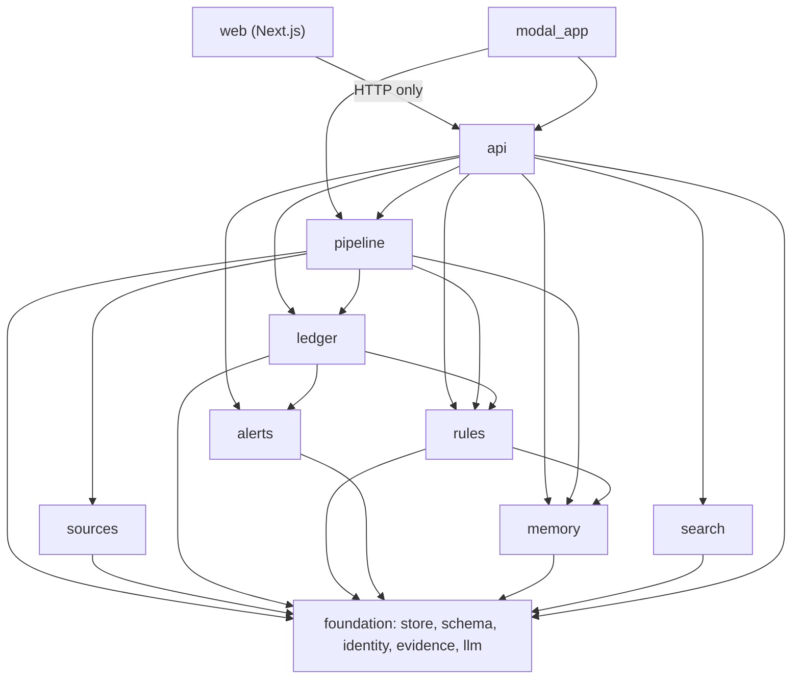
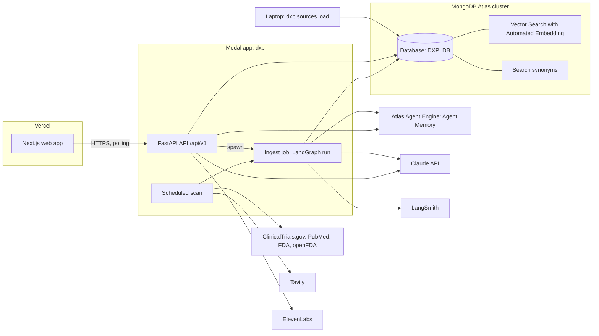
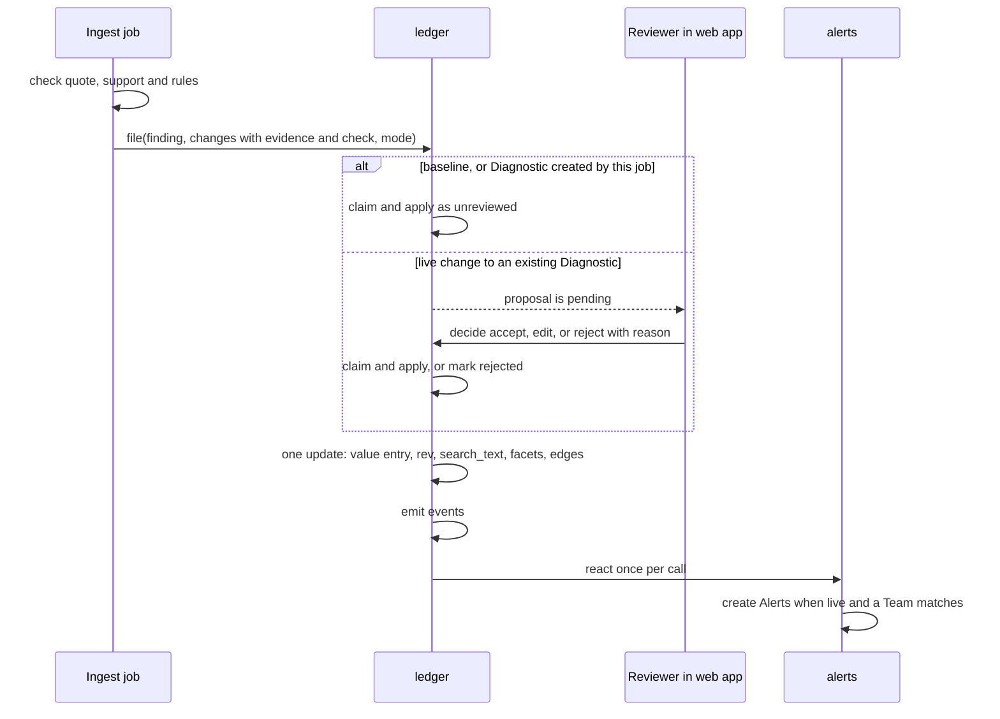
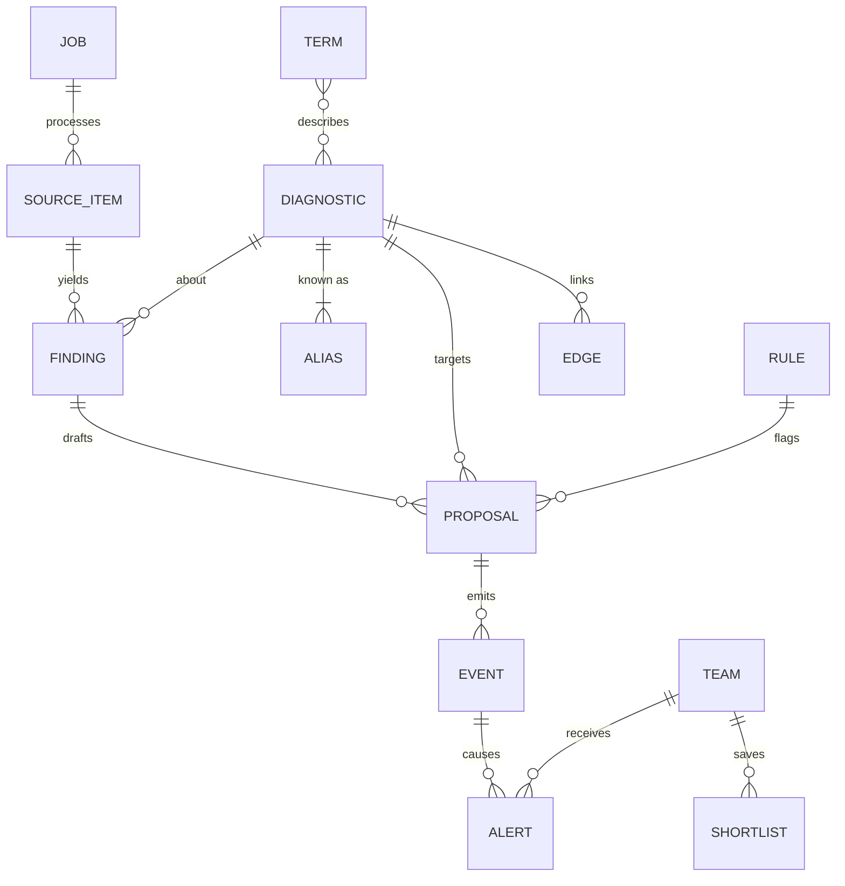

# Architecture Spine — DxProvida (DxP)

Terms follow the PRD Glossary. This is a one-day hackathon build: where a rule trades robustness for speed, speed wins.

**Precedence.** This spine overrides the `dxp-*` skills. The skills say how to call each technology; where a skill's example disagrees with a rule here, the rule wins. Known differences: review is a MongoDB queue, not a LangGraph `interrupt`; a batch is one graph run with `Send`, not `.map` or `.starmap` across containers; the collection is `proposals`, not `proposed_changes`; IDs are derived strings, not ObjectId; live updates are a long-poll on `events`, not server-sent events; update triggers come from the extraction model, not a vector index; the database variable is `DXP_DB`; web types are generated from the API, not copied from the front-end skill.

## Design Paradigm

**Pipes-and-filters ingest feeding a proposal ledger.** Source items flow one way through fixed filters: triage, extract, check, resolve, propose. The filters never touch a Record. They end by filing Proposed changes, and the ledger is the only thing that turns a Proposed change into a Record value.

| Layer | Directory under `backend/dxp/` | Writes |
| --- | --- | --- |
| Foundation | `store`, `schema`, `identity`, `evidence`, `llm` | indexes only |
| Ingest filters | `sources`, `pipeline` | `source_items`, `findings`, `jobs`, unmatched `terms` |
| Ledger | `ledger` | `aliases`, `diagnostics`, `proposals`, `edges`, `events` |
| Ledger helpers | `rules`, `alerts` | `rules`, `check.flags` on pending `proposals`, `alerts`, `events` |
| Memory | `memory` | Agent Memory, or `mem_*` collections |
| Read side | `search` | nothing |
| Edge | `api`, and `backend/modal_app.py` | `teams`, `shortlists`, `audio` |
| Web | `web/` | nothing; it calls the API |

## Invariants & Rules



Imports follow these arrows only. Only `modal_app` imports `api`; nothing imports `modal_app`. The backend imports nothing from `scripts/`. Code copied into `backend/` from `scripts/data/` or from a `dxp-*` skill is pre-made work and is listed in the README disclosure.

### AD-1 — The ledger is the only writer of Records [ADOPTED]

- **Binds:** FR-11, FR-15, FR-16, FR-17, FR-29, FR-30
- **Prevents:** agents, the review screen and the manual-entry form each writing Record values their own way, and parallel writers corrupting a Record.
- **Rule:**
  - Only `ledger` creates a `diagnostics` document and writes its `fields`, `rev`, `search_text`, `facets` and its `edges`. Every value enters through `ledger.file(finding_id, changes, mode)`: agent finds, Baseline load values, seed values, values on a new Diagnostic and values typed by hand.
  - `ledger.apply()` first claims the Proposed change with a conditional update, `status: pending` to `applied`. If the claim fails it does nothing. It then makes one `update_one` on the Diagnostic that writes the value entry, increments `rev` and rewrites `search_text` and `facets`.
  - A Proposed change whose canonical value equals a `current` entry of that field is not filed.
  - A value whose check fails (AD-6) is never filed and never applied.

### AD-2 — One value-entry shape, one registry, one canonical form

- **Binds:** FR-5, FR-7, FR-15, FR-17, FR-22
- **Prevents:** a new trial overwriting an earlier one; the backend and web app naming fields differently; one drug or gene appearing as two values, two graph nodes or two Proposed changes.
- **Rule:**
  - `diagnostics.fields.<key>` is always a list of value entries in the shape below. Entries are never deleted.
  - Field keys, labels, cardinality, enums, the stage order and the low-confidence threshold live only in `backend/dxp/schema/registry.py`. The web app reads them from `GET /api/v1/schema`.
  - `value` is always a string in canonical form, produced only by `registry.canonical(field, raw)`. `label` keeps the text as written. Extra detail goes in `detail` and never affects identity.
  - A `single` field has at most one `current` entry. A `list` field adds entries.
  - When values are applied without review (AD-4), a `single` field that already has a `current` entry is not superseded: the new value stays `pending` for a Reviewer. `lifecycle_stage` follows AD-5 instead.

```text
{ value_id, value, label, detail, state: current | superseded | rejected,
  review: unreviewed | accepted | edited | manual,
  evidence: { source_ref, source, source_url, source_date, quote } | { manual: true, submitter, note },
  check: { quote_found, supported, confidence, flags: [ { rule_id, note } ] },
  proposal_id, decided_by, decided_at }
```

| Field | Cardinality | Canonical `value` |
| --- | --- | --- |
| `modality`, `regulatory_status`, `lifecycle_stage` | single | registry enum value |
| `provider` | single | `identity.normalise_name(provider)` |
| `clinical_uses`, `sample_types`, `tumour_stage_or_line` | list | registry enum value |
| `biomarkers` | list | HGNC approved symbol; for a non-gene analyte, a registry enum value |
| `tumour_types` | list | OncoTree code |
| `trials` | list | NCT ID, upper case; linked drugs for that trial go in `detail` |
| `linked_drugs` | list | generic name, lower case, resolved through `terms` |
| `study_results` | list | the supporting sentence with whitespace collapsed |

### AD-3 — Derived identity, insert-if-absent, never auto-merge [ADOPTED]

- **Binds:** FR-3, FR-4, FR-30
- **Prevents:** duplicate Source items, Findings, Proposed changes, Diagnostics, events or Alerts when a batch runs in parallel, is retried by Modal or is run twice; a re-run resetting a decision already made.
- **Rule:**
  - `identity.derive(prefix, *parts)` is the only ID maker: the prefix plus the first 16 hex characters of SHA-256 over the parts joined with `|`.
  - `source_ref` is `<source>:<source_item_id>` using the `source` strings already in `data/` (`clinicaltrials.gov`, `pubmed`, `fda_cdx_list`, `openfda_device_pma`). It is the `_id` of `source_items` and the only way any other document refers to a Source item.
  - Finding ID: `derive("f_", source_ref, diagnostic_id)`. Proposed change ID: `derive("p_", finding_id, field, value)`. Alert ID: `derive("alert_", team_id, diagnostic_id, kind, cause)`.
  - Writes of Findings and Proposed changes are insert-if-absent (`$setOnInsert`). A second run never changes a document that exists.
  - `identity.normalise_name(text)` is the only name normaliser: Unicode NFKC, lower case, remove `®`, `™` and `©`, replace each run of non-alphanumeric characters with one space, trim.
  - A Diagnostic is found through `aliases`, whose `_id` is the normalised name. Its ID is `derive("dx_", first_alias)`. `ledger.ensure_diagnostic()` upserts the alias and the Diagnostic with `created_run_id` and `created_mode`; a duplicate-key error (`pymongo.errors.DuplicateKeyError`) means it exists, so read it.
  - A Finding that names no assay uses the alias `approach:<modality>:<biomarker>`, with registry values, taking the first biomarker in alphabetical order or `any`.
  - Seed Diagnostics come from `data/fda/assays.json`, with every string in `name_strings_in_list` passed through `normalise_name` as an alias. The file's own `assay_normalised` is not used as a key.
  - Nothing merges two Diagnostics automatically.
  - The `raw_text` of a Source item that has Evidence pointing at it is never overwritten.

### AD-4 — Two ingest modes decide what is applied and what alerts

- **Binds:** FR-12, FR-13, FR-16, FR-30
- **Prevents:** the Baseline load flooding Teams with Alerts; live changes reaching a Record without a Reviewer; the two developers reading "new Diagnostic" differently.
- **Rule:** Every job, Proposed change and event carries `mode`.
  - `baseline`: the ledger applies each filed change at once with `review: unreviewed`.
  - `live`: on a Diagnostic whose `created_run_id` is this job's `run_id`, changes are applied at once as `unreviewed`. On any other Diagnostic they wait with `status: pending`.
  - A Proposed change has `status` in `pending | applied | rejected`. The Reviewer queue is a query on `proposals`.
  - A Reviewer accepts, edits or rejects an `unreviewed` value through `ledger.review_value()`, which sets `review` or `state` on that entry.
  - Values with `confidence` below the registry threshold are applied or queued as above and listed first in the Reviewer queue.

### AD-5 — Lifecycle stage is a registry field, ordered by the ledger

- **Binds:** FR-2, FR-11, FR-12
- **Prevents:** stage being judged two ways; stage moving backwards when items are processed in parallel; the Early research label being computed in two places.
- **Rule:** Extraction gives each Finding at most one `stage_evidence { stage, quote }`, filed as a change to `lifecycle_stage`. `ledger.apply()` enforces the order: its update only matches when the stored stage is earlier than the new one. Rows from the FDA list file `regulatory_approval` by rule, without a model call. `registry.is_early_research(stage)` is the only test for the label; it is true for `discovery` and `assay_development`, and the label is never stored. A Diagnostic with no stage evidence has stage `not_determined`.

### AD-6 — One Evidence check before filing, one gate on the read side

- **Binds:** FR-7, FR-8, FR-18, FR-22, FR-25, FR-29
- **Prevents:** screens disagreeing about which values may be shown; unsupported values replacing good ones; PubMed text leaving the backend.
- **Rule:**
  - `evidence.quote_in_source(quote, raw_text)` is the only quote check. It runs against `source_items.raw_text`.
  - The pipeline's check filter sets `quote_found`, `supported` and `confidence`. A value passes when `quote_found` and `supported` are both true. A value that does not pass is recorded on its Finding and goes no further.
  - Every endpoint that returns Record data builds it with `search.readmodel`. The read model shows only entries that passed or are `manual`, adds the no-data state for an empty field, attaches the source name and its data date, and passes `synthetic` through. The web app applies no display rule of its own.
  - A hand-typed value has `evidence.manual` and `review: manual`, and is shown marked as manually sourced.
  - PubMed `raw_text` is stored only in `source_items`. It is never returned by the API, written to a file in the repository, or sent in a trace that is shared. A quote is at most 300 characters.

### AD-7 — One Learned rule mechanism, owned by DxP

- **Binds:** FR-19
- **Prevents:** three mechanisms built by different hands; a rule that cannot be switched off; flags with no owner.
- **Rule:** A Learned rule is one document in `rules`: `{ field, text, status: draft | active | off, from_proposal_id, synthetic }`. Rules apply to every Team. A rejection or edit must carry a reason. `rules.draft()` asks the model for a plain-language rule; a Reviewer's confirmation sets it `active`. `rules.evaluate(field, value, quote)` is the only place a rule is applied: in the pipeline's check filter, and over every `pending` Proposed change for that field when a rule's status changes. Only `rules` writes `check.flags`, and only on `pending` Proposed changes. A rule adds or removes flags; it never rejects or withdraws. Setting a rule `off` removes its flags. `rules` is the source of truth. Agent Memory receives one copy when a rule first becomes `active`.

### AD-8 — Memory sits behind one adapter; app state stays in DxP collections

- **Binds:** FR-9, FR-19, FR-28
- **Prevents:** the preview SDK leaking into every module; the app depending on a memory search for facts it must read exactly; developers' test memories mixing with production.
- **Rule:**
  - Only `backend/dxp/memory` imports the Agent Memory SDK. Its interface is `remember_episode(team_id, session_id, kind, text)`, `recall(team_id, query) -> list[str]`, `save_rule(rule_id, field, text)` and `glossary(term) -> list[str]`.
  - Two backends, chosen by `DXP_MEMORY_BACKEND`: `agent_engine` and `collections`.
  - The memory user ID is `<DXP_DB>:<team_id>`. Rule copies use `<DXP_DB>:reviewers`.
  - Facts the app must read exactly live in DxP collections: `teams` (profile, `last_seen_seq`, last Intended use), `shortlists`, `rules`, `terms`. "What changed since last visit" is a query on `events` after `last_seen_seq`.
  - Memory holds what a Team asked, opened and dismissed, and supplies the resume summary and agent context. Text recalled from a synthetic episode is labelled synthetic. Synthetic episodes are written with a `session_id` that starts `synthetic_`, and `recall` prefixes their text with `[synthetic] `.
  - Synonyms are owned by `search.terms`, reading `terms`. A curated link, such as liquid biopsy to ctDNA, carries `curated: true`. A term the pipeline cannot match is written to `terms` with `status: unmatched` for the Reviewer. Every `terms` document is a valid synonym document, `{ mappingType: "equivalent", synonyms: [...] }` plus DxP's own fields; an unmatched term is stored as `synonyms: [<term>]`. One invalid document stops the MongoDB Search index from building.

### AD-9 — The web app talks to the API only; long work is a job [ADOPTED]

- **Binds:** FR-1, FR-4, FR-21, FR-27
- **Prevents:** a second data path from Next.js to MongoDB or to a model; requests that die at Modal's 150-second cap.
- **Rule:** The web app's only backend is `NEXT_PUBLIC_API_URL` + `/api/v1`. No Next.js code opens a MongoDB connection or calls a model. Anything that can run longer than 30 seconds is a job (AD-16). The one long request is the 25-second long-poll in AD-10.

### AD-10 — One outbox feeds live updates and "what changed"

- **Binds:** FR-12, FR-13, FR-14, FR-27, FR-28
- **Prevents:** Alerts, the Graph view highlight and the resume summary each tracking change separately; events lost between polls; Alerts raised twice or not at all.
- **Rule:**
  - `store.emit_event()` is the only writer of `events`. The event `_id` is `seq`, the next integer, assigned by inserting and retrying on a duplicate key, so a higher `seq` is never visible before a lower one. Each event has a unique `dedupe_key`, so a retry emits nothing new.
  - Event `type` is one of `diagnostic_created`, `value_applied`, `proposal_pending`, `proposal_rejected`, `rule_status_changed`, `alert_created`.
  - `GET /api/v1/changes?after=<seq>` returns events with a higher `seq`. If there are none it may wait up to 25 seconds, using a change stream only as a wake-up, then query again. The query on `seq` is the only source of truth.
  - `alerts.react()` runs once at the end of each `ledger` call, when `mode` is `live`. A Team matches a Diagnostic when its profile overlaps the Diagnostic's `facets` on modality, biomarker or linked drug. Tumour type alone is not a match.
  - First Alert: the Diagnostic's `created_mode` is `live`, the Team matches, and no first Alert exists for that pair. Diagnostics from the Baseline load never get a first Alert.
  - Update Alert: an applied change carries a trigger and the Team matches. Triggers are `stage_advance`, `line_of_therapy`, `used_in_trial` and `standard_of_care`. The ledger sets `stage_advance` when it applies a `lifecycle_stage` change. The extraction model sets the other three per Finding.

### AD-11 — All model calls go through one module

- **Binds:** FR-4, FR-5, FR-13, FR-18, FR-19, FR-21
- **Prevents:** separate code paths together exceeding the rate limit, or using different clients and output methods.
- **Rule:** Only `backend/dxp/llm` calls Claude, through `langchain-anthropic` and nothing else. It holds the model IDs, retry and refusal handling, and returns parsed objects from the Pydantic models in `schema`. Structured output uses the JSON-schema method; no sampling parameters are sent. Every call is async. An ingest job may hold 16 calls at once; all other callers share 4. Triage uses the fast model; extraction, checking, rule drafting and query parsing use the stronger model.

### AD-12 — One graph run per job, fan-out inside it [ADOPTED]

- **Binds:** FR-1, FR-4
- **Prevents:** one trace per item exhausting the LangSmith allowance; one failed item discarding the batch; review state split between LangGraph and MongoDB.
- **Rule:** An ingest job is one LangGraph run in one Modal container, fanning out over Source items with `Send` and `max_concurrency` 16. Each item node catches its own exceptions and returns a failure result. Human review is not a graph node. The scheduled scan and a manual scan call the same job function.

### AD-13 — Graph node IDs and edges are derived by the ledger

- **Binds:** FR-26, FR-27
- **Prevents:** the backend and the Graph view inventing different node IDs; links lost when two changes land together.
- **Rule:** A node ID is `<type>:<value>`, with type in `diagnostic | biomarker | trial | drug | provider | tumour` and the canonical `value` from AD-2. An edge is `{ _id: derive("e_", from, to, kind), from, to, kind, seq }`, upserted by `ledger.apply()`; an edge is removed only when the `single` value that produced it is superseded. `GET /api/v1/graph` returns nodes and links built from `edges`. The web app does not derive links.

### AD-14 — The API contract is written once and types are generated

- **Binds:** all web-facing FRs
- **Prevents:** the web app and the backend each guessing routes and shapes.
- **Rule:** Response models are Pydantic classes in `backend/dxp/api/models.py`, matching the shapes below. `web/lib/types.ts` is generated from the API's `/openapi.json` with `openapi-typescript` and is never edited by hand. The web app calls the API only through `web/lib/api.ts`. Every changing request carries `actor`, the name chosen in the web app; there is no login. `POST /jobs` and every route that calls a model require the header `X-DxP-Key`, which the web app sends from server-side code only.

| Route under `/api/v1` | Returns |
| --- | --- |
| `GET /schema` | registry: fields, enums, stage order |
| `GET /teams`, `GET /teams/<team_id>` | `Team`, with resume summary |
| `POST /teams/<team_id>/seen` `{ seq }` | `Team` |
| `POST /jobs` `{ mode, source, set }` | `Job`; 409 if one is running |
| `GET /jobs`, `GET /jobs/<job_id>` | `Job` |
| `GET /diagnostics?<facet>=&q=` | `{ items: Record[], next }` |
| `GET /diagnostics/<dx_id>` | `Record`, all entries with history |
| `POST /diagnostics/<dx_id>/values` `{ field, value, note, actor }` | `Proposal` |
| `POST /diagnostics/<dx_id>/values/<value_id>/review` `{ action, value, reason, actor }` | `Record` |
| `POST /query` `{ text, filters, team_id }` | `{ parsed, columns, rows: Record[] }` |
| `GET /proposals?status=&field=` | `{ items: Proposal[], next }` |
| `POST /proposals/<p_id>/decision` `{ action: accept, edit or reject, value, reason, actor }` | `{ proposal, rule_draft }` |
| `GET /rules`, `POST /rules/<rule_id>/status` `{ status, actor }` | `Rule` |
| `GET /alerts?team_id=`, `POST /alerts/<alert_id>/dismiss` | `Alert` |
| `GET /alerts/<alert_id>/audio` | audio, the one non-JSON response |
| `GET /changes?after=<seq>` | `{ events: Event[], last_seq }` |
| `GET /graph?after=<seq>` | `{ nodes: Node[], links: Link[] }` |
| `GET /digest?team_id=` | `{ pending: Proposal[], alerts: Alert[] }` |
| `GET /terms?status=unmatched` | `{ items: Term[] }` |

```text
Record   { id, name, lifecycle_stage, early_research, created_mode, rev, synthetic,
           fields: { <key>: { values: Value[], no_data } } }
Value    the AD-2 entry, plus evidence.data_as_of
Proposal { id, diagnostic_id, diagnostic_name, field, value, label, current_value, evidence, check,
           status, mode, trigger, decided_by, decided_at, reason }
Rule     { id, field, text, status, from_proposal_id, synthetic }
Alert    { id, team_id, diagnostic_id, kind: first | update, trigger, why, early_research, seq, at, dismissed }
Event    { seq, type, mode, run_id, diagnostic_id, proposal_id, field, trigger, at }
Job      { id, mode, source, set, status: queued | running | done | failed,
           counts: { total, done, failed, early_research }, failures: [ { source_ref, error } ] }
Node     { id, type, label, lifecycle_stage, early_research, changed }
Link     { source, target, kind, changed }
Team     { id, name, profile: { modalities, biomarkers, linked_drugs }, last_seen_seq, synthetic }
```

### AD-15 — Search reads derived fields that only the ledger writes

- **Binds:** FR-9, FR-21, FR-22
- **Prevents:** the search index and the filters being built from the stored value entries in two different ways.
- **Rule:** On every apply the ledger rewrites two derived fields on the Diagnostic from its `current` entries: `search_text`, one plain-text summary, and `facets.<key>`, a flat list of canonical values per field. The Vector Search index with Automated Embedding is on `search_text` only. `search.query` filters on `facets` and ranks on `search_text`; it expands terms through `search.terms`. No other code indexes or filters on `fields`.

### AD-16 — Source items are loaded once; jobs read them, one at a time

- **Binds:** FR-1, FR-4, FR-30
- **Prevents:** a job on Modal looking for files that exist only on a laptop; two jobs sharing one rate limit; a restarted job repeating finished work; PubMed text reaching a shared trace.
- **Rule:**
  - Source items reach MongoDB by `python -m dxp.sources.load`, run from a laptop. It upserts the files under `data/` into `source_items` with `window` (`baseline` or `heldback`) and `sets`, the subset names from each manifest. Membership comes from the manifest ID lists, never from a date comparison.
  - A job is `{ mode, source, set }`. It processes the matching Source items that have no `processed_at`, and sets `processed_at` when an item's result is filed. Starting the same job again therefore resumes it.
  - At most one ingest job runs at a time. `POST /jobs` returns 409 while one is `running`.
  - The job function sets its Modal timeout to 3600 seconds. `modal_app.py` passes the job function to `api.create_app()`, and the API starts it with `.spawn()` on that object, never with `modal.Function.from_name`, so a `modal serve` API starts its own job and never production's. It is never called inside a request.
  - A job over `pubmed` runs with tracing off. Only a trace from a `clinicaltrials.gov` job is shared.
  - The scheduled scan first calls each `sources` adapter's `fetch(since)` to add new Source items, then starts a `live` job.

## Consistency Conventions

| Concern | Convention |
| --- | --- |
| Naming | Python packages and modules `snake_case`. MongoDB collections plural `snake_case`. JSON keys `snake_case` end to end, with no case conversion in the web app. British spelling in identifiers that come from the Glossary (`tumour_types`). |
| IDs | Strings, never ObjectId. Prefixes `dx_`, `f_`, `p_`, `e_`, `rule_`, `alert_`, `job_`, `team_`. All derived with `identity.derive`, except `job_` and `rule_`, which are random. |
| Dates | Stored as UTC BSON dates. In JSON, ISO 8601 with `Z`. A source date that arrives as text keeps its original string beside the parsed date. |
| Enums | Lower `snake_case`, defined in the registry, never free text. Source names are the exception and follow `data/`. |
| API | Success returns the resource or `{ items, next }`. Failure returns `{ error: { code, message } }` with a 4xx or 5xx status. |
| MongoDB access | Only `store` creates a client. One database, named by `DXP_DB`. Indexes are created by `store.ensure_indexes()`. |
| Run tracing | Every document written by a job carries `run_id` (the job ID) and `mode`. |
| Synthetic data | Synthetic Team profiles, session history, Reviewer corrections and rules carry `synthetic: true`. |
| Attribution | The web app footer carries the credits line from `dxp-open-data-sources/references/terms.md`. Every Evidence shows its source and that source's data date. |
| Config | Environment variables only. The spine fixes `MONGODB_URI`, `DXP_DB`, `DXP_MEMORY_BACKEND`, `DXP_API_KEY`, `NEXT_PUBLIC_API_URL`. The skills name the variables each service needs. No secret in the repository. |
| Errors in filters | A filter returns a result or a failure record. It does not raise out of an item node. |
| Accessibility | Every Reviewer action is reachable by keyboard and labelled. The comparison table is the non-visual equivalent of the Graph view. |

## Stack

| Name | Version |
| --- | --- |
| Python | 3.13 |
| FastAPI | 0.162.5 |
| Pydantic | 2.14.3 |
| PyMongo (async API) | 4.19.0 |
| MongoDB Atlas | 8.0 |
| LangGraph | 1.2.21 |
| langchain-anthropic | 1.7.10 |
| LangSmith SDK | 0.14.17 |
| Claude models | claude-haiku-5-5, claude-sonnet-5-5 |
| agent-engine-sdk-memory | 0.11.14 |
| tavily-python | 0.8.5 |
| ElevenLabs Python SDK | 2.78.0 |
| Modal | 1.6.4 |
| Next.js | 16.4.6 |
| React | 19.3.1 |
| TypeScript | 5.9 |
| openapi-typescript | 7.13.0 |
| react-force-graph-2d | 1.29.2 |

## Structural Seed

### System and deployment



| Environment | Web | Backend | Database |
| --- | --- | --- | --- |
| Developer | `next dev` | `modal serve`, own `MODAL_DEV_SUFFIX`; `DXP_DB` passed with `modal.Secret.from_dict` | own `DXP_DB`, for example `dxp_luis` |
| Production (judges) | Vercel production URL | `modal deploy`, by one person | `DXP_DB=dxp` |

- **Cluster.** One Atlas cluster. M10 is required for the `agent_engine` memory backend; Flex is enough for `collections`.
- **Network.** The cluster allows any address (`0.0.0.0/0`) for the event, as a temporary Atlas entry set to expire, protected by a strong database password. Atlas will email an alert about it; ignore it. No static address and no second cluster.
- **Agent Memory check, Friday.** On M10, add the two Agent Engine addresses from the memory skill and the temporary open entry, run `agentengine memory apply --wait` until it reports `ready`, then write and read one memory from a Modal function. If either step fails with the open entry present, set `DXP_MEMORY_BACKEND=collections` and move on.
- **Other Friday checks, five minutes each.** (1) One `with_structured_output(..., method="json_schema")` call on each model inside the pinned Modal image, since `langchain-anthropic` 1.7.10 predates `anthropic` 2.8.0. (2) `ainvoke` with `max_concurrency` 16 over 50 items with one forced failure, timed. (3) `$vectorSearch` with `query: { text }`, then a plain string; keep whichever returns results. (4) M10 on MongoDB 8.0 or later with storage auto-scaling on (Automated Embedding needs it); the vector index and the synonym search index both reach READY. (5) Read the Claude tier at platform.claude.com/usage/limits. (6) Under `modal serve`, `POST /jobs` with 3 items writes to the developer's `DXP_DB`, not `dxp`.
- **Long jobs.** The Baseline job runs in the deployed app or with `modal run --detach`, never under `modal serve`. The scheduled scan runs only when deployed.

### Operations on the day

| Situation | What to do |
| --- | --- |
| See a job's progress or failures | `GET /api/v1/jobs/<job_id>`: counts, and one failure line per item |
| A job stops part-way | Start the same job again; finished items are skipped (AD-16) |
| Bad data in a developer database | Drop that database, run `store.ensure_indexes()`, the seed and `dxp.sources.load` again |
| Agent Memory misbehaves | Set `DXP_MEMORY_BACKEND=collections` and redeploy |
| LangSmith quota gone | Turn tracing off; progress is still in `jobs` |
| A source API is down | Nothing to do: Saturday's jobs read `source_items`, not the APIs |
| Rate-limit errors | Lower the ingest limit in `llm`; do not start a second job |
| Retake the live demo | Straight after the Baseline jobs, `mongodump` database `dxp` to a folder outside the repository. To retake, `delete_many({})` every collection (dropping would delete the search indexes) and `mongorestore` that dump |

### Proposed change lifecycle



### Core entities



### MongoDB capabilities, for the video

| Capability | Where DxP uses it |
| --- | --- |
| Agent Memory, episodic | Resume summary and agent context (FR-28) |
| Agent Memory, procedural | A copy of each activated Learned rule (FR-19); `rules` stays the source of truth |
| Agent Memory, taxonomic | Glossary lookups behind `memory.glossary` (FR-9) |
| Vector Search with Automated Embedding | Plain-language query on `search_text` (FR-21) |
| Search synonym mappings | Term expansion from `terms` (FR-9) |
| `$graphLookup` | Neighbourhood of a node over `edges` (FR-26) |
| Change streams | Wake-up for the live feed (FR-27) |
| Flexible documents | Registry-driven fields: a new field needs no migration |

This replaces the mapping in the PRD addendum: update triggers come from the extraction model, not from a vector index.

Wording for the video. With Agent Memory working: "episodic memory in MongoDB Atlas Agent Engine (public preview)". On the fallback: "memory in MongoDB Atlas collections, organised as episodic, procedural and taxonomic".

### Source tree

```text
backend/
  modal_app.py         # Modal app: ASGI API, ingest job, scheduled scan
  dxp/
    store/             # client, collections, indexes, emit_event
    schema/            # registry.py, Pydantic models, enums
    identity/          # derive, normalise_name
    evidence/          # quote_in_source
    llm/               # the only Claude caller
    sources/           # adapters: fetch(since); load.py: data/ into source_items
    pipeline/          # LangGraph graph, filters, jobs.start
    ledger/            # ensure_diagnostic, file, apply, review_value, seed
    rules/             # draft, set_status, evaluate
    alerts/            # react, match
    memory/            # adapter and two backends
    search/            # readmodel, query, terms, graph
    api/               # routers, models.py
web/
  app/                 # Next.js App Router pages
  lib/api.ts           # the only fetch wrapper
  lib/types.ts         # generated from /openapi.json
  components/          # table, graph, review queue, alerts
data/                  # downloaded datasets and manifests (existing)
scripts/data/          # download scripts (existing)
```

### Saturday data

- **Seed, no model calls:** `data/fda/assays.json` and the 76 lung list rows, filed through the ledger in `baseline` mode.
- **Baseline jobs:** `clinicaltrials.gov` set `recent_baseline_narrow` (293 trials); then `pubmed`, the 150 most recent items of set `small`.
- **Live jobs, on camera:** `clinicaltrials.gov` held-back set `narrow` (40 trials), traced; then `pubmed` held-back set `small` (24 abstracts), untraced.

## Capability → Architecture Map

| Capability | Lives in | Governed by |
| --- | --- | --- |
| §4.1 Monitoring and Maturity gate (FR-1 to FR-4, FR-30) | `sources`, `pipeline`, `modal_app` | AD-3, AD-4, AD-5, AD-11, AD-12, AD-16 |
| §4.2 Records with Evidence (FR-5, FR-7 to FR-9) | `schema`, `evidence`, `ledger`, `search` | AD-1, AD-2, AD-6, AD-8, AD-15 |
| §4.3 Lifecycle tracking and Alerts (FR-11 to FR-14) | `pipeline`, `ledger`, `alerts`, `api` | AD-4, AD-5, AD-10, AD-14 |
| §4.4 Agent proposals and review (FR-15 to FR-20) | `ledger`, `rules`, `api`, `web` review queue | AD-1, AD-2, AD-4, AD-6, AD-7, AD-10, AD-14 |
| §4.5 Intended-use shortlisting (FR-21, FR-22, FR-24, FR-25) | `search`, `api`, `web` table | AD-6, AD-9, AD-11, AD-14, AD-15 |
| §4.6 Graph view (FR-26, FR-27) | `ledger`, `search`, `web` graph | AD-10, AD-13, AD-14 |
| §4.7 Memory across sessions (FR-28) | `memory`, `api`, `store` | AD-8, AD-10, AD-14 |
| §4.8 Category landscape (FR-29) | `search`, `ledger` | AD-1, AD-2, AD-6, AD-14 |

## Deferred

- **The P1 cut line.** Set in the scoping session. This spine covers every in-scope feature.
- **Provider-website scan through Tavily.** It is one more `sources` adapter behind `fetch(since)` and needs a domain allow-list. Whether it is built on Saturday is a scoping call.
- **Merging duplicate Diagnostics.** Not built. If added, a merge is a Proposed change.
- **Versions of a Source item.** Saturday's data has one version of each item. A changed text must be stored as a new item version, which is not designed here; AD-3 only forbids overwriting.
- **Lifecycle stage per clinical use, and its accuracy.** One stage per Diagnostic on Saturday. Stage labels can be added to the Gold set.
- **FR-6, FR-10, FR-23.** Later development. They add registry fields and need no new rule.
- **Login and tenancy.** `actor`, the Team switcher and one shared key stand in.
- **Shortlists and export (FR-24, FR-25).** Routes are added under AD-14 when built. An export is built from the read model.
- **Digest delivery (FR-20).** The in-app page from `GET /digest`. Other channels later.
- **Audio briefing (FR-14).** Generated on request and cached in `audio`. Details are in the ElevenLabs skill.
- **Capture on the go (§4.9).** If built, a submission is a Source item with `source: manual`.
- **Maturity gate thresholds.** None on Saturday.
- **Gold-set accuracy harness (SM-5).** A script over the pipeline's extract filter. Gold-set files hold IDs and labels, never PubMed text.
- **Tests.** Each FR's test in the PRD is the acceptance check. No framework is mandated.
- **Cost.** The Claude skill's estimate stands. No budget control is built.
- **Claude Agent SDK.** Not used. Revisit after the hackathon.
